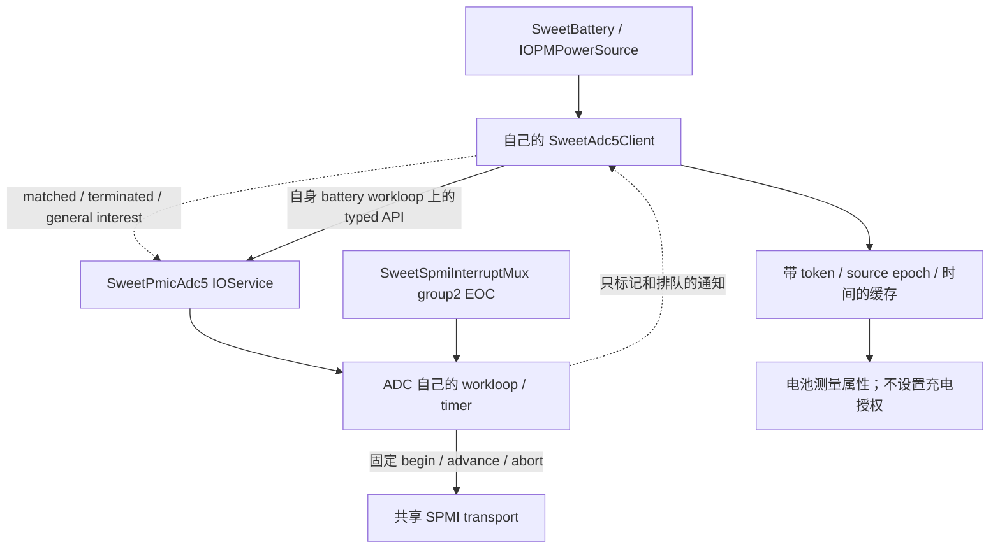

# SweetBattery 的 ADC5 测量接入（0156）

2026-11-06。本地实现和验证完成，待新云构建与实机日志。0120a4 已证明
BAT_ID/USBIN 转换及 EOC/恢复正常；本轮把真实测量接入电池服务的生命周期。
充电仍互锁，电池身份、输入承诺电流、SMB1355 隔离与 watchdog 维护尚未完成。

## 服务边界



`SweetAdc5Client` 是每个 consumer 持有的 OSObject，不是新 IOService、全局单例
或 fromPath 桥接。它在电池自己的 loop 上订阅、调用 provider 的固定通道接口，
不包含 SID/寄存器/掩码，也不直接调用 SPMI。没有改按键、USB、触摸的 IRQ 路径。
只有 `sweetbattruntime=1..3` 会建立该连接；provider 本身默认空闲，typed client
或原 `sweetbattadcconv` 有限诊断都可以发起转换。本轮镜像用 conv0，避免两套请求混测。

provider API 增加 `status()`，区分尚未 READY 与失败；`requestSample(channel,
unsigned *token = NULL)` 成功才写 token，最终 measurement.sequence 对应此 token。
READY、完成、失败和停止发 property-change。旧单参数请求仍可调用。
一般 interest 回调只加短锁、排软件事件，不调用任何 provider/consumer gate 或 SPMI。

| 上下文 | 允许操作 |
| --- | --- |
| matched / terminated | 短锁下 retain、记录离线、排队；不初始化硬件或进入任何 workloop |
| provider general-interest | 短锁下排队；不读取属性/重入 provider、不同步进入 battery gate |
| battery workloop | 安装 interest、status/request/copy；缓存验收与撤销、测量属性发布 |
| ADC workloop | 有界转换/恢复、EOC和超时；不执行电池策略 |
| stop（battery gate 外） | 置 stopping，gate action 排空并禁事件；同步 remove 全部通知，再 release provider / 移源 |

client 一直 retain provider 到 interest 同步移除之后；没有让 provider retain battery。
terminated 不释放资源、不调用 provider；实际退出由自己的 loop 处理。部分初始化失败
也会撤销通知、移源和释放引用。provider 终止/失败或已经 READY 后失去 READY，均
撤销两路缓存并停止本连接，不自动重绑或切换轮询。电池 stop 先同步 ADC client，
再停止其自身采样/策略并释放资源。未完成转换留给 ADC provider 自己有界结束，
consumer 不擅自 abort 可能仍服务其他客户端的硬件会话。

## 更新与结果有效性

- 启动请求 BAT_ID；已确认输入存在时再请求 USBIN，同一时刻只跟踪一笔请求。
- 输入 IRQ/arm-sync/有界确认刷新后，立即撤销 USBIN 缓存并递增 source epoch。
  拔线不再请求 USBIN；重新插入必须取得新 epoch 的转换结果。
- 转换中插拔会使旧结果被丢弃，即使电压数值看起来合理。还需 token、通道、
  started/completed 顺序与当前 uptime 校验，不能领取上轮诊断的缓存。
- 现有保护 monitor 每秒维护测量时效。输入存在时 USBIN 从采样开始满2秒安排
  新转换，超过3秒拒绝使用；BAT_ID 满30秒刷新，超过60秒拒绝使用。实际间隔
  受1秒monitor的调度影响，不能承诺固定2秒完成。presence有效性或存在状态变化
  也会撤销 BAT_ID 并重测。这里的周期转换用于电压保护，不定时读取 USBIN/APSD/
  Type-C 来发现插拔，也不读 ADC status 替代缺失 EOC。
- Busy/初次 NotReady 只等 READY/完成通知，不高频重试；转换恢复/超时仍由
  0155 provider 负责。没有新增运行期故障的静默回退。
- 屏幕息屏沿用现有路径。系统真正 sleep/restart/poweroff 后不重新授权：现有
  fPowerStopping 禁控制，下一次 battery action 撤销测量；尚无系统 suspend/resume
  的完整 ADC 恢复协议。本轮不把屏幕息屏等同于系统睡眠验收。

消费时 `copyFresh` 每次检查时效；IORegistry 是最近一次通知/保护 tick 的快照，
并不保证恰好在纳秒截止点刷新。发布 `SweetBatteryBATIDMeasured`、
`SweetBatteryVBUSMeasured`，以及各自 Microvolts / AgeMS。失效时 bool=false，
删除旧数值/年龄；`adcChanged` 在自己的 loop 调 updateStatus，沿用 IOPMPowerSource。
日志沿用 ERROR/WARN/INFO，成功结果记录 channel/token/epoch/uV，旧结果丢弃为 WARN。

本轮不写 `SweetBattLimits` 的授权字段，也不把 889684uV 直接当成电池型号，
不把 4.8V 当成供电端承诺了500mA。`inputVerified`、`batteryVerified`、
`parallelVerified` 保持 false，policy 的缺失原因仍应存在，不应出现启充 CONTROL。
下一步先补身份/额定限值与输入能力证据，再处理并联隔离和 watchdog 契约。

## 本地验证

底稿 `scratch/adc-consumer-0120a4/`（工作区，不入 git）：

- 0120a4 实际云树的31个基线文件逐字节匹配；0156严格 apply 后33文件匹配。
- 四个 ARM64 单文件编译：SweetBattery、SweetAdc5Client、SweetPmicAdc5、
  KernelConfigTables。使用旧 CI headers/Linux Clang兼容参数，不替代云端完整链接。
- 实际 client ASAN/UBSAN：17场景和100轮通知/终止与stop竞态，显式对象/通知/
  事件队列计数清零；覆盖先后匹配、延迟READY、Busy通知恢复、转换中拔插、
  过期/回退时间、provider失败/终止/失去READY、分配失败和活动转换时退出。
- 原实际 mux/provider/按键/电池 suite：57场景及80轮竞态；transport 81场景，
  battery runtime（含测量发布/撤回与授权不变）、SPMI、board回归通过。
  consumer独立测试用typed provider模型，底层转换另由实际provider/transport测试。
- CircleCI增加0156源码gate，构建命令/参数不变；gate接受0156、拒绝0155。
  新打包档拒绝0120a4旧kernel，避免仅改参数冒充新驱动。

host模型不证明原生IOKit锁序或真实硬件重复转换/插拔稳定，需下一轮实机日志。

## 下一轮一次镜像测试

用户push并下载新编号 kernel/buildtree 后，核对0156并打包：

```bash
tools/mk-mh2lm-event-matrix.sh /home/shenli/work1/logs/xnu-kernel-编号.gz 编号 --battery-adc5-consumer
```

生成 `out-bs/boot-16k-编号-battery-adc5-consumer.img`，参数
`sweetbattirq=4 sweetbattruntime=1 sweetbattadcconv=0`，保留按键/USB/触摸和USB日志。
保持USB插入启动，进入桌面等约30秒；拔线停15～20秒，再插入停15～20秒，
重复一次。操作三键/触摸，也可在屏幕息屏时进行其中一轮。直接导出持久日志
`sweetlog-编号-battery-adc5-consumer.bin`，不需要先跑baseline或重复启动转换档。

应见 client registry marker、BAT_ID/USBIN 被consumer接受，以及插入期间重复
USBIN EOC/恢复。拔线后不继续安排USBIN；重新插入后新epoch结果有效。
转换恰好跨插拔时出现一次 discarded WARN 是预期保护，不要求刻意追求该竞争。
不应有 ADC FAILURE/TIMEOUT、共享mux隔离、panic或错误启充。充电未恢复符合本轮范围。
