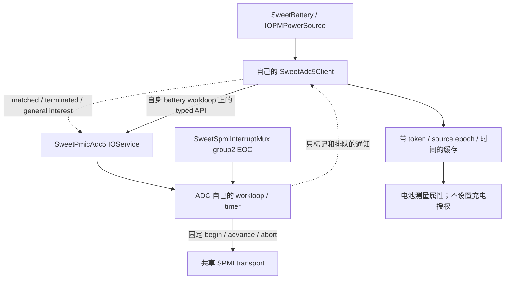

# SweetBattery 的 ADC5 测量接入（0156）

**0120a13副路禁止档新增故障证据：** ADC68的EOC已被mux投递并进入consumer，
advance返回-101/phase5/count0，restore/cleanup均0；没有timer TIMEOUT记录。
因此已有“收到EOC但处理过期”的案例，不能一概按未发硬件中断处理。附近电池
采样99.935ms仅提示并发，缺各阶段/锁时间戳，仍不能确定根因，也不能倒推身份档
一定同因。长期输入许可仍未覆盖；下一独立测试是watchdog4。
[完整证据](BATTERY-DEPENDENCY-TESTS.md#0120a13副路禁止档实测主pmic禁止通过adc收到eoc仍过期)。

**0120a13故障更新：** 237次转换成功后，token238 USBIN在GROUND/phase2缺首个
EOC，error-101；恢复/cleanup均0，provider停机、客户端测量和身份/限值撤销正确。
发生在首次拔线前，无正输入许可，长期许可未覆盖。此次不是已记录的第二阶段
超时，缺少故障现场寄存器/IRQ快照，根因未定；未以轮询/重试兜底。
[完整实测与下一步](BATTERY-DEPENDENCY-TESTS.md#0120a13身份档实测身份通过adc故障阻断输入许可验收)。
下方0120a12待push/缺陷未复现等描述按当时记录保留。

0165已将现有BAT_ID测量与新鲜FG profile/容量交叉核对，身份1档可建立板级限值；
ADC服务/client接口未改。缺失、过期或provider终止仍撤销，不能凭参数强制通过。
同轮分档、边界与待测状态见[依赖分步测试](BATTERY-DEPENDENCY-TESTS.md)。

**0163接口更新（0120a12已实测）：** ADC434次有效且恢复成功，424接受、10因
输入epoch改变正确丢弃。长期输入许可仍因来源清理错误失败；0164已本地修复，
待push/新云产物复测。本轮未修改ADC接口/实现，旧第二EOC超时未复现但未修复。
update第二参数从inputChanged bool改为电池
输入采集的uint64_t inputEpoch；新增copyFreshInput(expectedEpoch,now,out)，精确
绑定请求/结果与当前输入批次。USBIN提前到采样开始满1秒安排新转换，给3秒许可
留余量，非输入发现轮询。ADC值经会话管理器与CC/APSD一起形成typed输入许可，
仍不单独授权电池身份/充电使能。新契约和测试见[输入会话](BATTERY-INPUT-SESSION.md)；
以下保留0156实现和既有实机基线，旧“所有授权恒false/2秒刷新”不代表0163。

0120a5后的[身份/输入离线核对](BATTERY-IDENTITY-INPUT-AUDIT.md)已完成：BAT_ID与
nominal共同支持Tocad候选，但尚未读取profile前缀或建立输入电流许可。后续补证
不需要重复本页已经通过的持续转换/插拔测试。

2026-11-06。0120a5已完成云构建和持续测量/插拔正常路径实测，详细结果见末节。0120a4 已证明
BAT_ID/USBIN 转换及 EOC/恢复正常；本轮把真实测量接入电池服务的生命周期。
充电仍互锁，电池身份、输入承诺电流、SMB1355 隔离与 watchdog 维护尚未完成。

## 服务边界



`SweetAdc5Client` 是每个 consumer 持有的 OSObject，不是新 IOService、全局单例
或 fromPath 桥接。它在电池自己的 loop 上订阅、调用 provider 的固定通道接口，
不包含 SID/寄存器/掩码，也不直接调用 SPMI。没有改按键、USB、触摸的 IRQ 路径。
只有 `sweetbattruntime=1..3` 会建立该连接；provider 本身默认空闲，typed client
或原 `sweetbattadcconv` 有限诊断都可以发起转换。本轮镜像用 conv0，避免两套请求混测。

provider API 增加 `status()`，区分尚未 READY 与失败；`requestSample(channel,
unsigned *token = NULL)` 成功才写 token，最终 measurement.sequence 对应此 token。
READY、完成、失败和停止发 property-change。旧单参数请求仍可调用。
一般 interest 回调只加短锁、排软件事件，不调用任何 provider/consumer gate 或 SPMI。

| 上下文 | 允许操作 |
| --- | --- |
| matched / terminated | 短锁下 retain、记录离线、排队；不初始化硬件或进入任何 workloop |
| provider general-interest | 短锁下排队；不读取属性/重入 provider、不同步进入 battery gate |
| battery workloop | 安装 interest、status/request/copy；缓存验收与撤销、测量属性发布 |
| ADC workloop | 有界转换/恢复、EOC和超时；不执行电池策略 |
| stop（battery gate 外） | 置 stopping，gate action 排空并禁事件；同步 remove 全部通知，再 release provider / 移源 |

client 一直 retain provider 到 interest 同步移除之后；没有让 provider retain battery。
terminated 不释放资源、不调用 provider；实际退出由自己的 loop 处理。部分初始化失败
也会撤销通知、移源和释放引用。provider 终止/失败或已经 READY 后失去 READY，均
撤销两路缓存并停止本连接，不自动重绑或切换轮询。电池 stop 先同步 ADC client，
再停止其自身采样/策略并释放资源。未完成转换留给 ADC provider 自己有界结束，
consumer 不擅自 abort 可能仍服务其他客户端的硬件会话。

## 更新与结果有效性

- 启动请求 BAT_ID；已确认输入存在时再请求 USBIN，同一时刻只跟踪一笔请求。
- 输入 IRQ/arm-sync/有界确认刷新后，立即撤销 USBIN 缓存并递增 source epoch。
  拔线不再请求 USBIN；重新插入必须取得新 epoch 的转换结果。
- 转换中插拔会使旧结果被丢弃，即使电压数值看起来合理。还需 token、通道、
  started/completed 顺序与当前 uptime 校验，不能领取上轮诊断的缓存。
- 现有保护 monitor 每秒维护测量时效。输入存在时 USBIN 从采样开始满2秒安排
  新转换，超过3秒拒绝使用；BAT_ID 满30秒刷新，超过60秒拒绝使用。实际间隔
  受1秒monitor的调度影响，不能承诺固定2秒完成。presence有效性或存在状态变化
  也会撤销 BAT_ID 并重测。这里的周期转换用于电压保护，不定时读取 USBIN/APSD/
  Type-C 来发现插拔，也不读 ADC status 替代缺失 EOC。
- Busy/初次 NotReady 只等 READY/完成通知，不高频重试；转换恢复/超时仍由
  0155 provider 负责。没有新增运行期故障的静默回退。
- 屏幕息屏沿用现有路径。系统真正 sleep/restart/poweroff 后不重新授权：现有
  fPowerStopping 禁控制，下一次 battery action 撤销测量；尚无系统 suspend/resume
  的完整 ADC 恢复协议。本轮不把屏幕息屏等同于系统睡眠验收。

消费时 `copyFresh` 每次检查时效；IORegistry 是最近一次通知/保护 tick 的快照，
并不保证恰好在纳秒截止点刷新。发布 `SweetBatteryBATIDMeasured`、
`SweetBatteryVBUSMeasured`，以及各自 Microvolts / AgeMS。失效时 bool=false，
删除旧数值/年龄；`adcChanged` 在自己的 loop 调 updateStatus，沿用 IOPMPowerSource。
日志沿用 ERROR/WARN/INFO，成功结果记录 channel/token/epoch/uV，旧结果丢弃为 WARN。

本轮不写 `SweetBattLimits` 的授权字段，也不把 889684uV 直接当成电池型号，
不把 4.8V 当成供电端承诺了500mA。`inputVerified`、`batteryVerified`、
`parallelVerified` 保持 false，policy 的缺失原因仍应存在，不应出现启充 CONTROL。
下一步先补身份/额定限值与输入能力证据，再处理并联隔离和 watchdog 契约。

## 本地验证

底稿 `scratch/adc-consumer-0120a4/`（工作区，不入 git）：

- 0120a4 实际云树的31个基线文件逐字节匹配；0156严格 apply 后33文件匹配。
- 四个 ARM64 单文件编译：SweetBattery、SweetAdc5Client、SweetPmicAdc5、
  KernelConfigTables。使用旧 CI headers/Linux Clang兼容参数，不替代云端完整链接。
- 实际 client ASAN/UBSAN：17场景和100轮通知/终止与stop竞态，显式对象/通知/
  事件队列计数清零；覆盖先后匹配、延迟READY、Busy通知恢复、转换中拔插、
  过期/回退时间、provider失败/终止/失去READY、分配失败和活动转换时退出。
- 原实际 mux/provider/按键/电池 suite：57场景及80轮竞态；transport 81场景，
  battery runtime（含测量发布/撤回与授权不变）、SPMI、board回归通过。
  consumer独立测试用typed provider模型，底层转换另由实际provider/transport测试。
- CircleCI增加0156源码gate，构建命令/参数不变；gate接受0156、拒绝0155。
  新打包档拒绝0120a4旧kernel，避免仅改参数冒充新驱动。

host模型不证明原生IOKit锁序；0120a5已补持续转换/插拔正常路径证据，真实故障/服务终止仍待设备验证。

## 可复用的单镜像测试步骤（0120a5已执行）

用户push并下载新编号 kernel/buildtree 后，核对0156并打包：

```bash
tools/mk-mh2lm-event-matrix.sh /home/shenli/work1/logs/xnu-kernel-编号.gz 编号 --battery-adc5-consumer
```

生成 `out-bs/boot-16k-编号-battery-adc5-consumer.img`，参数
`sweetbattirq=4 sweetbattruntime=1 sweetbattadcconv=0`，保留按键/USB/触摸和USB日志。
保持USB插入启动，进入桌面等约30秒；拔线停15～20秒，再插入停15～20秒，
重复一次。操作三键/触摸，也可在屏幕息屏时进行其中一轮。直接导出持久日志
`sweetlog-编号-battery-adc5-consumer.bin`，不需要先跑baseline或重复启动转换档。

应见 client registry marker、BAT_ID/USBIN 被consumer接受，以及插入期间重复
USBIN EOC/恢复。拔线后不继续安排USBIN；重新插入后新epoch结果有效。
转换恰好跨插拔时出现一次 discarded WARN 是预期保护，不要求刻意追求该竞争。
不应有 ADC FAILURE/TIMEOUT、共享mux隔离、panic或错误启充。充电未恢复符合本轮范围。


## 0120a5 云产物与镜像核对

已核对云构建：33个选定源码文件与0156本地verify逐字节一致，源码gate通过；
plain arm64/subtype0、16K segment、manifest及client/provider新增方法定义符号通过。
这证明本轮代码已进入产物；持续转换/插拔的0120a5实机结果见下节。

| 文件 | SHA256 |
| --- | --- |
| xnu-kernel-0120a5.gz | `f4d0709e6100cd5fb0e84b89b53e419f16142887c758e698bc1af35ed5a7f89e` |
| xnu-buildtree-0120a5.gz | `90e421b00c5409c54bd9a7db10ae7a8755ae2b768cb9c00051c8f78609477bbc` |
| kernel.development.mh2lm | `8f21f6d1b0cb653c440de3318a85fce9b91dfd9edb620e9c4d6ebd18d797ef92` |
| boot-16k-0120a5-battery-adc5-consumer.img | `ff0f5284331f402d091f003b2cb4fb8276f48dc161db17e62665a974b59ad4a3` |

镜像位于工作区 `out-bs/boot-16k-0120a5-battery-adc5-consumer.img`，35,667,968字节。
最终boot回读验证header/原firmware、FAT内kernel/ADT/TOML一致、参数无重复，
runtime1/IRQ4/ADCconv0，无旧adcdiag参数，保留USB/按键/触摸路径。
底稿 `scratch/artifact-0120a5/{verify-artifact.py,verify-images.py,verification.json}`。
本轮未改驱动/CI、未push或操作设备；下一步按上节单镜像步骤导出持久日志。


## 0120a5 实机结果：持续测量与插拔正常路径通过

日志 `logs/sweetlog-0120a5-battery-adc5-consumer.bin`，SHA256
`f009090b73162c63ecb16122789013d4ab08b90e0b4bfb1dda12ca242c431ddb`。
SWEETLOG v1，ring4194304、total1511002、flush144，未回卷、有效正文无NUL；
按header有效长度解码，不计ring尾部残留。实参runtime1/IRQ4/ADCconv0，与测试镜像一致。
遥测跨度1470.037秒（约24分半），不是只验证启动时各采一次。

| 项目 | 实测 |
| --- | --- |
| ADC请求/完成 | id1..657连续，657次请求error0，657个结果均valid1/restored1 |
| BAT_ID | 48次完成且均被consumer接受，888581～889814uV，中位889489uV |
| USBIN | 609次完成，607次接受，2次因source epoch改变丢弃 |
| 被接受的USBIN电压 | 4610032～4994112uV，中位4813488uV |
| ADC真实EOC | 1266次mux hit，与48×1＋609×2一致；USBIN中间error1仍是MORE |
| BAT_ID转换间隔 | 30.141～30.346秒，中位30.143秒 |
| 同epoch接受USBIN的启动间隔 | 596对，2.054～2.861秒，中位2.079秒 |
| 转换测量区间 | BAT_ID 7.444～14.399ms；USBIN29.857～92.015ms；不含最终恢复耗时 |

请求id、结果id、consumer token/通道/uV逐笔对齐。657个结果恰好对应655个
consumer接受与2个丢弃，没有未结请求/丢失结果。日志顺序重放确认，接受的USBIN
都属于当时最新epoch且present1；present0撤销之后、下一次present1之前没有新的
USBIN请求。稳定epoch内测量间隔与设计一致，不把拔线期间115秒长间隔当超时。

19次epoch失效记录（含启动/arm-sync），其中present0共6条；它们来自输入/识别/
MSOC刷新，不可把每个epoch都当成一次物理插拔。17次实际电池IRQ刷新：USBIN10、
source6、MSOC1，notification/sample1..17连续、healthy1；route-to-publish
89.319～111.930ms。较短时间内也有present反复变化，日志不足以区分操作节奏与
物理接触抖动；未出现错误采用旧epoch的结果。

两次竞争都实际验证了保护：

- token496：USBIN转换中拔线，provider完成raw0x4b/77840uV，恢复成功；
  consumer已从epoch12切到13/present0，因此输出discarded，未采用这笔低电压。
- token498：仍插线但识别事件将epoch15推进到16，provider结果4981648uV；
  consumer丢弃旧epoch结果，随后token499在epoch16重新转换并接受。

这两条discarded WARN表示上下文校验生效，不是ADC转换失败，也没有退回轮询。
没有ADC FAILURE/TIMEOUT、ERROR、panic或mux故障/隔离。

1433组完整SAMPLE/FG/CAP/TIME、id1..1433匹配：19次IRQ/arm采样、1414次保护
monitor；V/I有效1433组，3854～3953mV、IOPM -736～+40mA；温度29.25～31.50°C
全部有效，仍未LG温度补偿。nominal/learned均4027mAh、profile0x13，SOC64→63%。
19份CONFIG均enable0/pause0、watchdog0x62/time0x8c；policy11条均allow0，
reasons0x7c0（6）/0x7c8（5），没有CONTROL。仍未恢复真实充电，符合本轮互锁。

三个按键都有完整HID down/up，触摸记录到hits140/empty0，USB计数记录hits128/
err0；既有USB endpoint cmd6/status1 WARN仍有10条，不将此称为USB全部问题已解决。
有SpringBoard发起shutdown的文字，但无完整的ADC服务终止/硬件停止证据，不能
据此验收系统PM或真实故障恢复。没有额外IORegistry dump，不宣称逐时刻属性过期
边界已被外部直接观察。ADC接入的正常转换/插拔路径已可继续推进后续依赖。

底稿 `scratch/artifact-0120a5/{battery-adc5-consumer-persistent.txt,analyze-consumer.py,
consumer-analysis.json,analysis-summary.txt}`。本轮仅分析/记录，无新驱动/CI修改、
不需要重新编译或重复baseline/本轮测量测试。下一步核对实际电池身份/额定限值与
输入承诺能力，接入相应证据，再补SMB1355隔离和watchdog维护；充电仍互锁。
