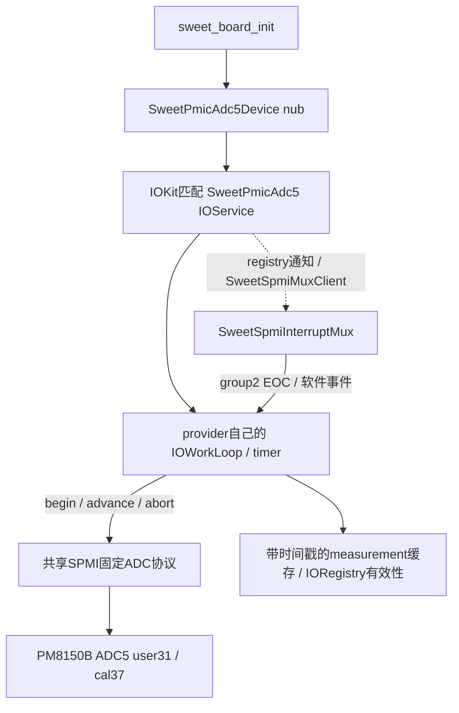

# PM8150B ADC5 转换 provider（0155）

2026-11-06。本地实现和验证完成，尚无云端全量构建/实机转换证据。
0120a3只证明ADC可读、writer/IRQ ownership元数据正常；本轮验证实际写入、
转换、EOC与恢复。ADC成功也不会自动满足电池身份、输入能力或充电允许条件。

## 服务与调用边界



板级入口只发布专用nub，不在UFS、按键或IOResources下挂载ADC服务。
默认模式也会attach group2并配置EOC中断，但不写ADC转换/校准寄存器。
matched回调只retain/记录/排队；consumer workloop完成attach/READY，再发起转换。
`subscribeAction`在自身gate内创建连接，防止同步registry重放/早到READY访问未赋值的连接。
初始属性在启用事件前设置，避免异步READY被start末尾的默认false覆盖。

上层通过IOKit发现并retain `SweetPmicAdc5`，调用固定通道的异步
`requestSample(channel)`；`copySample(channel, out)`只返回已完成且恢复成功的结果。
进行中的相同通道、失败或stop后返回NotReady；并发请求返回Busy。
结果含raw、微伏、started/completed uptime纳秒及EOC次数。有效性属性在重新请求、
失败和stop时撤销。客户端收到property-change应排到自己的loop后再读，不能在
通知中同步回调provider gate。尚无SweetBattery跨服务订阅或充电证据接入。

## 固定硬件协议

只支持已验证的PMIC-arb v5、SID2 PM8150B subtype0x20/revision4=2，
ADC type8/subtype0x28。内部observer按独立observer APID读取；写前检查唯一EE0
writer和共享RW poison；user31/cal37分别检查，不把cal无IRQ owner视为失败。
寄存器知识只在transport后端，上层不接收SID/地址/掩码。公共charger白名单不扩大。

| 配置 | 地址 / 掩码 | 用途 |
| --- | --- | --- |
| digital | 0x3142 / 0x7c | 绝对/定时校准，decimation840 |
| average | 0x3143 / 0x07 | BAT_ID使用1 sample；保留其余位 |
| channel | 0x3144 / 0xff | BAT_ID_PU2=0x4b，USB_IN_V_16=0x08，REF_GND=0 |
| settle | 0x3145 / 0x0f | BAT_ID采用目标DTS默认index0 |
| enable | 0x3146 / 0x80 | 仅在继承disabled/idle时接管，结束后关闭 |
| request | 0x3147 / 0x80 | 单次触发命令；不作稳定RMW或重试 |
| cal delay | 0x3744 / 0xff | USBIN临时0x73，结束恢复原值 |
| status/data | 0x3108，0x3150/51 | EOC=1/request=0、通道回读及有效raw检查 |

BAT_ID直接配置/请求，等待SID2/per0x31/bit0 rising EOC。USBIN复用LG workaround：
先设cal delay0x73，timer等待20ms；选REF_GND并请求，立即按LG顺序选择digital0x28
和USBIN；收到GND EOC后再请求USBIN，第二次EOC读结果。等待阶段不持共享SPMI锁。
USBIN前置GND阶段沿用LG驱动的继承配置，未额外改写avg/settle。

每阶段100ms截止，timer只负责settle与超时，绝不读status代替缺失EOC完成。
完成时验证status低两位=1、channel匹配、raw<0x8000，按LG公式换算：
`microvolts = floor(raw * 1875000 / 0x70e4)`，USBIN再乘16。
BAT_ID电压不等同于电池型号/安全上限，USBIN电压不等同于电源承诺电流。

配置在共享控制器锁下保存/逐笔验证，session lease仅串行ADC请求；其他APID事务
可在EOC等待间隙继续。恢复先禁用ADC、检查不再busy，再恢复已改配置，cal独立
尝试恢复。清理失败记录restore_error，后端本启动拒绝后续ADC转换；provider任何
转换错误都撤销valid并detach自身group2，不静默轮询。mux若无法隔离硬件故障仍可能
停止公共IRQ，不能保证所有硬件故障永远不影响其他consumer。

stop先原子停止事件生成，移除并同步registry通知/解绑mux，再在自身loop取消timer、
abort活动session并撤销属性；free最后移除事件源并release连接/timer/workloop。
本轮没有持续后台采样、系统睡眠恢复协议或充电watchdog维护。

资料：LG `qcom-spmi-adc5.c` 的 `adc_configure`、`adc_pre_configure_usb_in_read`；
`qcom-vadc-common.c` 电压换算；`pm8150b.dtsi` EOC定义和
`lge/sm8150_common/sm8150_common-pm.dtsi` 的BAT_ID/USBIN描述。

## 本地验证与实机步骤

- transport实际源码ASAN/UBSAN覆盖BAT_ID、USBIN、busy/foreign/ambiguous/poison、
  无效数据、错通道、假EOC、超时、abort与恢复失败；旧charger/FG用例回归通过。
- 实际mux/client/provider代码覆盖空闲、两通道、有限顺序、分配/通知失败、
  begin/result/restore错误、缺失EOC、stop活动转换与mux终止；模拟中按键和电池
  事件继续工作。实际SPMI、runtime、board启动及80次既有竞态回归通过。
- 严格apply0155、31文件逐字节比较、6个ARM64单文件编译通过。
  使用既有CI头文件和Linux Clang兼容参数，不能替代云端完整链接。
- CircleCI只更新应用后源码gate；实际build.sh调用未变，gate接受0155并拒绝0154。
  打包脚本拒绝0120a3旧内核；不把新参数塞进旧内核冒充转换实验。

用户push后下载新kernel/buildtree，先核对0155源码/符号，再运行：

```bash
tools/mk-mh2lm-event-matrix.sh /home/shenli/work1/logs/xnu-kernel-编号.gz 编号 --battery-adc5-conversion
```

生成 `out-bs/boot-16k-编号-battery-adc5-conversion.img`，实参
`sweetbattadcconv=3 sweetbattruntime=1 sweetbattirq=4`，保留三键/USB/触摸与USB日志。
原有 `sweetbattadcdiag=1` 仍只作预检，不因新provider自动变成转换请求。
首次保持USB线插入，进入桌面后约60秒，操作三键/触摸，正常插拔一轮后导出持久日志
`sweetlog-编号-battery-adc5-conversion.bin`；live可辅助，持久日志保留启动早期EOC。
转换仅启动时各一次，后面的插拔用于回归事件，不会自动重采ADC；无需先补baseline/dry。

应见group2成功attach、BAT_ID一次EOC、USBIN两次EOC、两个SAMPLE的valid=1/restored=1、
raw/uv与TIME，且无TIMEOUT/FAILURE及mux隔离。取得这些证据后再接实际身份/输入provider；
本轮仍不执行CONTROL/enable，不据UI充电图标判定真实充电恢复。

## 0120a4 产物核对

0155 云构建已通过源码 marker、31 个选定文件逐字节比较、plain arm64/subtype0、
16K segment 及 ADC5 符号检查。测试镜像为
`out-bs/boot-16k-0120a4-battery-adc5-conversion.img`，SHA256
`bce9b70785a24f48352335960f4833e30e1764604bbdcd5781deae5a03f971a5`。

