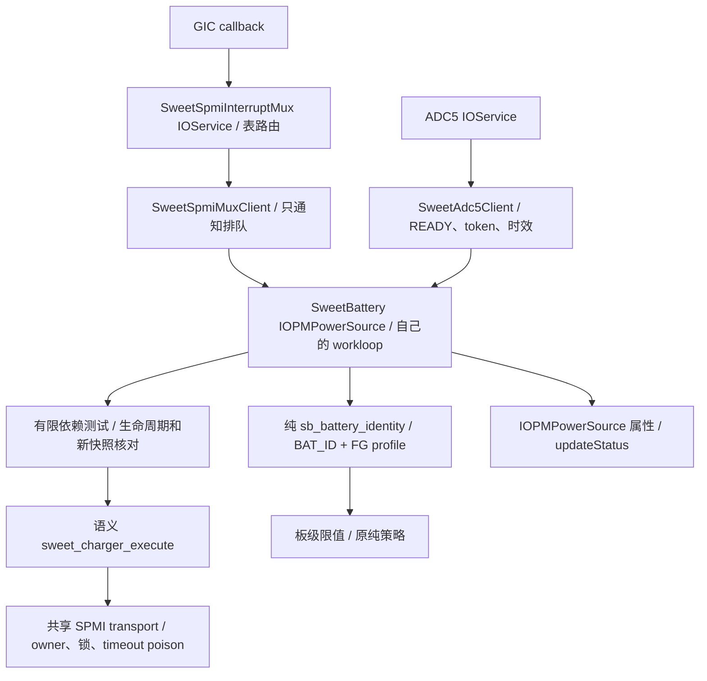

# 电池身份、并联禁止与 watchdog 分步测试（0165）

2026-11-07。用户要求在0164来源保留修复的同一次云编译中推进后三项依赖，
用参数分开或组合测试。0120a13身份档已实测：身份建立/刷新及ADC故障后撤销通过，
ADC第238次请求缺首个EOC，长期输入许可未覆盖；副路/watchdog/组合待实机。
**全部档位只允许runtime1；没有主动启充。** 身份可建立板级限值，主PMIC副路
禁止与watchdog的配置/IRQ链可独立取证；外部SMB1355隔离和managed-watchdog
最终授权仍未成立。不能将“已有实现”写成“三项实机验收完成”。

## 参数和同内核镜像

`sweetbattdeps` 是请求执行的位集合，不是强制通过条件。仅接受0～7，非0时要求
`sweetbattruntime=1`，否则服务启动显式失败。保留IRQ4、ADCconv0、三键/DWC3/
触摸IRQ与USB日志；不修改CircleCI或GitHub XNU触发/检查配置。

新产物核对后使用 `tools/mk-mh2lm-event-matrix.sh ARTIFACT LABEL --battery-dependencies`。
同一个实际内核生成下列五份boot，名称包含产物LABEL；0120a13镜像见文末。

| 镜像后缀 | deps | 作用 / 写入边界 |
| --- | --- | --- |
| `battery-evidence` | 0 | 原输入观察；包括0164修复，不执行新增准备写入，不订阅bark |
| `battery-identity` | 1 | BAT_ID/profile/容量交叉验证和板级限值；不执行新增充电配置写入 |
| `battery-inhibit` | 2 | 先禁主路，再禁止主PMIC的SMB_EN副路输出；核对即时与后续读回 |
| `battery-watchdog` | 4 | 先禁主路，再配置有限watchdog观察、初次pet和bark IRQ维护 |
| `battery-deps-all` | 7 | 上述三项一起；仍保留外部隔离/最终watchdog授权互锁 |

位集合3/5/6也受支持，可由打包参数安排有目标的组合；默认不额外生成它们。
每份镜像保留同一内核、ADT和基线ramdisk内容，只改测试参数。打包器要求0164
和0165的marker，拒绝旧内核；原0120a12不要重测。新产物仍需源码/marker与boot
payload/参数回读核对，不能用本地主机测试替代云内核验证。

## 架构与身份契约



`SweetBattIdentity` 是电池loop拥有的值类型，没有新单例、假IOService、跨层
寄存器写或Linux votable。实际SPMI读取仍在PMIC采样组件，准备写入在语义后端。
匹配/IRQ通知不做重SPMI；bark在原consumer loop里处理，mux只管理IRQ寄存器。

身份要求电池present、ADC client存活且BAT_ID结果有效，非零token，ADC与profile
各自开始/完成时间有效且从开始严格小于60秒。完整固定tuple要求integrity白名单、
24字节前缀与nominal capacity一致；该前缀比较沿用LG选择依据，不是全416字节
profile散列验证。BAT_ID换算复现LG的整数顺序：

```text
mv = microvolts / 1000
ohms = 100000000 / (1825000 / mv - 1000)
kohm = ohms / 1000
```

拒绝零、越界、未来时间、到期/缺失测量和不匹配。按91kΩ Tocad / 12kΩ LGC的
15%整数容差选最近候选，不采用Android“无匹配默认Tocad”fallback。profile/容量
须分别匹配Tocad4027或LGC4073mAh。通过后板级上界FCC2800mA、FV4430mV；原
试验策略继续最多FCC/ICL500mA、FV4200mV，绝不是立即按2800mA取电。

身份开启时每30秒保护采样刷新FG tuple，BAT_ID沿用ADC client已有30秒刷新/
60秒时效；不是轮询输入/IRQ。每次策略执行重新交叉核对，失去测量、profile错误、
present变化、ADC终止、停止或过期均撤销身份与限值，不给旧值续原采集时间。
`verifiedNs`只是本笔遥测下的限值核对时间，不替代两份原证据的60秒期限。
`batteryUntilNs`保存两份证据的最早到期点，策略同时检查该点，并将控制命令
截止时间收紧到它，避免两次保护采样之间越过身份期限仍使用上一笔决定。

主要诊断：INFO `SWEET BATT IDENTITY: v1`，含valid/profile/ohms/token及板级上界；
IORegistry `SweetBatteryIdentityVerified/IdentityProfile/ApprovedFCCMA/ApprovedFVMV`。
identity1可以同时检验0164输入修复，无需先重复一个baseline。

## 并联禁止能证明什么

`SWEET_CHARGER_PARALLEL_INHIBIT=1` 仅执行LG SEC_NONE的语义：SID2:0x1648，
mask0x18、value0x08，强制SMB_EN override低，保留CP/STAT等其他位；不改0x1690
选择位，也不开放任意副路寄存器写。新操作要求已读回主路enable0，逐事务owner/
错误检查与即时回读，再由写入后的新遥测核对。读错、状态改变、主路重新使能或
mux丢失会终止诊断并尽力禁主路，不自动重试或还原继承的enable。

`SWEET BATT INHIBIT`表示命令接受，`SWEET BATT DEP CHECK`和
`SweetBatterySecondaryOutputInhibited`表示后续PMIC读回相符；`select`只记录选择。
**`SweetBatteryParallelVerified`始终false。** LG SMB1355支持CHG_EN_SRC/polarity和
独立command控制，主PMIC的SMB_EN低不足以证明外部器件已停充。仍需SE4 I²C的
typed provider发现芯片、读取/核对并安全禁用实际充电源与状态；当前没有该provider，
不能把缺I²C访问当作器件不存在或默认关闭，也不假装已完成外部隔离。

## Watchdog 配置、中断与有限责任

新增路由表尾索引18：SID2/PID16/bit1、rising `battery-wdog-bark`，consumer事件
`SWEET_BATT_IRQ_WDOG=0x100`。表19路/3组，合法battery mask1ff；默认实际订阅
仍ff，仅deps含4才请求1ff。复用原GIC INTID513、IOService/registry client与共享
SPMI锁；按原owner、已使能位拒绝接管、回滚/隔离规则处理，不能因新路失败影响
按键组，更不能静默切到轮询。实际MISC APID/owner与路由使能仍待新镜像确认。

主路禁充后，`WATCHDOG_PREPARE=1`固定配置：0x1653=f3，snarl8秒/bark16秒/
bite8秒且bite禁充；0x1651仅mask c2置42，plugin-enable和bark IRQ开启、AFP按LG
主路初始化方式关闭，保留其他位，不关闭watchdog。不重写JEITA/温度阈值。
这不是逐字复制LG主路整套默认值；bite禁充是本轮明确保留的保护选择。

初次执行一次pet，然后仅在真实bark consumer事件上pet。`WATCHDOG_PET=1`走
专用 `sweet_spmi_charger_pet_watchdog()` 固定0x1643 bit0脉冲：同一transport锁、
唯一EE0 writer、v5和共享RW timeout poison；不使用稳定值RMW，不读回比较、不因
上次读到1跳过，也不重试。成功只说明总线命令完成，不能单凭它证明计时器已复位。
所有新语义操作检查主路禁充，非禁充的诊断写与priority power通知共用control锁。
原runtime控制提交入口拒绝这三种诊断操作，不能借它们绕过充电策略。

配置返回后要等 `snapshot.startedNs >= 配置完成时间` 的新遥测。ADC通知可能先到，
此时等待，不能拿旧配置误报失败；新遥测缺失/过3秒、配置变化/读错都会终止。
plugin-enable不证明继承的插线已启动计时器：只有配置后的新plugin采集或实际bark
才启动中断期限检查。source/ADC/保护tick不能续此期限；有输入且该期待已建立时，
23秒没有新bark则ERROR终止，早于16+8秒名义窗口的末端。

整个准备诊断从开始最多180秒，时间到再次禁主路并停止pet，不自动重启；停止/
IRQ失败/关机/系统睡眠也不再pet。保持副路禁止和watchdog bite保护配置，不恢复
未知继承enable。普通息屏不等于系统深睡，尚无本轮深睡恢复验收。
INFO `SWEET BATT WATCHDOG`区分prepared与bark IRQ pet；配置读回见DEP CHECK，
错误为必出ERROR。初次pet计数1不算自然bark验收；`window complete`也不代表没有
发生中断时自动通过。最终策略仍只接受原watchdog-off契约，未授予managed-watchdog
许可；待真实IRQ/保护语义验收后再接入正式控制策略。

## 下一轮逐步测试

同一云内核，按以下顺序分别fastboot，由用户操作；保留持久日志即可。任一项失败
先分析该档日志，后续独立档可按原因选择，不要求重跑旧0120a12/baseline或ADC正常
路径bring-up。不在本轮增加enable=1镜像。

1. **identity1**：桌面约15秒→拔5秒→原同一电源/线材稳定45～60秒→拔5秒→接
   1～2秒再拔→稳定接15秒再拔。检查IDENTITY valid1/profile1/约95kΩ、2800/4430
   上界；同时验0164重复source后恢复输入许可、>3秒来源时间不续、新epoch电压
   匹配及有效许可期间拔线撤销。默认evidence0只留作有目标的输入隔离对照。
2. **inhibit2**：桌面后尽快操作，插拔一次并稳定20～30秒；检查主路enable0、
   INHIBIT接受、新遥测DEP CHECK的SMB mask18为08且选择位有记录，后续不被改回。
   外部隔离仍为false属于本档预期。
3. **watchdog4**：桌面后尽快拔线5秒，再接稳定电源至少50秒，期间确认按键/
   触摸；检查bark路由attach/healthy、f3/42掩码、新遥测确认，以及至少两个自然
   bark与成功pet。若无中断或配置失败，保留日志而不继续宣称维护通过。180秒从
   驱动开始算，若此前等待过长导致窗口结束，日志会明确指出，不能靠插拔重启。
4. 前三项看过日志后再测 **deps-all7**，确认同一供电下身份、输入许可、禁止副路、
   bark pet和三键/USB/触摸并存；它仍不启充。正式启充前继续完成外部I²C隔离与
   watchdog授权/故障保护验收。

## 源码依据与本地验证

参考根 `ref/android_kernel_lge_sm8150`，HEAD
`d4f335e13d73c4aa2af85581a6ec11b670ee5b94`，并对照工作区`docs/INDEX.md`六章。

- `drivers/of/of_batterydata.c:of_batterydata_get_best_profile`、MH2LM common PM
  DTS及两份BLT42 profile；详细整数依据见[身份审计](BATTERY-IDENTITY-INPUT-AUDIT.md)。
- `smb5-lib.c:smblib_select_sec_charger_locked/smblib_smb_disable_override_vote_callback`，
  `smb1355-charger.c:smb1355_set_parallel_charging`：输出禁止与实际并联状态的区别。
- `smb5-reg.h`的SMB_EN/WD_CFG/timeout/pet，`qpnp-smb5.c:smb5_init_hw`和
  `smb5-lib.c:wdog_bark_irq_handler`；`pm8150b.dtsi:qcom,misc@1600`的bark bit1 rising。

底稿 `scratch/battery-dependencies/`：从实际0120a12的33文件依次严格apply0164/
0165，与edited/verify逐字节一致；原106源码gate通过。ASAN/UBSAN runtime11、
transport123、mux70条PASS（含新bark交付/owner冲突/已有enable拒绝/失败回滚与
按键并行，原80次退出竞态），日志等级检查通过。新增runtime覆盖所有准备操作
错误、写后新遥测、真实配置/mux丢失、初始插线不伪造计时器启动、source不续bark
期限、有限结束及20次pet/优先电源停止竞态。五个ARM64单文件编译通过：
SweetBattery、SweetPmicPower、SweetSpmiInterruptMux、sweet_spmi、sweet_charger；
有编译警告，非macOS全内核链接或硬件验收。

打包器bash语法、实际分档分支的参数唯一性/0、1、2、4、7、旧内核拒绝已验证；
未生成假新boot。未重跑未改动的ADC client独立测试。CI文件逐字节未改，未push/
操作设备。失败路径不静默fallback，尚无新CI run ID/0165实机结果。


## 0120a13云产物与五档boot

实现提交8d6435b、交接fe21cca。实际0120a13 buildtree的33个选定源码文件与
`scratch/battery-dependencies/verify/xnu`逐字节一致，原106项CI源码检查通过；
kernel manifest及0164来源保留、0165身份/副路禁止/watchdog/bark和既有输入/
ADC/mux/三键/DWC3/触摸/ACM标记完整。未提供新构建日志或CI run ID，不据此
宣称所有构建警告已排查。尚无0120a13实机结果。

| 产物 | SHA256 |
| --- | --- |
| `xnu-buildtree-0120a13.gz` | `e383562860e87913d89cf1dfae10ce96f34128be4c972660f662501fb72fa12b` |
| `xnu-kernel-0120a13.gz` | `5bfa27a403b5dda60887f2a35cb47efd5abdd9d5bc1b2c05f7614ce0f01ab0e2` |
| 实际kernel | `1e66616567862cf52c3eb67ba0aa1feb27b3d4018b51b47d00578e5fe3b3dc24` |

镜像目录：`/home/shenli/work1/out-bs/`。每份35,667,968字节，boot header v1；
外层firmware/ramdisk切片、内层FAT的kernel/ADT/TOML回读全部一致，同一内核与
16K ADT。参数无重复，除deps及菜单标题外一致；runtime1/IRQ4/ADCconv0，USB日志
和三键/USB/触摸IRQ保留。全部不启充。五档SHA256：

| 镜像文件 | deps | SHA256 |
| --- | --- | --- |
| `boot-16k-0120a13-battery-evidence.img` | 0 | `17db8436a398f3ae05e688dbff506b1ec6ded20272f13bd2ad74fa2f2db0b439` |
| `boot-16k-0120a13-battery-identity.img` | 1 | `db6368d1490bd31e8ecb1bc08703d174a0eb6ed6d7150e444fce9a0daec58f4a` |
| `boot-16k-0120a13-battery-inhibit.img` | 2 | `2073d315d6dc7f4fa02d8659238bb2e31ab303ac29f5182caa0aeef9f3f770fe` |
| `boot-16k-0120a13-battery-watchdog.img` | 4 | `c28a600770f70ccaf04b05e58ad69cbf8e6df7052c13adf1ef7fd8586b6e7342` |
| `boot-16k-0120a13-battery-deps-all.img` | 7 | `4a237cab72ce67e0d41abb1b4f8bc21cf78764d867e379efeb38c8d5bfcde095` |

先由用户fastboot boot `boot-16k-0120a13-battery-identity.img`，按上方identity1步骤
操作，导出 `sweetlog-0120a13-battery-identity.bin`；持久日志即可。默认evidence0
无需再测，待本档日志分析后再给inhibit2/watchdog4的具体下一项；组合7保留到分项
结果核对后。watchdog4从驱动准备起只有180秒，届时需桌面后尽快完成插线取证。

底稿 `scratch/artifact-0120a13/`：verify-artifacts.py、source-compare.json、
verification.json、packaging.txt、verify-boots.py、boot-verification.json及五份
回读TOML。本轮只核对、打包和更新文档，未改驱动或CI、未push或操作设备。

## 0120a13身份档实测：身份通过，ADC故障阻断输入许可验收

日志 `logs/sweetlog-0120a13-battery-identity.bin`，SHA256
`9ce9fabcad010e21bb0bf16be8a0253d1e0316c8f33c6a66613a62ab9d3587a4`。
SWEETLOG v1，4MiB环、有效901517字节、flush67、11510行，无回卷/NUL。
约700.009秒、711笔连续电池采样（39 IRQ含初始化/arm-sync、672保护timer）。
本节是本轮实测结论；上方打包时“待实机”仅为历史状态。

| 项目 | 证据与结论 |
| --- | --- |
| 身份正常路径 | token1/31/61/91/121/151/181/211共8次有效建立/刷新；BAT_ID889359～889814µV，LG整数式均95057Ω，profile1、FCC2800mA/FV4430mV板级上界正确。58次FG tuple均match1/integrity0x13/nominal4027mAh |
| 身份失效撤销 | 第238次ADC请求超时后立即valid0/profile0/token0/限值0；策略撤销身份，不使用缓存冒充新测量 |
| ADC正常部分 | 238请求中237成功（8 BAT_ID、229 USBIN），全部valid1/restored1并被接受，无epoch丢弃。466 EOC，成功请求总耗时7.488～49.756ms；USBIN4514528～4867472µV |
| ADC故障 | token238/channel2从WAIT_SETTLE进入GROUND后无本请求EOC，phase2 TIMEOUT/error-101；restore-error0/cleanup0，provider停止并通知撤销，后续无请求/结果 |
| 0164来源保留 | id523/524/526/527与545/546/548/549两组CC均qualified1、coherent1/reasons0；重复source两笔保持原CC时间戳，未复现0120a12约1.3秒误删 |
| 长期输入许可 | 未覆盖。故障在uptime295.883～296.885秒之间，第一次拔线在305.366秒；所有Rp3A分类在ADC停止以后，无同epoch新VBUS、无正permit/lease记录。不能据此判0164长期许可通过或失败；有效许可内拔线撤销也未覆盖 |
| 主路/共享IRQ | 38笔配置全部enable0、无CONTROL。37次IRQ refresh全部healthy，route→publish100.973～104.479ms；UV12次，OV无自然命中，不能算完整保护验收 |
| 功能回归 | 三键均有配对down/up，触摸hits310/empty0，两次ACM configured；无panic/共享mux失败或隔离。5条USB EP0/EP5命令warning，重复枚举问题仍保留 |

本次phase2明确是USBIN REF_GND的**第一阶段EOC**，不能套用先前记录的“第二EOC
缺失”。超时日志没有当时的ADC状态、PMIC IRQ latch/enable、arbiter pending和mux
分发快照，无法区分转换未完成、硬件中断未送达与软件排队/时序问题；也没有证据
归因于插拔、身份刷新或UI。失败前后的成功不等于这个缺陷已经修复。
后续ADC修复应先在typed ADC后端和mux各自边界补一次性故障快照及阶段时间，
保持IRQ-only和失败撤销；不能用轮询结果、自动重试或放宽deadline掩盖缺失EOC。

下一项可独立测同内核 `boot-16k-0120a13-battery-inhibit.img`：桌面后尽快拔5秒、
接同一稳定电源20～30秒再拔，确认三键/触摸并导出
`sweetlog-0120a13-battery-inhibit.bin`。检查禁主路、INHIBIT接受、新遥测SMB mask18
为08且后续保持。此档不依赖身份或输入许可即可取证；外部parallelVerified仍false、
仍不启充。随后按日志推进watchdog4；组合7和完整验收仍需解决ADC可靠性并补长期
输入许可。默认不重跑baseline，不要求为本项重新编译。

底稿 `scratch/artifact-0120a13/`：battery-identity-persistent.txt、analyze-log.py、
log-analysis.json、audit-identity.py、identity-verification.json。分析器显式将238归入
失败请求，不把“无结果”当日志截断，也不使用0120a12固定3个正permit的旧断言。
本轮只读日志/源码并更新文档，未改驱动/CI、未push/操作设备或重新打包镜像。
