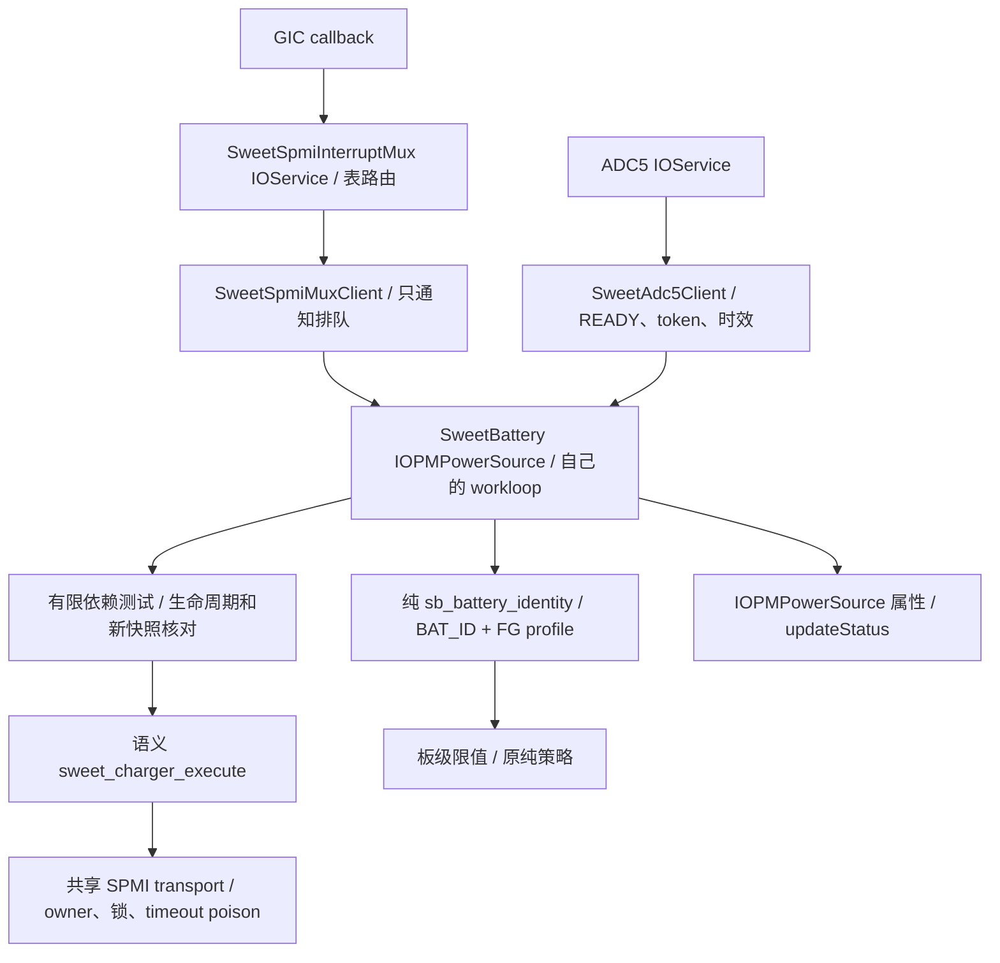

# 电池身份、并联禁止与 watchdog 分步测试（0165）

**0120a16身份档实测：未通过，阻塞点为USBIN RESULT校验失败-12。**
只有3请求/2成功/5EOC，约53.744秒终止；失败这次GIC→notify61.979µs，ACK等锁
0.312µs/持锁12.188µs，callback距deadline仍98.522ms，属于及时交付后的校验错误。
快照status1/channel8均正常，但未保存原校验值和data lo/hi，不能断言具体是哪项。
实测ADC仅覆盖约1.255秒，不能用整档约700秒日志宣布旧超时/长期ADC已修复。
LG拒绝恰好0x8000，其他越界电压码按零处理；本实现拒绝所有raw>=0x8000，存在
具体语义差异，尚无被拒原始码证实因果。下一实现保留已读校验值/失败阶段并核对
零电压语义；本批不再重刷identity/watchdog/组合，无新驱动需push，继续禁充。
[完整时间线、已证实与未证实项](BATTERY-DEPENDENCY-TESTS.md#0120a16身份档实测及时交付后发生校验失败)。
以下旧待测/待编译动作均为历史，以本段为准。


**当前0120a16：真实云源码/内核核对通过，同核五档boot已打包并回读，待测identity1。**
实现357b26f/0167，相关33源码与本地验证树逐字节一致，原106源码gate、新仲裁/
ACK计时及snapshot v2标记通过；五档均runtime1、不主动启充，三键/USB/触摸IRQ
及USB日志保留。先用`out-bs/boot-16k-0120a16-battery-identity.img`：桌面后尽快
拔5秒→同一稳定电源5～10分钟→拔5秒，简测三键/触摸，导出
`sweetlog-0120a16-battery-identity.bin`，持久日志即可。目标核对持续USBIN转换与
ACK等锁/持锁/通知时序，是否消除旧超时尚待实机；之后按结果决定同核watchdog4/
组合7。无需新push/编译，不重测旧0120a15或baseline。
[镜像归档与验证边界](BATTERY-DEPENDENCY-TESTS.md#0120a16云产物与同内核测试镜像)。
以下旧待push/待编译/待测动作为历史记录，以本段为准。


**当前0167：ACK/遥测竞争修复已完成本地验证，待用户push/新云内核实测。**
等待中的mux IRQ写/ACK优先于下一笔普通SPMI事务；每遍先ACK、再合并通知，全部
有限遍次结束后输出日志；独立故障快照逐字段让锁，协议错误的恢复前快照仍保留
原子区间。新增ACK等锁/持锁计时，原期限/owner/poison/group隔离及runtime1禁充
不变。7文件ARM64单编译、并发/故障回归通过，CI未改，尚无实机修复结论。
下一步用户push，下载新产物后核对/打包同核五档，优先identity1；不再测旧0120a15。
[实现、锁顺序、计时边界和测试步骤](SPMI-ACK-ARBITRATION.md)。以下旧待测动作均按历史保留。


**0120a15-watchdog已分析：** 独立看门狗配置/9次自然bark维护/180秒有限停止通过
（含初始化10pet，结束后20bark不再pet），仍未主动启充。ADC59又RESULT超时，
这次mux在deadline前4.003ms已读到EOC pending，却到deadline后9.028ms才notify，
确认存在预截止事件交付过晚；ACK锁等待/抢占/总线耗时仍待拆分。下一实现处理
关键ACK/分发与重遥测竞争，当前不追加组合7或重复测试，无新驱动需push。
[完整实测与验收边界](BATTERY-DEPENDENCY-TESTS.md#0120a15看门狗档实测正常维护通过adc确认deadline前已有eoc)。
下方待watchdog等步骤按历史保留，以本段为当前动作。

**0120a15身份档已分析：** 5次身份转换正常；第6请求（首笔USBIN）RESULT超时。
恢复前读到转换完成/EOC锁存，第二mux scan晚于deadline78.134ms、notify晚109.106ms；
首EOC回调仅23.178µs、advance锁等待0.312µs，timer是真到期。已定位到存在分发
延迟，尚未证明硬件在deadline前完成，精确阻塞来源仍待核对。身份/限值撤销正确，
无有效VBUS或正许可。下一项同核watchdog4：桌面尽快拔5秒→接稳定电源≥60秒→拔5秒，
导出`sweetlog-0120a15-battery-watchdog.bin`。无新push/编译、不主动启充；不重测身份/
baseline/inhibit，暂不要求组合。[实测时间线与边界](BATTERY-DEPENDENCY-TESTS.md#0120a15身份档实测捕获result完成后的分发延迟)。
下方待identity等步骤按历史保留，以本段为当前动作。

**0120a15云产物已核对并打包，待实机：** 0166真实源码33文件与验证树一致，
原106源码检查、kernel manifest/新诊断marker和五档最终boot回读通过。先测
`boot-16k-0120a15-battery-identity.img`：进桌面尽快拔5秒→同一稳定电源约5分钟→
拔5秒，导出`sweetlog-0120a15-battery-identity.bin`，持久日志即可。之后按新证据
安排同核watchdog/组合档；当前不重测baseline/旧四档/独立inhibit，不主动启充。
[镜像、哈希与步骤](BATTERY-DEPENDENCY-TESTS.md#0120a15云产物与同内核测试镜像)。
下方待push/待云构建段落按历史保留，当前动作以本段为准。

**0166本地实现更新（待新云编译/实测）：** 已补ADC trigger→父GIC→mux扫描/ACK/
notify→consumer→SPMI锁的时间与一次性故障现场；timer先核对当前阶段的原截止
时间，未到时重挂，真超时仍撤销。watchdog补命令/软件plugin/故障取证，先禁充再
读现场，保留23秒/180秒，不额外pet。根因仍待新硬件证据，未宣布故障已修复。
本地回归和7文件ARM64编译通过；CI未改，可由用户push。下一次一次云编译、同核
分档，优先identity1；旧0120a13四档不重测。架构、字段、判读边界及步骤见
[IRQ时序取证](BATTERY-IRQ-TIMING.md)。以下均按历史时点保留，以本段为当前动作。

2026-11-07。用户要求在0164来源保留修复的同一次云编译中推进后三项依赖，
用参数分开或组合测试。0120a13四个目标档已完成日志分析：身份及故障撤销、
主PMIC输出禁止、单独watchdog正常维护/有限停止有实测；组合7未通过，出现
ADC第二阶段超时及首bark晚于23秒期待。长期输入许可未覆盖，外部隔离/最终
授权仍未成立。本批不再重刷，下一步定位ADC时序和watchdog首bark启动语义。
**全部档位只允许runtime1；没有主动启充。** 身份可建立板级限值，主PMIC副路
禁止与watchdog的配置/IRQ链可独立取证；外部SMB1355隔离和managed-watchdog
最终授权仍未成立。不能将“已有实现”写成“三项实机验收完成”。

## 参数和同内核镜像

`sweetbattdeps` 是请求执行的位集合，不是强制通过条件。仅接受0～7，非0时要求
`sweetbattruntime=1`，否则服务启动显式失败。保留IRQ4、ADCconv0、三键/DWC3/
触摸IRQ与USB日志；不修改CircleCI或GitHub XNU触发/检查配置。

新产物核对后使用 `tools/mk-mh2lm-event-matrix.sh ARTIFACT LABEL --battery-dependencies`。
同一个实际内核生成下列五份boot，名称包含产物LABEL；0120a13镜像见文末。

| 镜像后缀 | deps | 作用 / 写入边界 |
| --- | --- | --- |
| `battery-evidence` | 0 | 原输入观察；包括0164修复，不执行新增准备写入，不订阅bark |
| `battery-identity` | 1 | BAT_ID/profile/容量交叉验证和板级限值；不执行新增充电配置写入 |
| `battery-inhibit` | 2 | 先禁主路，再禁止主PMIC的SMB_EN副路输出；核对即时与后续读回 |
| `battery-watchdog` | 4 | 先禁主路，再配置有限watchdog观察、初次pet和bark IRQ维护 |
| `battery-deps-all` | 7 | 上述三项一起；仍保留外部隔离/最终watchdog授权互锁 |

位集合3/5/6也受支持，可由打包参数安排有目标的组合；默认不额外生成它们。
每份镜像保留同一内核、ADT和基线ramdisk内容，只改测试参数。打包器要求0164
和0165的marker，拒绝旧内核；原0120a12不要重测。新产物仍需源码/marker与boot
payload/参数回读核对，不能用本地主机测试替代云内核验证。

## 架构与身份契约



`SweetBattIdentity` 是电池loop拥有的值类型，没有新单例、假IOService、跨层
寄存器写或Linux votable。实际SPMI读取仍在PMIC采样组件，准备写入在语义后端。
匹配/IRQ通知不做重SPMI；bark在原consumer loop里处理，mux只管理IRQ寄存器。

身份要求电池present、ADC client存活且BAT_ID结果有效，非零token，ADC与profile
各自开始/完成时间有效且从开始严格小于60秒。完整固定tuple要求integrity白名单、
24字节前缀与nominal capacity一致；该前缀比较沿用LG选择依据，不是全416字节
profile散列验证。BAT_ID换算复现LG的整数顺序：

```text
mv = microvolts / 1000
ohms = 100000000 / (1825000 / mv - 1000)
kohm = ohms / 1000
```

拒绝零、越界、未来时间、到期/缺失测量和不匹配。按91kΩ Tocad / 12kΩ LGC的
15%整数容差选最近候选，不采用Android“无匹配默认Tocad”fallback。profile/容量
须分别匹配Tocad4027或LGC4073mAh。通过后板级上界FCC2800mA、FV4430mV；原
试验策略继续最多FCC/ICL500mA、FV4200mV，绝不是立即按2800mA取电。

身份开启时每30秒保护采样刷新FG tuple，BAT_ID沿用ADC client已有30秒刷新/
60秒时效；不是轮询输入/IRQ。每次策略执行重新交叉核对，失去测量、profile错误、
present变化、ADC终止、停止或过期均撤销身份与限值，不给旧值续原采集时间。
`verifiedNs`只是本笔遥测下的限值核对时间，不替代两份原证据的60秒期限。
`batteryUntilNs`保存两份证据的最早到期点，策略同时检查该点，并将控制命令
截止时间收紧到它，避免两次保护采样之间越过身份期限仍使用上一笔决定。

主要诊断：INFO `SWEET BATT IDENTITY: v1`，含valid/profile/ohms/token及板级上界；
IORegistry `SweetBatteryIdentityVerified/IdentityProfile/ApprovedFCCMA/ApprovedFVMV`。
identity1可以同时检验0164输入修复，无需先重复一个baseline。

## 并联禁止能证明什么

`SWEET_CHARGER_PARALLEL_INHIBIT=1` 仅执行LG SEC_NONE的语义：SID2:0x1648，
mask0x18、value0x08，强制SMB_EN override低，保留CP/STAT等其他位；不改0x1690
选择位，也不开放任意副路寄存器写。新操作要求已读回主路enable0，逐事务owner/
错误检查与即时回读，再由写入后的新遥测核对。读错、状态改变、主路重新使能或
mux丢失会终止诊断并尽力禁主路，不自动重试或还原继承的enable。

`SWEET BATT INHIBIT`表示命令接受，`SWEET BATT DEP CHECK`和
`SweetBatterySecondaryOutputInhibited`表示后续PMIC读回相符；`select`只记录选择。
**`SweetBatteryParallelVerified`始终false。** LG SMB1355支持CHG_EN_SRC/polarity和
独立command控制，主PMIC的SMB_EN低不足以证明外部器件已停充。仍需SE4 I²C的
typed provider发现芯片、读取/核对并安全禁用实际充电源与状态；当前没有该provider，
不能把缺I²C访问当作器件不存在或默认关闭，也不假装已完成外部隔离。

## Watchdog 配置、中断与有限责任

新增路由表尾索引18：SID2/PID16/bit1、rising `battery-wdog-bark`，consumer事件
`SWEET_BATT_IRQ_WDOG=0x100`。表19路/3组，合法battery mask1ff；默认实际订阅
仍ff，仅deps含4才请求1ff。复用原GIC INTID513、IOService/registry client与共享
SPMI锁；按原owner、已使能位拒绝接管、回滚/隔离规则处理，不能因新路失败影响
按键组，更不能静默切到轮询。实际MISC APID/owner与路由使能仍待新镜像确认。

主路禁充后，`WATCHDOG_PREPARE=1`固定配置：0x1653=f3，snarl8秒/bark16秒/
bite8秒且bite禁充；0x1651仅mask c2置42，plugin-enable和bark IRQ开启、AFP按LG
主路初始化方式关闭，保留其他位，不关闭watchdog。不重写JEITA/温度阈值。
这不是逐字复制LG主路整套默认值；bite禁充是本轮明确保留的保护选择。

初次执行一次pet，然后仅在真实bark consumer事件上pet。`WATCHDOG_PET=1`走
专用 `sweet_spmi_charger_pet_watchdog()` 固定0x1643 bit0脉冲：同一transport锁、
唯一EE0 writer、v5和共享RW timeout poison；不使用稳定值RMW，不读回比较、不因
上次读到1跳过，也不重试。成功只说明总线命令完成，不能单凭它证明计时器已复位。
所有新语义操作检查主路禁充，非禁充的诊断写与priority power通知共用control锁。
原runtime控制提交入口拒绝这三种诊断操作，不能借它们绕过充电策略。

配置返回后要等 `snapshot.startedNs >= 配置完成时间` 的新遥测。ADC通知可能先到，
此时等待，不能拿旧配置误报失败；新遥测缺失/过3秒、配置变化/读错都会终止。
plugin-enable不证明继承的插线已启动计时器：只有配置后的新plugin采集或实际bark
才启动中断期限检查。source/ADC/保护tick不能续此期限；有输入且该期待已建立时，
23秒没有新bark则ERROR终止，早于16+8秒名义窗口的末端。

整个准备诊断从开始最多180秒，时间到再次禁主路并停止pet，不自动重启；停止/
IRQ失败/关机/系统睡眠也不再pet。保持副路禁止和watchdog bite保护配置，不恢复
未知继承enable。普通息屏不等于系统深睡，尚无本轮深睡恢复验收。
INFO `SWEET BATT WATCHDOG`区分prepared与bark IRQ pet；配置读回见DEP CHECK，
错误为必出ERROR。初次pet计数1不算自然bark验收；`window complete`也不代表没有
发生中断时自动通过。最终策略仍只接受原watchdog-off契约，未授予managed-watchdog
许可；待真实IRQ/保护语义验收后再接入正式控制策略。

## 下一轮逐步测试

同一云内核，按以下顺序分别fastboot，由用户操作；保留持久日志即可。任一项失败
先分析该档日志，后续独立档可按原因选择，不要求重跑旧0120a12/baseline或ADC正常
路径bring-up。不在本轮增加enable=1镜像。

1. **identity1**：桌面约15秒→拔5秒→原同一电源/线材稳定45～60秒→拔5秒→接
   1～2秒再拔→稳定接15秒再拔。检查IDENTITY valid1/profile1/约95kΩ、2800/4430
   上界；同时验0164重复source后恢复输入许可、>3秒来源时间不续、新epoch电压
   匹配及有效许可期间拔线撤销。默认evidence0只留作有目标的输入隔离对照。
2. **inhibit2**：桌面后尽快操作，插拔一次并稳定20～30秒；检查主路enable0、
   INHIBIT接受、新遥测DEP CHECK的SMB mask18为08且选择位有记录，后续不被改回。
   外部隔离仍为false属于本档预期。
3. **watchdog4**：桌面后尽快拔线5秒，再接稳定电源至少50秒，期间确认按键/
   触摸；检查bark路由attach/healthy、f3/42掩码、新遥测确认，以及至少两个自然
   bark与成功pet。若无中断或配置失败，保留日志而不继续宣称维护通过。180秒从
   驱动开始算，若此前等待过长导致窗口结束，日志会明确指出，不能靠插拔重启。
4. 前三项看过日志后再测 **deps-all7**，确认同一供电下身份、输入许可、禁止副路、
   bark pet和三键/USB/触摸并存；它仍不启充。正式启充前继续完成外部I²C隔离与
   watchdog授权/故障保护验收。

## 源码依据与本地验证

参考根 `ref/android_kernel_lge_sm8150`，HEAD
`d4f335e13d73c4aa2af85581a6ec11b670ee5b94`，并对照工作区`docs/INDEX.md`六章。

- `drivers/of/of_batterydata.c:of_batterydata_get_best_profile`、MH2LM common PM
  DTS及两份BLT42 profile；详细整数依据见[身份审计](BATTERY-IDENTITY-INPUT-AUDIT.md)。
- `smb5-lib.c:smblib_select_sec_charger_locked/smblib_smb_disable_override_vote_callback`，
  `smb1355-charger.c:smb1355_set_parallel_charging`：输出禁止与实际并联状态的区别。
- `smb5-reg.h`的SMB_EN/WD_CFG/timeout/pet，`qpnp-smb5.c:smb5_init_hw`和
  `smb5-lib.c:wdog_bark_irq_handler`；`pm8150b.dtsi:qcom,misc@1600`的bark bit1 rising。

底稿 `scratch/battery-dependencies/`：从实际0120a12的33文件依次严格apply0164/
0165，与edited/verify逐字节一致；原106源码gate通过。ASAN/UBSAN runtime11、
transport123、mux70条PASS（含新bark交付/owner冲突/已有enable拒绝/失败回滚与
按键并行，原80次退出竞态），日志等级检查通过。新增runtime覆盖所有准备操作
错误、写后新遥测、真实配置/mux丢失、初始插线不伪造计时器启动、source不续bark
期限、有限结束及20次pet/优先电源停止竞态。五个ARM64单文件编译通过：
SweetBattery、SweetPmicPower、SweetSpmiInterruptMux、sweet_spmi、sweet_charger；
有编译警告，非macOS全内核链接或硬件验收。

打包器bash语法、实际分档分支的参数唯一性/0、1、2、4、7、旧内核拒绝已验证；
未生成假新boot。未重跑未改动的ADC client独立测试。CI文件逐字节未改，未push/
操作设备。失败路径不静默fallback，尚无新CI run ID/0165实机结果。


## 0120a13云产物与五档boot

实现提交8d6435b、交接fe21cca。实际0120a13 buildtree的33个选定源码文件与
`scratch/battery-dependencies/verify/xnu`逐字节一致，原106项CI源码检查通过；
kernel manifest及0164来源保留、0165身份/副路禁止/watchdog/bark和既有输入/
ADC/mux/三键/DWC3/触摸/ACM标记完整。未提供新构建日志或CI run ID，不据此
宣称所有构建警告已排查。尚无0120a13实机结果。

| 产物 | SHA256 |
| --- | --- |
| `xnu-buildtree-0120a13.gz` | `e383562860e87913d89cf1dfae10ce96f34128be4c972660f662501fb72fa12b` |
| `xnu-kernel-0120a13.gz` | `5bfa27a403b5dda60887f2a35cb47efd5abdd9d5bc1b2c05f7614ce0f01ab0e2` |
| 实际kernel | `1e66616567862cf52c3eb67ba0aa1feb27b3d4018b51b47d00578e5fe3b3dc24` |

镜像目录：`/home/shenli/work1/out-bs/`。每份35,667,968字节，boot header v1；
外层firmware/ramdisk切片、内层FAT的kernel/ADT/TOML回读全部一致，同一内核与
16K ADT。参数无重复，除deps及菜单标题外一致；runtime1/IRQ4/ADCconv0，USB日志
和三键/USB/触摸IRQ保留。全部不启充。五档SHA256：

| 镜像文件 | deps | SHA256 |
| --- | --- | --- |
| `boot-16k-0120a13-battery-evidence.img` | 0 | `17db8436a398f3ae05e688dbff506b1ec6ded20272f13bd2ad74fa2f2db0b439` |
| `boot-16k-0120a13-battery-identity.img` | 1 | `db6368d1490bd31e8ecb1bc08703d174a0eb6ed6d7150e444fce9a0daec58f4a` |
| `boot-16k-0120a13-battery-inhibit.img` | 2 | `2073d315d6dc7f4fa02d8659238bb2e31ab303ac29f5182caa0aeef9f3f770fe` |
| `boot-16k-0120a13-battery-watchdog.img` | 4 | `c28a600770f70ccaf04b05e58ad69cbf8e6df7052c13adf1ef7fd8586b6e7342` |
| `boot-16k-0120a13-battery-deps-all.img` | 7 | `4a237cab72ce67e0d41abb1b4f8bc21cf78764d867e379efeb38c8d5bfcde095` |

先由用户fastboot boot `boot-16k-0120a13-battery-identity.img`，按上方identity1步骤
操作，导出 `sweetlog-0120a13-battery-identity.bin`；持久日志即可。默认evidence0
无需再测，待本档日志分析后再给inhibit2/watchdog4的具体下一项；组合7保留到分项
结果核对后。watchdog4从驱动准备起只有180秒，届时需桌面后尽快完成插线取证。

底稿 `scratch/artifact-0120a13/`：verify-artifacts.py、source-compare.json、
verification.json、packaging.txt、verify-boots.py、boot-verification.json及五份
回读TOML。本轮只核对、打包和更新文档，未改驱动或CI、未push或操作设备。

## 0120a13身份档实测：身份通过，ADC故障阻断输入许可验收

日志 `logs/sweetlog-0120a13-battery-identity.bin`，SHA256
`9ce9fabcad010e21bb0bf16be8a0253d1e0316c8f33c6a66613a62ab9d3587a4`。
SWEETLOG v1，4MiB环、有效901517字节、flush67、11510行，无回卷/NUL。
约700.009秒、711笔连续电池采样（39 IRQ含初始化/arm-sync、672保护timer）。
本节是本轮实测结论；上方打包时“待实机”仅为历史状态。

| 项目 | 证据与结论 |
| --- | --- |
| 身份正常路径 | token1/31/61/91/121/151/181/211共8次有效建立/刷新；BAT_ID889359～889814µV，LG整数式均95057Ω，profile1、FCC2800mA/FV4430mV板级上界正确。58次FG tuple均match1/integrity0x13/nominal4027mAh |
| 身份失效撤销 | 第238次ADC请求超时后立即valid0/profile0/token0/限值0；策略撤销身份，不使用缓存冒充新测量 |
| ADC正常部分 | 238请求中237成功（8 BAT_ID、229 USBIN），全部valid1/restored1并被接受，无epoch丢弃。466 EOC，成功请求总耗时7.488～49.756ms；USBIN4514528～4867472µV |
| ADC故障 | token238/channel2从WAIT_SETTLE进入GROUND后无本请求EOC，phase2 TIMEOUT/error-101；restore-error0/cleanup0，provider停止并通知撤销，后续无请求/结果 |
| 0164来源保留 | id523/524/526/527与545/546/548/549两组CC均qualified1、coherent1/reasons0；重复source两笔保持原CC时间戳，未复现0120a12约1.3秒误删 |
| 长期输入许可 | 未覆盖。故障在uptime295.883～296.885秒之间，第一次拔线在305.366秒；所有Rp3A分类在ADC停止以后，无同epoch新VBUS、无正permit/lease记录。不能据此判0164长期许可通过或失败；有效许可内拔线撤销也未覆盖 |
| 主路/共享IRQ | 38笔配置全部enable0、无CONTROL。37次IRQ refresh全部healthy，route→publish100.973～104.479ms；UV12次，OV无自然命中，不能算完整保护验收 |
| 功能回归 | 三键均有配对down/up，触摸hits310/empty0，两次ACM configured；无panic/共享mux失败或隔离。5条USB EP0/EP5命令warning，重复枚举问题仍保留 |

本次phase2明确是USBIN REF_GND的**第一阶段EOC**，不能套用先前记录的“第二EOC
缺失”。超时日志没有当时的ADC状态、PMIC IRQ latch/enable、arbiter pending和mux
分发快照，无法区分转换未完成、硬件中断未送达与软件排队/时序问题；也没有证据
归因于插拔、身份刷新或UI。失败前后的成功不等于这个缺陷已经修复。
后续ADC修复应先在typed ADC后端和mux各自边界补一次性故障快照及阶段时间，
保持IRQ-only和失败撤销；不能用轮询结果、自动重试或放宽deadline掩盖缺失EOC。

下一项可独立测同内核 `boot-16k-0120a13-battery-inhibit.img`：桌面后尽快拔5秒、
接同一稳定电源20～30秒再拔，确认三键/触摸并导出
`sweetlog-0120a13-battery-inhibit.bin`。检查禁主路、INHIBIT接受、新遥测SMB mask18
为08且后续保持。此档不依赖身份或输入许可即可取证；外部parallelVerified仍false、
仍不启充。随后按日志推进watchdog4；组合7和完整验收仍需解决ADC可靠性并补长期
输入许可。默认不重跑baseline，不要求为本项重新编译。

底稿 `scratch/artifact-0120a13/`：battery-identity-persistent.txt、analyze-log.py、
log-analysis.json、audit-identity.py、identity-verification.json。分析器显式将238归入
失败请求，不把“无结果”当日志截断，也不使用0120a12固定3个正permit的旧断言。
本轮只读日志/源码并更新文档，未改驱动/CI、未push/操作设备或重新打包镜像。

## 0120a13副路禁止档实测：主PMIC禁止通过，ADC收到EOC仍过期

日志 `logs/sweetlog-0120a13-battery-inhibit.bin`，SHA256
`07f0c0a427ae5f038a640c493183de3b97b1d222a3f17e544cfc77ef25c2f60e`。
SWEETLOG v1/4MiB/有效476631字节/flush25/6154行，无回卷/NUL。
291笔连续采样、约279.991秒；22笔IRQ含初始化/arm-sync，269笔保护timer。

**本档目标通过：主PMIC的SMB_EN副路输出禁止。** deps2/runtime1正确，初始SMB0；
INHIBIT命令被接受，下一笔独立遥测id31确认main-enable0/SMB08/select02。
后续20笔PARALLEL原始记录均SMB08/select02且读取error0，覆盖插拔、ADC故障和
有限窗口结束之后，最后id285/uptime297.923秒仍保持。21笔CONFIG均enable0，
无CONTROL/主动启充。180秒诊断到期正常终止，pets0/disable-error0；本档没有
watchdog维护任务，pets0是预期。没有DEPENDENCIES FAILED或禁止位丢失。
外部SMB1355仍无I²C实际状态证据，parallelVerified保持false，不能称外部隔离通过。

ADC68请求中67次成功（3 BAT_ID/64 USBIN），全部valid1/restored1并接受，无epoch
丢弃；USBIN4573696～5082352µV，成功总耗时7.486～51.881ms。第68次USBIN故障：

1. REQUEST68从WAIT_SETTLE开始；同一轮mux irq137明确hit adc5-eoc（route-hits132）。
2. consumer确实执行EOC68，返回error-101/phase5/count0；随后restore-error0/cleanup0，
   provider停机，客户端测量撤销。没有timer `SWEET ADC5 TIMEOUT`记录。
3. 源码在 `sweet_spmi_adc5_advance()`取得共享SPMI锁后先检查deadline；该返回值与
   count0说明第一次EOC尚未接受即已过期。附近电池id121采样耗时99.935ms、涉及
   变化中的Type-C状态；仅是并发线索，不能由相邻日志顺序推出精确锁等待时间。

与身份档“未看到EOC到达”不同，本档已有mux投递及consumer回调证据，不能一概
称硬件没有发中断。仍缺trigger/IRQ/排队/回调入口/锁获取的时间戳及故障现场快照，
不能认定硬件完成晚、workloop调度晚、共享锁等待或二者组合中的哪一种是根因，
也不能倒推身份档一定同因。后续ADC修复优先补各层有界取证，不以轮询、自动重试
或单纯放宽100ms截止掩盖。长期输入许可仍未覆盖：Rp3A分类id127/128/130/131
在ADC故障后，虽重复source保留CC原时间戳，已无新VBUS可生成permit。

20次IRQ refresh全healthy，route→publish99.871～108.922ms；三键down/up配对、
触摸hits83/empty0、ACM configured2，无panic/共享mux失败或隔离。UV6、OV未
自然命中，不能冒充完整保护验收；5条USB EP0/EP5 warning保留旧枚举问题。

NEXT：用现成 `boot-16k-0120a13-battery-watchdog.img`，进入桌面后尽快拔线5秒，
接同一稳定电源至少60秒，再拔线5秒并导出
`sweetlog-0120a13-battery-watchdog.bin`；确认三键/触摸。诊断从驱动准备起只有
180秒，开始操作前不要在桌面等待几分钟。目标是路由attach/healthy、配置f3及
maskc2=42的新遥测、至少两次自然bark与pet；初次pet/窗口结束不能独立算通过。
仍不启充，无需新编译或baseline。组合7/ADC可靠性和长期许可验收仍待后续。

底稿 `scratch/artifact-0120a13/`：battery-inhibit-persistent.txt、analyze-inhibit.py、
inhibit-log-analysis.json、audit-inhibit.py、inhibit-verification.json。本轮只读分析和
文档更新，未改驱动/CI、未push/操作设备或重新打包。

## 0120a13-watchdog实测：bark维护与有限停止通过

日志 `logs/sweetlog-0120a13-battery-watchdog.bin`，SHA256
`47eca1cdc7c6ab4dd8b1730afe585b08e2734bb56609cb42fc3e0081ce2987f3`。
SWEETLOG v1/4MiB/有效441261字节/flush20/5750行，无回卷/NUL；246笔连续电池
采样、约229.202秒（26 IRQ含初始化/arm-sync、220保护timer）。

**本档诊断目标通过：watchdog配置、新遥测、自然bark驱动pet及有限停止。**
不等于正式managed-watchdog授权、带电充电下bite禁充或系统深睡恢复全部通过。

- deps4/runtime1，battery mask1ff；bark路由实际APID272/acc0/status0，IRQ健康。
- 初次pet后，新遥测确认main-enable0、WD1651=62（maskc2=42）、1653=f3。
  16笔CONFIG均enable0，写后均保持62/f3且error0；无CONTROL/主动启充。
- 9次自然bark route hit/9次events100 healthy刷新；前8次各有且仅有一笔
  `bark IRQ pet=2..9`、pulse-completed1、main-enable0、rt0/error0。
  加初次pet总9次；rt0是mux已ACK之后的快照，不能要求它仍保留原latch位。
- 对应采样完成时间为uptime72.442/88.818/141.232/160.229/176.606/192.984/
  209.362/225.739秒。连续稳定段间隔约16.377～16.378秒；全序列还含一次
  52.414秒跨拔插间隔、一次18.997秒间隔，不能声称每笔均16秒或精确pet时刻。
- 180秒窗口在uptime236.531秒附近正常终止，pets9/disable-error0。其后第9次
  bark（id231/uptime242.116秒附近）仍由IRQ采样并发布，但无第10次pet。
  证明正常有限停止后不再维护；没有DEPENDENCIES FAILED或配置丢失。

ADC仍阻断输入许可。本档51请求中50成功（3 BAT_ID/47 USBIN）、98条consumer
EOC；成功结果全部valid1/restored1且接受，无epoch丢弃，总耗时7.478～48.287ms。
USBIN4586144～4853968µV。请求51/channel2第一EOC返回MORE/phase3/count1，
表示已触发第二转换；随后timer在RESULT/phase3超时。日志顺序为：

```text
mux adc5-eoc route-hits98 → EOC51 MORE/phase3/count1
→ TIMEOUT51 phase3 → mux adc5-eoc route-hits99 → FAILURE51 error-101
```

restore-error0/cleanup0，provider停机并撤销测量，没有第二次EOC51成功回调。
第二次mux hit与首次同属irq/work104，说明同一drain内ADC和多条Type-C/USBIN
路由交错，定时器先报告超时，之后才看到第二个hit日志。routeNotify发生在hit
打印之前，日志没有各层时间戳，不能拿文本行顺序当成精确硬件IRQ/投递时刻，
也不能直接断言转换硬件没完成或认定某个锁是根因。三档已覆盖首EOC没见到、
收到首EOC但advance过期、第二阶段超时而稍后记录mux hit；后续ADC时序/一次性
故障快照应覆盖trigger、GIC、mux scan/notify、consumer入口和锁前后，不用
轮询/自动重试/单纯延长deadline替代修复。watchdog在ADC失败后仍自然bark/pet，
与诊断档独立于测量许可的设计相符；这不授予缺测量时启充的权限。

CC id110/112/113保持原来源时间戳，但在ADC失败后，无新VBUS/正permit，
长期输入许可和有效许可内拔线撤销仍未验收。24次IRQ refresh全healthy，
route→publish89.839～115.977ms；三键down/up配对、触摸hits177/empty0、ACM
configured2，无panic/共享mux失败或隔离；UV5、OV未命中，3条USB EP0/EP5
warning保留旧枚举问题。runtime1未真实启充，其他保护/故障路径不能据此升级。

NEXT：最后一个同内核组合诊断 `boot-16k-0120a13-battery-deps-all.img`（deps7）。
桌面后尽快拔5秒→接同一稳定电源至少60秒→拔5秒，确认三键/触摸，导出
`sweetlog-0120a13-battery-deps-all.bin`。同样从驱动准备起只有180秒，不要先在
桌面等待几分钟。核对身份、SMB08和bark pet并存；若ADC失败，检查身份/限值/
测量撤销且主路保持enable0，不能把组合诊断叫完整验收。该测试增加三项组合
覆盖，不是重复baseline；之后优先修ADC时序、补长期许可，再闭合外部SMB1355
I²C隔离、最终managed-watchdog授权与故障保护。全部不启充，无需新编译。

底稿 `scratch/artifact-0120a13/`：battery-watchdog-persistent.txt、analyze-watchdog.py、
watchdog-log-analysis.json、audit-watchdog.py、watchdog-verification.json；逐笔连接
route hit→pet→healthy refresh，确认窗口后的bark没有pet。只读分析/文档更新，
未改驱动/CI、未push/操作设备或重新打包。

## 0120a13组合档实测：启动配置并存，运行验收未通过

日志 `logs/sweetlog-0120a13-battery-deps-all.bin`，SHA256
`68213bfedc94ac51b53e8c83a825c54bb79bbda0361d6f4d9e4009c78ff77c95`。
SWEETLOG v1/4MiB/有效460149字节/flush26/5879行，无回卷/NUL；308笔连续电池
采样、约289.737秒（30 IRQ含初始化/arm-sync，278保护timer）。四个目标档至此
已有结果，evidence0无需追加；上方“下一项组合”等指令为当时状态。

**组合7没有通过。** 启动准备相容不等于三项运行并存验收成功：

| 项目 | 实测结论 |
| --- | --- |
| 初始配置 | deps7/runtime1、battery mask1ff；新遥测main-enable0/SMB08/select02/WD62(maskc2=42)/timef3，准备阶段无冲突 |
| 身份 | token1/17/18三次valid1/profile1，95057/94786/94786Ω，板级2800mA/4430mV；31次FG tuple均match1/13/4027。ADC停机后身份、token、限值正确归零 |
| 主PMIC输出禁止 | 16笔后续PARALLEL均08/02且error0；17笔CONFIG始终enable0，写后WD62/f3保持。无CONTROL/主动启充，外部SMB1355实际隔离仍无证据 |
| ADC | 19请求中18成功（3 BAT_ID/15 USBIN），全部valid/restored/接受，无epoch丢弃；34条consumer EOC/35个mux hit。第19次首EOC MORE/phase3/count1后，RESULT阶段timer超时，随后mux才打印第二hit（两次irq/work39），restore/cleanup0，provider停机并撤销测量 |
| Watchdog | 只有初始化pet，没有自然bark pet。稳定plugin id106采样完成124.219秒；23秒期待在id131/147.490秒终止诊断。首bark到id136/152.072秒才完成采样，比plugin约晚27.853秒，晚于终止约4.582秒 |
| 终止后 | 后续12次bark路由均healthy交付，但无pet/隐式重启，主路继续enable0。没有正常window-complete，此档终止原因是bark missing/late，不能套用单独watchdog档的正常结束结论 |

ADC成功总耗时7.549～48.252ms，BAT_ID888321～889684µV，USBIN4579920～4829056µV。
第二阶段超时/随后hit与watchdog4的ADC51现象一致，但仍缺精确trigger/GIC/mux
scan+notify/consumer入口/锁获取时间戳；文本行序不能证明硬件发出时间或锁等待
时长。ADC失败后CC id106/108/109仍保留同一原来源时间，但已无新VBUS/正permit，
长期许可与有效许可内拔线撤销未验收。

本档第一bark晚于预期已有日志证据，**不能直接认定是mux冲突或把23秒简单放宽**。
首次plugin起算依赖软件观察的输入epoch，不等于已证实PMIC内部启动/重启时刻。
需要按LG实现及PMIC定义核对配置、pet、真实plugin/掉线抖动和首bark的关系，并
用MISC IRQ/状态及各层时间取证。故障后的采样完成间隔交替约8.19/16.05秒，
那时软件已停止pet，不能当作健康16秒维护或完整bite保护验收。单独watchdog4
有自然bark维护/有限停止证据，该结论仍有效，但不能推广成组合7或正式授权通过。

28次IRQ refresh全healthy，route→publish89.560～117.417ms；三键有配对down/up，
触摸hits151/empty0，无panic/共享mux失败或隔离。UV5、OV无自然命中；本档无ACM
configured记录，也无USB warning，不据此宣称USB枚举回归通过或功能失效。

NEXT：本批上机测试收束，不再重刷identity/inhibit/watchdog/all或追加baseline。
下一实现围绕两项缺口：ADC各阶段/事件投递/锁等待的有界诊断和修复；watchdog
首plugin启动/首bark期限的语义核对及取证。补证必须经typed ADC/PMIC后端和mux
各自接口，保持现有IOService/registry client/consumer workloop；不在高层穿透读
寄存器，不添加轮询/自动重试，不靠延长deadline冒充修复。新版本准备完成后再
通知用户push/编译，本轮没有新的驱动提交需要云编译。后续仍需长期输入许可、
外部SMB1355 I²C隔离、最终managed-watchdog授权及保护验收，全部尚未主动启充。

底稿 `scratch/artifact-0120a13/`：battery-deps-all-persistent.txt、analyze-deps-all.py、
deps-all-log-analysis.json、audit-deps-all.py、deps-all-verification.json。只读分析与
文档更新，未改驱动/CI、未push/操作设备或重新打包。


## 0120a15云产物与同内核测试镜像

2026-11-07。实现提交`9f49c1d`（0166）。实际buildtree的33个相关源码文件与
`scratch/battery-irq-timing/verify`逐字节一致，原106项源码gate通过；实际kernel
的manifest及ADC TIMING/FAULT/STAGE/SNAPSHOT、WD COMMAND/START/FAULT/SNAPSHOT
和原输入/mux/三键/DWC3/触摸/ACM标记均通过。确认0166生效，不是旧内核换编号。
本次用户只提供buildtree/kernel两个归档，没有构建日志或CI run ID；未检查全量
构建警告。尚无0120a15实机结果，ADC及首bark根因仍未定位。

| 产物 | SHA256 |
| --- | --- |
| `xnu-buildtree-0120a15.gz` | `97d95acfb4934ed0dea259398a3ae9c49fb0c6adbcb1774f2b359b9c07a0f0de` |
| `xnu-kernel-0120a15.gz` | `a8b26dd4164300761b29243d45e775e50e17340d4fe412ddfb0078ac30697320` |
| 实际kernel | `83294f81fd0df1d3303eebc82daa0733ae747c4f059e4d1bcd818f9e76e6d552` |

镜像目录`/home/shenli/work1/out-bs/`，已实际执行打包并从最终Android boot读取
ramdisk/FAT回验kernel、ADT、TOML及外层firmware blob。五份均为boot header v1、
35,667,968字节、同一实际内核与既有16K ADT。参数无重复，除deps/菜单标题外
一致；runtime1/IRQ4/ADCconv0，保留USB日志及三键/USB/触摸IRQ，全部不主动启充。

| 镜像 | deps | SHA256 |
| --- | --- | --- |
| `boot-16k-0120a15-battery-evidence.img` | 0 | `e232181726fdf089d015745c49aef4119dec61a1d2806080c6664163cb459482` |
| `boot-16k-0120a15-battery-identity.img` | 1 | `36d99c96991f60a815cba2d5c81b3246f21ca01e5fdabf9ddc8423926402311c` |
| `boot-16k-0120a15-battery-inhibit.img` | 2 | `dd6958ad2d58906be4e396459ac9ee081f2a09b99069375e83424403a68b255d` |
| `boot-16k-0120a15-battery-watchdog.img` | 4 | `4205279fdebb7f04fa32fd123229c4f2dd2d171bbde6266caccc54df5b75dc2e` |
| `boot-16k-0120a15-battery-deps-all.img` | 7 | `45f4c0c2914b01cafafa91dca2f4a3e8442d49b29db0401198b2354db23d8ba7` |

**当前先测identity1：** 用户fastboot boot
`/home/shenli/work1/out-bs/boot-16k-0120a15-battery-identity.img`。
进桌面后尽快拔线5秒→接同一稳定电源保持约5分钟→拔线5秒，期间简单确认三键/
触摸；导出`sweetlog-0120a15-battery-identity.bin`，持久日志即可。5分钟是为覆盖
旧identity约296秒的故障窗口，不是更改ADC硬件deadline；若已出现明显异常可
提前导出。优先分析新FAULT/STAGE/MUX/PATH/SNAPSHOT/FIELD及晚到hit时间，区分
转换/投递/consumer排队/共享SPMI锁等待，再安排同核watchdog4或组合7。后两档
180秒窗口从驱动准备起算，测试时不要先在桌面空等。evidence0/inhibit2只是同核
预备镜像，当前无需重测baseline、旧0120a13四档或独立inhibit。

底稿`scratch/artifact-0120a15/`：verify-artifacts.py、source-compare.json、
verification.json、packaging.txt、verify-boots.py、boot-verification.json；脚本/
产物均未提交。CI配置与驱动本轮未改，未push/操作设备；本轮只核对、打包与更新
交接文档。时序字段含义和判读边界见[BATTERY-IRQ-TIMING](BATTERY-IRQ-TIMING.md)。


## 0120a15身份档实测：捕获RESULT完成后的分发延迟

日志`logs/sweetlog-0120a15-battery-identity.bin`，SHA256
`38000bb01b639453f18bea952490912bae5524d5c3a4dcfa68bbe25577651df9`。
SWEETLOG v1/4MiB、有效579259字节/flush54、7268行，无回卷/NUL。runtime1/deps1、
新TIMING标记存在；565连续采样跨569.517秒（20irq含初始化，545保护）。本轮只
分析日志/实际云源码和写文档，未改驱动/CI、未push/操作设备/重打包。

5次BAT_ID转换、恢复和consumer接受成功，888516～889035uV、94786/95057Ω，
profile1/2800mA/4430mV；35笔FG tuple均match1/integrity13/nominal4027。
第6请求是本档第一笔USBIN，首EOC成功进入RESULT（phase3/count1），随后-101。
restore/cleanup0，provider停止，身份token/profile/限值归零；未静默重试。
只有5个有效结果、无有效USBIN、无正permit/CONTROL；18笔CONFIG全部enable0，
未运行watchdog命令。该档未主动启充，长期输入许可/有效许可内撤销仍未覆盖。

### 可核对的故障时间线

以下是uptime秒，非日志打印顺序。第一/第二ADC hit均irq10/work10，属于同一次
父GIC屏蔽期间的drain。该父GIC入口481.888655468早于本次REF_GND启动，不是ADC
专属硬件完成时间；不能把GIC→scan差值直接当ADC自身中断延迟。

| 阶段 | uptime秒 | 结论 |
| --- | --- | --- |
| 第一EOC scan / notify | 481.996196093 / 482.002533697 | GROUND EOC已由mux处理 |
| consumer回调 / advance锁定 | 482.002556875 / 482.002561770 | notify到回调23.178µs；本次advance锁等待0.312µs |
| RESULT trigger进入 / 总线完成 | 482.003925364 / 482.004609791 | trigger事务0.684ms，命令成功不等于转换完成 |
| RESULT deadline | 482.103924635 | 原100ms阶段期限，没有延长 |
| timer执行 | 482.105213854 | 晚于当前期限1.289ms，是真到期，不是提前timer误报 |
| 故障观察锁定 / 完成 | 482.105971250 / 482.112758802 | 锁等待0.629ms、固定读6.788ms；尚未abort恢复 |
| 第二EOC scan | 482.182058281 | 晚于deadline78.134ms，距trigger命令完成177.448ms |
| 第二EOC ACK / notify | 482.213029843 / 482.213030156 | scan→ACK30.972ms；notify晚于deadline109.106ms |

故障现场`before-restore=1,saved=0`，十字段均error0：
`status1=01/status2=00/channel08/enable80/request00/RT00/type01/EN_SET01/latched01/cal73`。
即恢复前观察到转换完成状态、正确USBIN通道、EOC锁存且IRQ仍使能；RT为0不能否定
已经锁存的事件。观察先于第二scan至少69.299ms（以整个快照完成为界），所以
**存在“EOC已锁存而mux还没处理”的软件延迟证据**。但快照始于deadline之后，
每字段也非硬件原子读取；尚不能证明硬件在deadline之前就完成，更不能把所有
过去缺首EOC/advance过期案例统一定为同因。

### 源码关联与修复方向的边界

真实mux按路由表顺序，每路ACK后立即排consumer软件事件；第一/第二EOC之间
又处理USBIN/UV/多条Type-C路由。对应电池样本157/158/159分别耗98.536/94.587/
100.053ms，其中profile采集约30.661/30.640/30.899ms；其SPMI事务与同一drain重叠。
电池的完整input/FG/profile采样在自己的loop，**不是mux同步调用电池重采样**；
两个loop竞争共享SPMI事务，另有调度及逐条日志开销。scan→ACK包含锁等待、总线
事务和被抢占时间，现有记录不能把30.972ms全部归因于某一把锁。

下一实现调查和回归重点：急需处理的ADC/watchdog事件与普通路由的公平分发、
避免逐路notify引发重复重采样、重遥测与IRQ ACK之间的SPMI仲裁/调度。
优先扫描/有界批次/延后或合并通知是候选设计，**本轮未实现，尚不能保证单改
路由顺序就足够**。必须保留既有owner/ACK语义、按键不饥饿、group隔离/stop清理，
用实际代码模型复现竞争再验证；不能直接去锁、跨loop读寄存器、重试或扩大期限。

18次IRQ刷新均healthy，route-to-publish90.115～113.613ms；三键配对5/3/4次，
touch207/empty1（保留该计数，不称零空中断），ACM配置成功1次，无panic/mux失败。
后段有EP0/EP5各1条warning，保留已知USB枚举问题，不能据一次配置声称所有插拔
稳定。UI外接电源有亮灭、charging始终0，符合本档未主动启充边界。

**下一项：同内核watchdog4取证，无需push/新编译。** 用户fastboot boot
`/home/shenli/work1/out-bs/boot-16k-0120a15-battery-watchdog.img`。
桌面后尽快拔5秒→接同一稳定电源至少60秒→拔5秒，简单确认三键/触摸，导出
`sweetlog-0120a15-battery-watchdog.bin`，持久日志即可。180秒诊断从驱动准备起算，
不要先在桌面等几分钟。重点联查WD COMMAND/START、首bark的GIC/scan/ACK/notify、
pet及终止快照；ADC失败仍保留分析。当前不重测identity/baseline/inhibit，也暂
不要求组合7。新证据用于一次后续编译合并修复，全部仍不主动启充。

底稿`scratch/artifact-0120a15/`：battery-identity-persistent.txt、analyze-log.py、
log-analysis.json、audit-identity.py、identity-verification.json；断言覆盖逐字段/
请求结果/期限/晚到hit/身份撤销/无正许可与无启充，底稿和原日志不入git。


## 0120a15看门狗档实测：正常维护通过，ADC确认deadline前已有EOC

日志`logs/sweetlog-0120a15-battery-watchdog.bin`，SHA256
`b330efaca945025918974eed1fad5dc9eeb948edea4cc7bfe2907e6f37fbd31b`。
SWEETLOG v1/4MiB/有效592827/flush44/7341行，无回卷/NUL；497连续采样跨469.531秒
（46irq含初始化/451保护）。deps4/runtime1，实际0166诊断标记存在。本轮只读
日志/源码并写文档，未改驱动/CI、未push/操作设备/重新打包。

### 这个镜像测什么

PMIC watchdog用于监督驱动能否持续处理充电保护事件；bark是提前告警中断，
驱动收到后写一次专用pet命令重置计时。后续bite可承担硬件禁充保护，不能只靠
软件声称自己正常。该档先禁止主充电输出，再配置bark16s/bite8s/snarl8s/
bite-disable1及IRQ，只在初始化和真实bark后pet；诊断180秒结束或故障后不再pet。
这里测的是配置/IRQ/维护/停止及其时序，**没有主动开启充电，也没有验证带电
bite禁充、深睡恢复或正式managed授权**。watchdog的硬件事件在诊断结束后仍可
继续到达；“停止维护”指不再pet，并不表示硬件被关闭。

### watchdog结果

准备op8在55.957199427秒完成，初始pet/op9在55.958830833秒完成，两次命令
error0/actual1。实际新遥测`main-enable0/WD62(maskc2=42)/timef3`，后续保持；
16笔CONFIG全部enable0，无CONTROL/正permit，parallel外部隔离和身份许可仍未授予。

29次自然bark均通过路由，窗口内前9次对应pet2..10，加初始化共10pet；每次命令
error0/actual1。首bark GIC在71.856766406秒，距初始pet完成15.897936秒。
窗口内GIC→notify85.885～122.448µs；notify→pet命令完成90.332～93.156ms，
表明mux快速交付之后电池完整采样仍有约90ms开销，不等于硬件响应需要90ms。
稳定bark间隔16.378～16.381秒，中间跨插拔33.415秒，不能把所有段都算16秒。

软件plugin START两笔：epoch5/observed121.236511614秒、epoch12/observed
122.246603645秒，均pets4；后者到下一bark GIC138.029354166秒为15.782751秒。
**这时已维护过3次自然bark，不能当作0120a13组合档“尚未收到自然bark时，首次
新plugin后27.853秒才到”的同条件复测。** 软件plugin仍不是已证实硬件零点；
本档未触发缺bark/配置失败，WD FAULT未执行，故障快照路径本档无实机覆盖。

样本226完成236.168014687秒之后window complete/pets10/disable-error0。
其后20次bark（首个236.313901666秒）仍通过IRQ采样，但无第11pet/重启；后续
8.19/16.05秒交替只能记为停止维护后的硬件事件，非正常喂狗或带电bite验证。
watchdog独立诊断维护/有限停止通过，不能推广为组合/正式充电保护全部验收。

### ADC新增决定性证据

59请求/58成功：3BAT_ID、55USBIN，全部valid/restored/consumer接受，无epoch
丢弃；成功耗时7.499～48.425ms。第59USBIN首EOC MORE/phase3/count1，随后
RESULT超时-101；restore/cleanup0、provider停止并撤销测量，无失败后结果或重试。

| 阶段 | uptime秒 |
| --- | --- |
| 首EOC notify / consumer回调 | 121.236163906 / 121.236186093 |
| RESULT trigger总线完成 | 121.238245520 |
| 第二EOC channel pending被mux读到 | 121.333559739 |
| 原RESULT deadline | 121.337562291 |
| timer实际执行 | 121.339324010 |
| 恢复前固定现场读取区间 | 121.339799322～121.346517083 |
| 第二EOC ACK完成 / notify前 | 121.346589479 / 121.346589843 |

首notify→callback22.187µs，advance锁等待0.312µs。第二scan的`status1`证明该
通道EOC已pending，发生在deadline**之前4.003ms**；scan→ACK13.030ms，notify
晚于deadline9.028ms；timer晚1.762ms是真到期。两次hit仍为irq121/work121。
这次可以排除“硬件尚无第二EOC，只有正常超时”的解释：事件已在期限前可见，
却未及时ACK/通知。比identity档仅能在超时后快照证明锁存的证据更强。

十字段error0，值仍为`01/00/08/80/00/00/01/01/01/73`；快照锁等待0.340ms、
读取6.718ms，位于scan→ACK之间且与电池样本101采集重叠。因无ACK获取SPMI锁
前后时间，不能把13.030ms全部判为锁等待；其中还可能有被抢占/总线完成等待，
现场读取也会参与共享锁竞争。新实现要缩短关键ACK/通知路径和重遥测之间的
竞争，并避免诊断本身延长关键事件处理；不能只凭换表顺序承诺根治。

ADC错误之后自然watchdog仍正常维护，说明不同consumer可独立失败，未发生
共享mux整体关闭。44IRQ refresh全healthy（89.537～116.566ms），power/volume-down
各4次down/up配对，volume-up本档没有HID验证记录；touch124/empty0、ACM配置2次，
无panic/mux失败。EP0两条、EP5一条warning保留既有USB枚举问题。

### 下一步

0120a15身份和watchdog两档已有足够ADC分发证据。当前无需重复它们、baseline/
独立inhibit，暂不追加组合7；下一实现围绕mux ACK/分发公平性与电池重遥测的
SPMI仲裁/调度做可复现回归，再一次云编译合并修复。先保存实际预截止pending/
晚通知的失败案例；保留GIC→IOService/client→consumer loop、owner校验、按键
公平性、ACK/失败隔离/清理和原100ms/23秒期限。不要轮询后备、隐式重试、无锁
寄存器访问或单纯延长期限。硬件首bark初始起算问题保留，不由本档静默销账。
本轮是诊断/文档提交，无新驱动提交需要push。仍无主动启充/长期许可/外部SMB1355
隔离/最终授权结果，修复实现完成后再通知用户push。

底稿`scratch/artifact-0120a15/`：battery-watchdog-persistent.txt、analyze-watchdog.py、
watchdog-log-analysis.json、audit-watchdog.py、watchdog-verification.json。脚本断言
逐笔命令/自然bark/维护停止、预截止pending与晚ACK/notify及ADC错误恢复；不入git。

## 0120a16云产物与同内核测试镜像

2026-11-07，实现`357b26f`/0167（ACK入场优先、有限通知合批、独立诊断逐字段
让锁、ACK wait/hold计时）。用户提供`xnu-buildtree-0120a16.gz`及
`xnu-kernel-0120a16.gz`；未提供构建日志或CI run ID，不声称检查了完整构建警告。

真实buildtree相关33文件与`scratch/spmi-ack-arbitration/verify/`逐字节一致；
原106源码gate通过。内核SHA256SUMS及新`SWEET MUX ARBITRATION: v1`、
`SWEET MUX ACK: v1`、ADC/WD snapshot v2和既有IRQ/输入/ACM标记通过。
本轮不改驱动/CI，不push或操作设备；以下是产物/打包验证，不代表实机修复通过。

实际内核SHA256：`b2a1affab8549e97ff702320b4e314407e89e27e72fc11c61eb5e049bf19d368`。

| 下载归档 | SHA256 |
| --- | --- |
| `xnu-buildtree-0120a16.gz` | `99b4c6f3d676341d8fe51dfac45eacf2d526e71e3218c46ec7de649393c19bd2` |
| `xnu-kernel-0120a16.gz` | `8a63ce6db96157013d404403ec16eb79e0572e2c58896c4b9ca561c5717ac83c` |

打包命令（已执行）：

```sh
bash tools/mk-mh2lm-event-matrix.sh /home/shenli/work1/logs/xnu-kernel-0120a16.gz 0120a16 --battery-dependencies
```

五档输出位于`/home/shenli/work1/out-bs/`：

| 镜像 | deps | 字节 | SHA256 |
| --- | --- | --- | --- |
| `boot-16k-0120a16-battery-evidence.img` | 0 | 35667968 | `db7421fe9b43821053d3cd8d2382a94a226e8c188573a91366eb0d7105b131e5` |
| `boot-16k-0120a16-battery-identity.img` | 1 | 35667968 | `093f27d68959bc4d8135c1855f132a1be4e9b394a819b9519d9e3098e2c96061` |
| `boot-16k-0120a16-battery-inhibit.img` | 2 | 35667968 | `9be8e763e069af6eb10d038fbd68842a2a748c819b81c44b45da546d067ede27` |
| `boot-16k-0120a16-battery-watchdog.img` | 4 | 35667968 | `138d91d21a3a0fe2f15c37c7567db61e87f9fa87959a7e26151d4126f99c1f52` |
| `boot-16k-0120a16-battery-deps-all.img` | 7 | 35667968 | `cb4632dee52a307a920553311099e7b7486076d05f6282b1947c8ba0bd3f8e0c` |

均为Android boot header v1/2048页；从最终boot回读外层kernel blob/ramdisk，
以及内层FAT中的kernel/16K ADT/UniXNU TOML，与已验证输入逐字节一致。五档
共用同一真实新内核及ADT，参数唯一且除deps之外一致，runtime1/IRQ4/ADCconv0，
三键、USB、触摸IRQ和ACM日志保留。副路/WD档仍是有限诊断，不主动启充。

**先测identity1。** 启动路径：
`/home/shenli/work1/out-bs/boot-16k-0120a16-battery-identity.img`。
进入桌面后尽快拔5秒→同一稳定电源5～10分钟→拔5秒，简单确认三键和触摸，
导出`sweetlog-0120a16-battery-identity.bin`。持久日志即可；出现明显故障可提前
导出。关注连续USBIN测量至少覆盖旧59请求故障附近、原100ms阶段deadline、
MUX ACK wait/hold及scan/ack/notify；不把hold当作纯硬件耗时，不把v2快照的
`done-first-lock`当作连续持锁时间。

看过日志后再安排现成watchdog4/组合7；不重刷旧0120a15或baseline/evidence0，
也不为取旧日志追加云编译。新镜像仍未主动启充；首bark起算、长期输入许可、
外部SMB1355 I²C隔离及最终managed-watchdog授权仍待完成。

本地底稿`scratch/artifact-0120a16/`：verify-artifacts.py/source-compare.json/
verification.json、packaging.txt、verify-boots.py/boot-verification.json及最终TOML，
均不入git。下载归档、实际源码和boot产物不入git。

## 0120a16身份档实测：及时交付后发生校验失败

2026-11-07，日志`sweetlog-0120a16-battery-identity.bin`，SHA256
`cf1d0c93ea6ca932c73a499f558e63dcb27f1355572ea108f9a53a657aa7f3ba`。
SWEETLOG v1/4MiB，有效672132字节，flush67/8466行，无回卷/NUL。实现357b26f/0167，
依赖mode1/runtime1，新仲裁启动和ACK计时标记可见。692连续电池样本、699.666秒，
但ADC在启动约53.744秒已停止，不能把剩余电池遥测当成ADC连续转换测试。

### 结果与时间线

- 请求1 BAT_ID：raw0x3583/888775µV，7.757ms，restored/valid1；建立profile1、
  94786Ω、板级2800mA/4430mV，身份token1。
- 请求2 USBIN：两个EOC正常，raw1/1024µV，51.396ms，restored/valid1且被接收。
  这个近零电压结果不是可用VBUS证据，不代表充电输入建立。
- 请求3 USBIN：GROUND EOC进入RESULT/count1，第二EOC在deadline前到达；advance
  返回`SWEET_SPMI_VERIFY=-12`，phase5/count1，恢复和abort cleanup均0。provider
  停止并撤销身份/token/限值，无后续转换。没有TIMEOUT/-101。

失败请求的uptime（秒）：

| 事件 | 时间 |
| --- | --- |
| 第二阶段trigger进入/命令完成 | 53.729172604 / 53.729846458 |
| 第二EOC GIC / mux scan | 53.730575364 / 53.730618072 |
| ACK / notify | 53.730633854 / 53.730637343 |
| consumer callback / advance取锁 | 53.730650833 / 53.730652031 |
| 恢复前快照开始 / 首次取锁 / 完成 | 53.733312916 / 53.733314427 / 53.739926770 |
| fault打印时刻 / 原deadline | 53.743635000 / 53.829172395 |

本次GIC→notify61.979µs，scan→ACK15.782µs；ACK wait0.312µs、hold12.188µs；
notify→callback13.490µs，advance取锁0.104µs，callback距截止98.522ms。即使
加上诊断与恢复，fault仍早于deadline85.537ms。明确属于及时交付后的校验失败，
不属于0120a15那次deadline前pending、ACK却延迟13ms的同一种可见错误。

本档全部5次EOC ACK的wait为0.260～731.094µs，hold12.188～31.615µs，
GIC→notify61.979～800.312µs，scan→ACK15.782～748.125µs。样本少，且非ADC
电池路由的主要插拔事件都发生在ADC停止后；不能据此宣称混合负载下的mux长期
时延已经验收。

### 校验原因的证据边界与LG差异

`-12`对应后端同一错误码，可能来自当时的status低两位、channel回读、或结果
raw范围校验。恢复错误已排除（restore-error0），SPMI读取错误有不同返回码。
本次快照saved1/before-restore1、10字段error0：
`01 00 08 80 00 00 01 01 00 73`，依次为status/sequence/channel/enable/request/
RT/type/IRQ enable/latched/cal。快照重读时status=EOC、channel=USBIN；latched0
与ACK已经清除相容。它不包含0x3150/51，也没有保存首次校验时的status/channel，
不能用之后的正常值倒推具体是哪条校验失败。

saved1现场仍属于协议锁内保存，耗6.612ms；发生在验证失败之后，不能当成这次
失败之前的ACK延迟。0167拆分的是独立public观察，这条原子恢复路径按设计保留。

本地LG参考发现具体差异：

- `android_kernel_lge_sm8150/drivers/iio/adc/qcom-spmi-adc5.c:254`的
  `adc_read_voltage_data()`仅拒绝`data == ADC_USR_DATA_CHECK (0x8000)`。
- 同目录`qcom-vadc-common.c:716`的`qcom_vadc_scale_hw_calib_volt()`对
  `adc_code > VADC5_MAX_CODE`归零，再进行电压换算。
- 我们的`sweet_spmi_adc5_advance()`使用
  `raw >= 0x8000`即终止整个provider。语义确实更严格，但本次未记录被拒raw，
  因而尚不能断言这就是实机根因，也不能直接取消有效性检查来放行充电。

下一实现应在typed ADC后端保存**已经读出的**status/channel/lo/hi与精确失败阶段，
避免诊断新增寄存器读改变现场；对照LG区分无效标记、零输入/越界、真正传输故障。
保留IRQ-only、原deadline、owner/poison、错误恢复及许可撤销，不靠自动重试或延长
超时掩盖。本批不再要求watchdog4/组合7/重测身份，因为ADC已在早期停止，无法
验收持续输入许可或混合ADC负载。当前仅分析/记录，无新驱动需push。

### 其他回归与充电边界

19条IRQ refresh均healthy，发布耗89.934～103.635ms（完整电池采样仍存在）。
41次FG profile tuple均match1/integrity0x13/nominal4027，不代表ADC仍有效。
电源键3对、音量下2对、音量上1对；touch438/empty0，无panic/mux整体失败或warning。
ACM configured0，本档没有枚举成功证据，也不能据此认定USB日志路径故障。
19条CONFIG均main-enable0，无CONTROL、正输入permit或watchdog命令；后段观察到
CC/源分类，但ADC已失效，长期有效许可/真实充电仍未验收。

底稿`scratch/artifact-0120a16/`：battery-identity-persistent.txt、analyze-log.py/
log-analysis.json、audit-identity.py/identity-verification.json；全部断言通过，日志与
底稿不入git。
