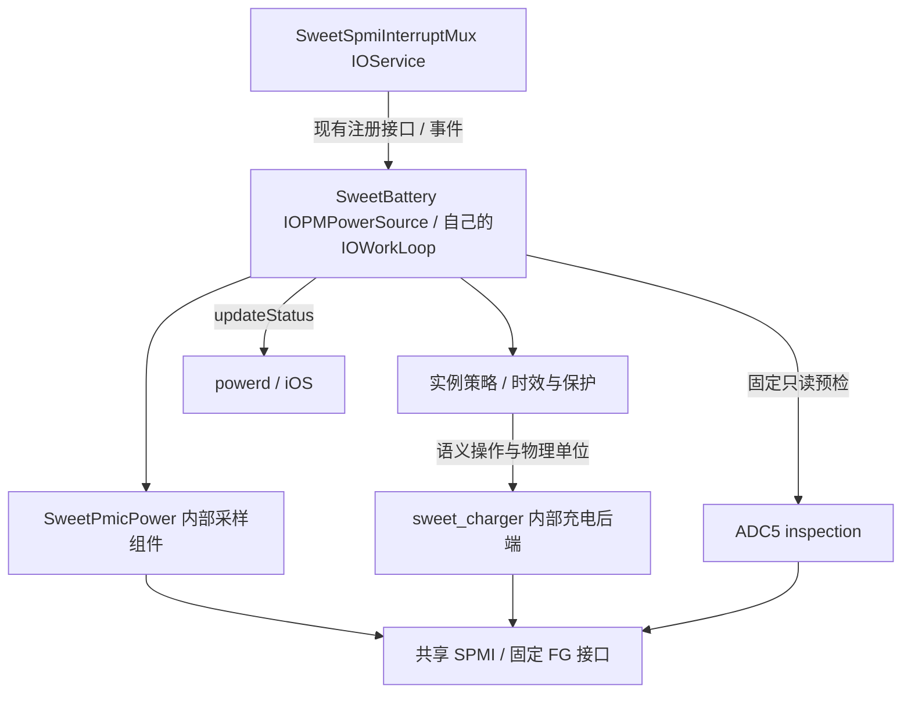

# 电池硬件接口与 ADC5 预检（0154）

2026-11-06，承接0120a2已验证的FG遥测。0154完成本地实现/测试，0120a3云
产物已核对并打包，尚无本轮实机结果。本轮先固定接口边界并取得ADC5访问依据；未完成ADC测量、
电池身份验证、并联控制或watchdog维护，仍不开放受控充电。

## 服务、策略与硬件边界

保留现有IOKit匹配、consumer通知、workloop、停止及IOPMPowerSource发布路径。
没有新增全局服务单例、注册桥接、匹配回调中的重SPMI操作或MMIO映射。
新采样和充电后端是服务内部无状态组件，不是假装已完成的ADC5/SMB1355
IOService。内部函数调用不替代跨服务的provider发现/生命周期协议。

当前没有可直接调用的通用ADC5或SMB1355 I²C provider；底层协议必须由硬件
后端实现。现有SPMI和FG接口可以完成的事务继续复用，控制/采样层不自行
操作控制器窗口。SPMI共享事务锁、observer/RW权限和timeout poison保持不变。
mux继续只负责IRQ路由，不作为充电策略setter。

源文件分工：

| 文件 | 责任 |
| --- | --- |
| `bsd/dev/sweet_battery_runtime.h` | 快照/限制/策略状态、控制顺序与退出；控制接口不接收寄存器地址或掩码 |
| `bsd/dev/sweet_charger.h/.c` | 固定语义操作、mA/mV编码、逐笔期限检查和回读，经现有受限SPMI更新接口 |
| `bsd/dev/sweet_pmic_power.h`、`iokit/Kernel/arm/SweetPmicPower.cpp` | 新runtime的固定PMIC采样、FG读取和换算 |
| `bsd/dev/sweet_adc5.h`、`bsd/dev/sweet_spmi.c` | 固定ADC5只读检查及总线访问归属；不启动转换 |
| `iokit/Kernel/arm/SweetBattery.cpp` | 实例生命周期、调度、记录、策略调用和标准电源属性发布 |

本次迁移的是新runtime采样函数；旧baseline/IRQ采样及历史诊断仍有显式SPMI
调用，不能称整个SweetBattery已经移除所有寄存器知识。它们经已有transport，
后续在兼容模式退役或整理时继续收敛。

## 充电操作契约

`sweet_charger_execute(operation, value, deadline_ns, &verified)`只接受固定操作。
enable/pause/input-suspend使用0/1；ICL/FCC使用mA，暂限50～500mA且50mA步进；
FV使用mV，暂限3600～4200mV且10mV步进；software-input-limit只接受1。
这是当前保守执行器范围，不是已验证的电池额定参数。

策略仍按先禁充、限制输入、配置ICL/模式/FCC/FV、解除暂停/输入挂起、最后
使能的顺序执行。模式操作内部三次稳定配置更新封装在后端，逐笔掩码回读。
每次物理更新之前检查XNU uptime纳秒期限，包含复合操作内部三次更新。
仅安全禁充ENABLE=0可不带期限；过期不会继续使能，策略转入停止流程。
参数无效时没有I/O；失败不更新verified，但不能推断硬件绝无变化。
失败不自动重试或回滚使能；原控制锁继续防止系统停止通知与最后使能竞态。

API仍复用`sweet_spmi_charger_update()`，没有扩大白名单或写权限。watchdog
pet尚未实现，未来应是独立的触发命令接口，不能塞入稳定配置RMW/回读协议。

## ADC5 只读预检

telemetry档新增`sweetbattadcdiag=1`，在电池自己的loop执行一次，早于consumer
注册。它沿用既有charger只读preflight并追加ADC5检查；不是定时扫描或IRQ
回调工作。dry和observe档不新增该参数，三键/USB/触摸和电池IRQ参数保留。

`sweet_spmi_adc5_inspect()`只支持当前PMIC-arb v5，固定SID2/user0x31与cal0x37。
总线未就绪/版本不支持/参数无效时保持输出不变；执行后逐字段返回raw、error、
valid位，局部失败不会伪装成有效零。返回0表示检查已执行，不表示所有字段有效。

| field序号 | 地址 | 含义 |
| --- | --- | --- |
| 0/1 | 0x3104/3105 | type/subtype |
| 2/3 | 0x3108/3109 | status/sequence |
| 4/5 | 0x3142/3143 | digital/average控制 |
| 6/7 | 0x3144/3145 | channel/settle |
| 8/9 | 0x3146/3147 | enable/request |
| 10/11 | 0x3150/3151 | data低/高字节，只作原始诊断 |
| 12 | 0x3744 | calibration delay |

分别报告observer APID、唯一EE0 writer及独立的唯一EE0 IRQ-owner APID/错误。
可读不代表可写；writer归属不代表有IRQ；元数据通过不代表硬件已接受写入。
检查使用现有core/cfg映射和observer通道，不触碰中断窗口、ADC写寄存器、
转换请求或通用读取白名单。共享超时poison规则仍适用。

ADC数据可能陈旧或来自别的通道，明确打印`measurement-valid=0`，不得将其
换算成“本次实测VBUS/电池ID”，不得因此设置inputVerified/batteryVerified。

参考LG目标`qcom-spmi-adc5.c`及PM8150B/板级DTS：BAT_ID使用PU2通道，USBIN
使用除16通道；EOC为SID2/0x31/bit0/rising。实际转换还需所有权、通道/校准、
有界完成及恢复协议；LG USBIN workaround涉及cal0x3744和临时GND转换，不能
仅取3150/3151或照搬另一个板的常数。SMB1355在SE4 I²C0x0c，当前仍缺总线provider。

## 本地验证与下一轮

严格应用0154并验证29个选定文件逐字节一致；58个transport/FG/语义操作/ADC
场景经ASAN/UBSAN通过，无sanitizer诊断；实际runtime策略/采样/发布/停止、
11次物理更新各步失败和过期、100次PM竞态通过。mux全套及80次竞态、共享
SPMI套件及10次并发通过。四个源文件ARM64单文件交叉编译通过；使用既有CI
头文件及Linux Clang兼容处理，含现有头文件/严格诊断警告，不代替原生完整链接。

CircleCI只增加源码门禁：完整门禁接受0154、拒绝0153，实际build.sh调用前缀
逐字节未变；YAML、打包脚本语法、telemetry参数和ADC日志255字节预算检查通过。
本地底稿：`/home/shenli/work1/scratch/battery-interfaces-0120a2/validation-results.json`。

0120a3产物已核对新源码/符号和marker，并用`--battery-runtime`生成同核三档。
镜像与SHA见[BATTERY-RUNTIME-0120-TESTING.md](BATTERY-RUNTIME-0120-TESTING.md)。先测telemetry：稳定约60秒，插拔两轮、
每状态15～30秒，导出持久日志即可；无需先dry或重复旧USB日志实验。
检查HARDWARE v1、ADC5 PREFLIGHT/ROUTE/FIELD、原FG遥测和共享IRQ健康。
若预检失败，按独立observer/writer/IRQ与字段error定位，不试写验证权限。

后续实际ADC provider应有自己的IOService生命周期/workloop，经现有mux
consumer接口接入EOC，初始化在自己的loop，退出同步撤回回调。补齐实际
电池身份/限值、VBUS/输入能力、并联隔离和watchdog保护之后，才进入首次
受控充电及CHGR状态转换验收。0120a2的遥测实机成功不构成0154实机通过。
