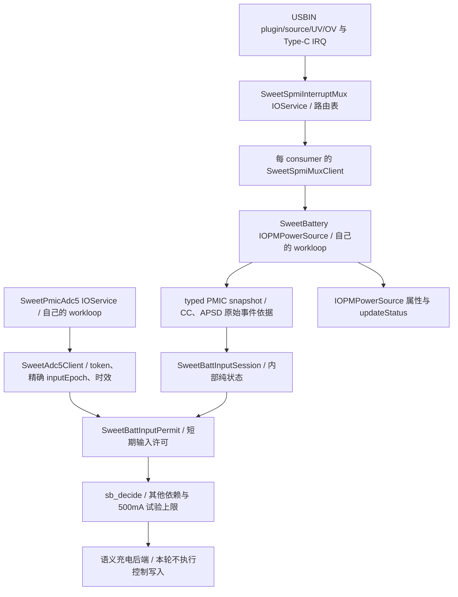

# 输入会话与 VBUS 许可（0163～0164）

**0120a13组合档更新：** id106/108/109仍保留CC原时间戳，但ADC19已在第二
阶段超时，无新VBUS/正permit，长期许可仍未覆盖。组合首bark期待也失败；本批
不再追加同内核测试，先定位ADC时序和首bark启动语义。详见[组合档实测](BATTERY-DEPENDENCY-TESTS.md#0120a13组合档实测启动配置并存运行验收未通过)。

**0120a13-watchdog档补充：** id110/112/113重复source后保留原CC时间戳，但
ADC51已先在第二阶段超时，依然无新VBUS/正permit。长期许可与有效许可内撤销
未验收，不能把bark诊断通过代替输入许可通过。最后组合7仅检查并存/故障撤销，
随后优先修ADC时序，见[watchdog实测](BATTERY-DEPENDENCY-TESTS.md#0120a13-watchdog实测bark维护与有限停止通过)。

**0120a13副路禁止档补充：** id127/128/130/131的CC来源在重复source后保持，
但ADC68已先故障，仍无新VBUS/正permit，长期许可与有效许可内撤销尚未验收。
这次EOC确实由mux投递，consumer以deadline过期拒绝，根因待阶段/锁时间戳取证。
副路输出禁止已通过，下一独立测试watchdog4，详见
[最新实测](BATTERY-DEPENDENCY-TESTS.md#0120a13副路禁止档实测主pmic禁止通过adc收到eoc仍过期)。

**0120a13身份档实测更新：** 身份8次建立/刷新均为profile1、95057Ω、板级
2800mA/4430mV，ADC故障后身份/限值正确撤销。第238次USBIN请求在GROUND
phase2缺首个EOC，provider停止；首次拔线及全部Rp3A分类在故障后，长期输入
许可与有效许可内撤销未覆盖。0164重复source保留原CC时间戳已有两组实证。
下一项用现成battery-inhibit镜像独立取证，无需新编译；ADC缺EOC待定位修复，
组合/正式启充仍未验收。详细时间线与步骤见
[身份档实测](BATTERY-DEPENDENCY-TESTS.md#0120a13身份档实测身份通过adc故障阻断输入许可验收)。
下方打包和待push等段落保留为历史，下一动作以本段为准。

后续同轮增量0165已加入后三项依赖的独立/组合测试，全部runtime1。下一轮
先identity1镜像同时验证本页0164输入修复，不必再单独重跑一个baseline；
原evidence0保留作有目标对照。当前入口和步骤见
[依赖分步测试](BATTERY-DEPENDENCY-TESTS.md)，下方0120a12结论及0164修复边界保持。

2026-11-07最新：0120a12实机确认了同epoch ADC与输入许可的短暂建立、UV路由
交付，但重复source IRQ使来源丢失，长期许可未通过。0164已本地修复并验证，
待用户push和新云产物；不重复0120a12测试，不启充。完整证据与下一动作见文末
[0120a12实测与0164修复](#0120a12实测与0164修复)。以下0163设计保留，排队语义已按0164更正。

## 对象与调用关系

session/permit都是电池loop拥有的内部值类型，不是新IOService、全局单例或
Linux votable。跨服务ADC仍经registry client，mux不接受充电策略setter。
matched/IRQ通知仍只排队；PMIC读取、会话更新、ADC结果消费与策略都在电池loop。
没有新增高层寄存器访问、通用写权限、输入轮询fallback或定时APSD/CC续期。

## 会话和许可分别保证什么

| 类型/接口 | 契约 |
| --- | --- |
| 原 `sb_input_capability()` | 3秒诊断观测保持不变；到期并不改写原CC/APSD事件时间 |
| `SweetBattInputSession` / `sb_input_observe()` | 仅在初始或真实输入IRQ采集后更新；首次建立仍需新鲜、带事件来源的CC或APSD依据；启动残留不能建立许可 |
| 已建立session | 同一已观测USB会话、角色/状态/来源一致时保留；新source事件不会覆盖仍有效的中/高Rp优先级，原来源时间不被保护tick续写 |
| ADC `update(present, inputEpoch, batteryChanged, now)` | 输入采集epoch由SweetBattery提供；改变即撤销USBIN缓存，记录请求时的epoch；不是用bool给旧样本重新贴标签 |
| ADC `copyFreshInput(expectedEpoch, now, out)` | 除原token/通道/内部generation/时效/服务存活检查外，要求请求、已接受结果和当前输入的外部epoch完全相同；0和饱和值拒绝 |
| `SweetBattInputPermit` | 要求上述session有效、同epoch且不早于该输入采集完成的VBUS转换、4.5～5.5V、转换开始至今严格小于3秒；包含来源种类、电流上界、session/epoch/token及明确截止点 |
| `sb_decide()` | 消费typed permit，不再同时要求3秒诊断观测一直新鲜；控制期限取遥测、身份限值和VBUS许可的最早期限；ICL/FCC试验上限仍为500mA |

CC中/高Rp可在APSD未完成、或APSD为FLOAT时建立输入许可；仍要求APSD元数据
可读且一致，以排除已观察到的QC。短期CC诊断仍独立于APSD读取错误，不能将
诊断kind2等同于正式许可。QC状态位（即使尚未DONE）、QC2/3结果、完成后未知
结果、读错、不一致、缺来源、default Rp单独出现、仅SDP/FLOAT/OCP均不授权。
DCP/CDP只能在正常sink和同会话source完成依据下授予首版500mA上界。
Rp3A是输入端的广播能力，不是PD合同，也不表示已经取电3A。

原 `SweetBattLimits.inputVerified/inputMa/vbusMv` 零散字段改为 `input` typed
permit。`batteryVerified/parallelVerified`、电池FCC/FV上界仍由独立依赖提供。
`verifiedNs`代表电池限值时效，失效归 `SB_R_LIMITS`；不再借它给输入续期。
本轮这些依赖未闭合，硬件watchdog状态仍按旧策略检查，不写watchdog配置。

## 撤销、排队竞态和保护路由

输入采集更新后必须重新取得该epoch的VBUS；旧转换即使刚完成且电压正常也不能
继续许可。断线、source角色、Rp/附件错误、水/VCONN故障、USBIN OV/UV、读取
失败或不一致都会使相应会话无法匹配。测量过期、ADC失效/终止/失去READY、
power stopping或service停止立即阻断后续命令；ADC恢复/重绑策略未新增。

`SweetSpmiMuxClient::hasPendingEvents(mask)`是owner-loop上的只读检查：同时
覆盖mux已经排入client、尚未进入电池回调的事件，以及provider离线/不可用。
电池再检查自己的 `fIrqPending`。检查不调用provider gate或SPMI；修补了仅看
电池pending遗漏第一段队列的窗口。采样期间检测到新输入事件时保留一致的来源
历史，两段pending检查暂停许可；等待队列中的输入采集及其新epoch的VBUS。
真实读取变化/错误仍会撤销来源，不能把保留历史当作允许使用旧电压。
每个非禁充语义命令还在原control锁下核对pending、permit期限、ADC服务与同一
epoch/token；安全禁充 `ENABLE=0` 仍可在失效/停止时执行。

新增路由保留原索引，附加在表尾；未新注册GIC，也未改三键/USB/触摸路径：

| PM8150B SID2/PID13 | 路由 | 边沿 | consumer事件 |
| --- | --- | --- | --- |
| bit2 / `0x1310` UV | `battery-usbin-uv` | 双边沿 | `SWEET_BATT_IRQ_INPUT_FAULT=0x80` |
| bit3 / `0x1310` OV | `battery-usbin-ov` | 双边沿 | 同上 |

runtime才订阅这两路；battery mask从7f扩到ff，固定路由表从16扩到18。
沿用唯一IRQ-owned APID发现、已使能位拒绝接管、按位配置/ack/恢复及group隔离；
不硬编码APID269、不越过已有owner检查。路由接入失败会显式撤销电池功能，
不能静默只用VBUS定时测量代替保护IRQ。0120a12已确认两路attach于APID269、
battery mask ff及UV自然交付；OV没有自然命中，尚无完整电压保护实机验收。
UV/OV恢复边沿会采集新输入并撤销旧电压；故障已经清除了来源时，必须由之后的
合格plugin/Type-C/source事件重新建立，不用恢复边沿伪造来源或自动rerun APSD。

已启用控制器失去许可时先禁充。批准ICL变零不再与原硬件ICL比较而虚构永久
hardware fault；其他遥测/硬件故障及有效限值下的超限检查仍保留。
IORegistry是最近一次loop更新的快照，命令每次按实际uptime核对，不依赖属性
恰在截止纳秒变false。这里只能管理已收到的中断和快照，不能排除ABA/合并期间
漏掉的同状态物理插拔；还没有完整PD/DPDM协议、AICL、USBIN collapse/VASHDN
专用恢复、LG OV debounce/UV storm处理或系统深睡恢复验收。

VBUS采样仍由每秒保护monitor维护，USBIN从转换开始满1秒安排下一笔，给3秒
许可留下调度/转换余量；实际间隔受monitor调度影响，不能保证固定周期完成。
迟调度或ADC超时照常到期撤销，不延长许可；这不是轮询USBIN/APSD/Type-C发现
插拔，也不轮询ADC状态替代EOC。BAT_ID的30秒刷新/60秒时效保持不变。

## LG源码依据

工作区 `ref/android_kernel_lge_sm8150`，HEAD `d4f335e13d73c4aa2af85581a6ec11b670ee5b94`：

- `drivers/power/supply/qcom/smb5-lib.c:update_sw_icl_max`（5873附近）：PD独占、QC另管，普通sink中/高Rp优先于BC1.2；不把FLOAT任意提升为500mA。
- 同文件 `smblib_get_prop_typec_mode`、`typec_state_change_irq_handler`、`typec_attach_detach_irq_handler`：角色/附件变化驱动输入更新。
- `arch/arm64/boot/dts/qcom/pm8150b.dtsi:qcom,usb@1300`（250附近）：UV bit2、OV bit3均为 `IRQ_TYPE_EDGE_BOTH`；`smb5-reg.h`给出独立RT_STS位。
- `smb5-lib.c:usbin_uv_irq_handler/usbin_ov_irq_handler`：存在专门保护逻辑。这里只移植事件归属及拒绝条件，没有宣称移植完LG全部恢复机制。

## 本地验证与下一次上机

底稿：工作区 `scratch/battery-input-session/`。基于实际0120a11的33个选定源码
文件，0163严格apply并与edited/verify逐字节一致；原106个源码gate通过。
CircleCI和GitHub XNU workflow均未改，新增打包marker只在本地脚本；0162旧内核
已被 `--battery-evidence` 拒绝，防止误用旧产物。

ASAN/UBSAN：runtime8条PASS（含长期会话、CC优先、BC来源、精确epoch/电压期限、
两段pending队列、命令前ADC失效、撤销与缺依赖无控制写）、ADC client19场景及
100次通知/终止竞态、mux66条PASS（含两条保护路由配置/交付/退出和按键并行）、
transport122条、日志等级1条。SweetBattery、SweetAdc5Client、SweetSpmiMuxClient、
SweetSpmiInterruptMux四个ARM64单文件编译通过；仍有头文件/格式/严格诊断及路由聚合初始化警告。
这不是macOS完整内核链接、真实IRQ时序或设备充电验收；无新CI run ID/设备结果。

用户push并给出新产物后，用原 `--battery-evidence` 打包一个runtime1/IRQ4/
ADCconv0镜像，保留三键、DWC3/触摸IRQ和USB日志。无需baseline或dry档：

1. 电脑启动桌面稳定约15秒，拔线约5秒。
2. 用0120a11同一电源/线材稳定接入45～60秒，确认CC诊断过3秒后新token仍形成许可。
3. 拔线5秒；再接该电源1～2秒后拔线，覆盖短许可期内撤销，随后再次稳定接入15秒并拔线。
4. 确认三键/触摸仍工作；导出持久日志即可。若USB枚举再次失败沿用已知bug记录，不重复USB bring-up。

重点记录：`INPUT SESSION v1`、两条保护路由attach、battery events ff/healthy；
`ADC INPUT v1`的token/外部epoch与 `INPUT PERMIT v1` 一致；`INPUT LEASE v1`
保持原source-ns而voltage-ns/until-ns随新测量变化；拔线/切源先撤销旧许可，旧
token不复用。`SweetBatteryInputVerified/Kind/MaxMA`描述正式输入，旧
`ObservedInputKind`仍是3秒诊断，二者可在稳定接入后不同。正常电脑SDP/default
或debug附件仍可拒绝许可；不要求电脑被授权。OV/UV自然有命中则检查撤销，无
命中不冒充保护实机验收，也不要求制造电压故障。本轮预期无CONTROL/enable，
沿用本机现有enable0时充电仍为0；输入成功后再闭合身份限值、parallel隔离与
watchdog阶段。短接若未建立许可，只算未授权插拔覆盖，不冒充有效许可内的撤销验收。

## 0120a12云产物核对与测试boot

实现提交7b7da93，交接0ab66ae。0120a12的33个选定源码文件与本地0163验证树
逐字节一致，原106个源码gate通过；kernel manifest和新INPUT SESSION/PERMIT/
LEASE、ADC INPUT、USBIN UV/OV及既有CC/APSD/共享mux/三键/USB/触摸/ACM标记齐全。
无新实机结果或CI run ID，本轮未修改驱动/CI、未push或操作设备。

| 项目 | SHA256 |
| --- | --- |
| `xnu-buildtree-0120a12.gz` | `09e47b9329f0d01f0785be6fa2a3ba4c58bdcb03726f3580de30805549db83df` |
| `xnu-kernel-0120a12.gz` | `ad17d450a4773b175f38e66674cc9998cd50cb82978d2b319680783f08824919` |
| 实际kernel | `4402489776e4dfb0eb42ff9247972465269c516fd60cc13c65c2822e36f72ac6` |
| 测试boot | `038b794b93a2747030e43e21346ac0c94c1349abe07a9ce2964a3cf2bfabecdb` |

镜像：工作区 `out-bs/boot-16k-0120a12-battery-evidence.img`，35,667,968字节。
boot header v1，firmware/ramdisk切片与原输入一致，FAT回读kernel/ADT/TOML一致，
参数无重复；runtime1/IRQ4/ADCconv0，USB日志及三键/USB/触摸IRQ保留。底稿
`scratch/artifact-0120a12/`，含源码对比、manifest/marker、打包和boot回读报告。

用户fastboot boot此镜像后按上节单镜像步骤测试，导出
`sweetlog-0120a12-battery-evidence.bin`，持久日志即可。无需baseline或dry；本轮
不启充，重点是长期许可、精确ADC批次、拔线撤销及新增保护路由接入健康。

## 0120a12实测与0164修复

日志 `sweetlog-0120a12-battery-evidence.bin`，SHA256
`d0be98dae2a0f39f7733053f95ecb4259d638f6f5d8df9224bcc691401a9c5c4`。
SWEETLOG v1/4MiB，有效959950字节、flush49、12437行，无回卷/NUL。
底稿 `scratch/artifact-0120a12/`：解码文本、`analyze-log.py`、`log-analysis.json`、
`audit-permits.py`、`permit-verification.json`；设备日志不入git。

约519.191秒、546连续样本（47 IRQ含初始/arm-sync，499保护采样）。45次运行期
IRQ刷新全部healthy，route到publish约89.106～119.658ms。USBIN UV/OV都attach
APID269，battery mask ff；UV自然命中14次，USBIN14、source7、Type-C rid27/
cc15/vbus14/attach12/legacy6、MSOC1。OV、CHGR、VCONN/READY无自然交付证据。
id435/520只有UV事件也能采集并发布断线状态，证明独立路由可用，不能将拔线时
UV当作稳定带电欠压保护验收，也不要求人为制造过压。

ADC434请求/434有效且恢复成功结果/851 EOC，含BAT_ID17与USBIN417；接受424、
因输入epoch改变正确丢弃10（error0）。BAT_ID888581～889749µV，USBIN4548784～
5107264µV；总请求耗时7.503438～205.157344ms。旧第二EOC超时未复现但未修复，
总时长不能代替每阶段deadline取证。47笔profile都match1/integrity13/4027mAh。

**长期许可失败证据：** 只有以下三笔正许可，均kind2/max3000；ADC token、epoch
与电压一一相符。随后source事件把已验证CC来源删掉，并非缺Rp或缺VBUS。

| 正许可样本 / session / epoch / token / mV | 两次source样本 / epoch | 首次source时原CC年龄 | 最后epoch后续新电压结果 |
| --- | --- | --- | --- |
| 217 / 6 / 11 / 170 / 5082 | 219、220 / 12、13 | 1.350070秒 | 163笔，仍未恢复 |
| 429 / 11 / 23 / 342 / 5083 | 431、432 / 24、25 | 1.356721秒 | 2笔，仍未恢复 |
| 450 / 16 / 37 / 349 / 5081 | 452、453 / 38、39 | 1.339414秒 | 66笔，仍未恢复 |

首笔source时原CC tuple仍为USB10/sink02/attached23/misc3b/debug0/legacy4，
coherent1/reasons0且原CC时间仍在，但qualified0、APSD source0。下一笔source
返回APSD21/result10（FLOAT），CC时间已清零。三次拔线id384/435/520都发生于
许可已经撤销之后，不能算有效许可内拔线撤销通过，更不能算>3秒长期许可通过。

### 根因和修正边界

0163的 `SweetBattery::sampleRuntime()` 在采样期间遇到排队输入事件时直接清除
`next.ccFromEvent/apsdFromSource`，之后 `sb_input_observe()` 又清除持久会话。
source IRQ在约100ms采集期间重复进入mux client队列，就会误删一致的CC来源；
下次只有source原因的采集不能重新建立plugin/Type-C来源。保护tick也有同样窗口。
这是前次pending清理过度的实现错误。

0164只改SweetBattery这个环节：保留一致来源，由现有client队列与battery队列
两段pending检查暂停许可；下一次IRQ必须重新采集输入、递增epoch并取得同epoch
新VBUS才能恢复。`sb_note_input`和来源匹配仍撤销真实断线、读错、角色/Rp变化、
QC及OV/UV。新增INFO级 `SWEET BATT INPUT QUEUE: v1` 仅在输入采集时记录pending。
没有放宽来源/电压期限、绕过命令前检查、轮询fallback、自动rerun或新增控制写。
架构仍为GIC→mux IOService→registry client→consumer workloop，按键/USB/触摸未改。

底稿 `scratch/battery-input-queue/`：实际0120a12的33文件作为base，0164严格apply
后与edited/verify逐字节一致，原106源码gate通过。新回归在旧代码上稳定失败于
CC/APSD来源保留断言，修复后ASAN/UBSAN runtime9及mux66条PASS；SweetBattery
ARM64单文件编译通过（有编译警告，非完整内核链接）。测试涵盖实际采样中注入
重复source、保护tick排队、两段pending阻断命令、新epoch必须等待新电压、>3秒
会话和七类真实故障仍撤销；缺其他依赖时无控制写。patch SHA256
`1e4345596ab1f458cb9bc28d2aa16cdb7c2ed894b7e7128078ef7105d1faa697`。
本地打包器要求新marker，实际0120a12旧内核已被拒绝；CI两个配置文件没有修改。
未重复运行未改动的transport/ADC client测试，不将0163历史测试算作本轮重跑。

### 当前下一步

用户push当前main并给出新云产物；核对0164源码与marker后，仍只打包一个原
`--battery-evidence` 镜像（runtime1/IRQ4/ADCconv0，USB日志/三键/USB/触摸IRQ保留）。
不重测0120a12、baseline/dry或ADC正常路径bring-up；沿用上方同一电源/线材的
稳定接入与短接测试，重点是重复source后历史不丢、两段队列清空并取得新epoch
VBUS后许可恢复，>3秒保持原来源时间，并在有效许可期间拔线撤销。

本轮18次IOPMPowerSource发布均updateStatus完成，电量59、charging0，外接标志
随输入改变；未提供屏幕现象，不冒充视觉验收。45笔CONFIG全enable0、无CONTROL，
allow0/owned0；输入短暂成功时策略6c0，否则7c0，watchdog raw62/time8c仍阻断。
身份限值、parallel隔离及watchdog尚未闭合，下一轮同样不启充。日志无ERROR/
panic/mux隔离；电源键、音量加有down/up，音量减无本轮证据；触摸计数39/empty1。
ACM配置成功两次，后段EP0 warning/reset仍保留已知重复枚举问题。
