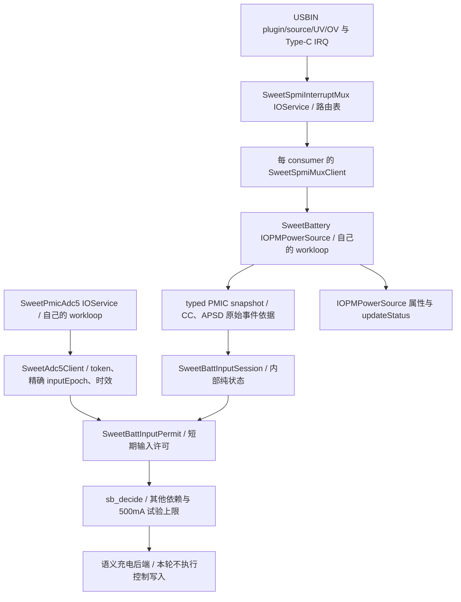

# 输入会话与 VBUS 许可（0163）

2026-11-07。接在0120a11已验证的0162之后，本地实现与验证完成，待用户push、
云编译和实机测试。本轮不启充。0120a11证明了Rp3A分类和正常拔线撤销，尚未证明
长期输入授权；本补丁把这个缺口接到现有策略接口，不重复ADC正常转换bring-up。

## 对象与调用关系

session/permit都是电池loop拥有的内部值类型，不是新IOService、全局单例或
Linux votable。跨服务ADC仍经registry client，mux不接受充电策略setter。
matched/IRQ通知仍只排队；PMIC读取、会话更新、ADC结果消费与策略都在电池loop。
没有新增高层寄存器访问、通用写权限、输入轮询fallback或定时APSD/CC续期。

## 会话和许可分别保证什么

| 类型/接口 | 契约 |
| --- | --- |
| 原 `sb_input_capability()` | 3秒诊断观测保持不变；到期并不改写原CC/APSD事件时间 |
| `SweetBattInputSession` / `sb_input_observe()` | 仅在初始或真实输入IRQ采集后更新；首次建立仍需新鲜、带事件来源的CC或APSD依据；启动残留不能建立许可 |
| 已建立session | 同一已观测USB会话、角色/状态/来源一致时保留；新source事件不会覆盖仍有效的中/高Rp优先级，原来源时间不被保护tick续写 |
| ADC `update(present, inputEpoch, batteryChanged, now)` | 输入采集epoch由SweetBattery提供；改变即撤销USBIN缓存，记录请求时的epoch；不是用bool给旧样本重新贴标签 |
| ADC `copyFreshInput(expectedEpoch, now, out)` | 除原token/通道/内部generation/时效/服务存活检查外，要求请求、已接受结果和当前输入的外部epoch完全相同；0和饱和值拒绝 |
| `SweetBattInputPermit` | 要求上述session有效、同epoch且不早于该输入采集完成的VBUS转换、4.5～5.5V、转换开始至今严格小于3秒；包含来源种类、电流上界、session/epoch/token及明确截止点 |
| `sb_decide()` | 消费typed permit，不再同时要求3秒诊断观测一直新鲜；控制期限取遥测、身份限值和VBUS许可的最早期限；ICL/FCC试验上限仍为500mA |

CC中/高Rp可在APSD未完成、或APSD为FLOAT时建立输入许可；仍要求APSD元数据
可读且一致，以排除已观察到的QC。短期CC诊断仍独立于APSD读取错误，不能将
诊断kind2等同于正式许可。QC状态位（即使尚未DONE）、QC2/3结果、完成后未知
结果、读错、不一致、缺来源、default Rp单独出现、仅SDP/FLOAT/OCP均不授权。
DCP/CDP只能在正常sink和同会话source完成依据下授予首版500mA上界。
Rp3A是输入端的广播能力，不是PD合同，也不表示已经取电3A。

原 `SweetBattLimits.inputVerified/inputMa/vbusMv` 零散字段改为 `input` typed
permit。`batteryVerified/parallelVerified`、电池FCC/FV上界仍由独立依赖提供。
`verifiedNs`代表电池限值时效，失效归 `SB_R_LIMITS`；不再借它给输入续期。
本轮这些依赖未闭合，硬件watchdog状态仍按旧策略检查，不写watchdog配置。

## 撤销、排队竞态和保护路由

输入采集更新后必须重新取得该epoch的VBUS；旧转换即使刚完成且电压正常也不能
继续许可。断线、source角色、Rp/附件错误、水/VCONN故障、USBIN OV/UV、读取
失败或不一致都会使相应会话无法匹配。测量过期、ADC失效/终止/失去READY、
power stopping或service停止立即阻断后续命令；ADC恢复/重绑策略未新增。

`SweetSpmiMuxClient::hasPendingEvents(mask)`是owner-loop上的只读检查：同时
覆盖mux已经排入client、尚未进入电池回调的事件，以及provider离线/不可用。
电池再检查自己的 `fIrqPending`。检查不调用provider gate或SPMI；修补了仅看
电池pending遗漏第一段队列的窗口。采样期间检测到新输入事件时不使用该笔来源；
策略阶段暂时撤销permit但不篡改旧snapshot时间，等待队列里的新采集。
每个非禁充语义命令还在原control锁下核对pending、permit期限、ADC服务与同一
epoch/token；安全禁充 `ENABLE=0` 仍可在失效/停止时执行。

新增路由保留原索引，附加在表尾；未新注册GIC，也未改三键/USB/触摸路径：

| PM8150B SID2/PID13 | 路由 | 边沿 | consumer事件 |
| --- | --- | --- | --- |
| bit2 / `0x1310` UV | `battery-usbin-uv` | 双边沿 | `SWEET_BATT_IRQ_INPUT_FAULT=0x80` |
| bit3 / `0x1310` OV | `battery-usbin-ov` | 双边沿 | 同上 |

runtime才订阅这两路；battery mask从7f扩到ff，固定路由表从16扩到18。
沿用唯一IRQ-owned APID发现、已使能位拒绝接管、按位配置/ack/恢复及group隔离；
不硬编码APID269、不越过已有owner检查。路由接入失败会显式撤销电池功能，
不能静默只用VBUS定时测量代替保护IRQ。实际IRQ归属/使能状态仍待新镜像验证。
UV/OV恢复边沿会采集新输入并撤销旧电压；故障已经清除了来源时，必须由之后的
合格plugin/Type-C/source事件重新建立，不用恢复边沿伪造来源或自动rerun APSD。

已启用控制器失去许可时先禁充。批准ICL变零不再与原硬件ICL比较而虚构永久
hardware fault；其他遥测/硬件故障及有效限值下的超限检查仍保留。
IORegistry是最近一次loop更新的快照，命令每次按实际uptime核对，不依赖属性
恰在截止纳秒变false。这里只能管理已收到的中断和快照，不能排除ABA/合并期间
漏掉的同状态物理插拔；还没有完整PD/DPDM协议、AICL、USBIN collapse/VASHDN
专用恢复、LG OV debounce/UV storm处理或系统深睡恢复验收。

VBUS采样仍由每秒保护monitor维护，USBIN从转换开始满1秒安排下一笔，给3秒
许可留下调度/转换余量；实际间隔受monitor调度影响，不能保证固定周期完成。
迟调度或ADC超时照常到期撤销，不延长许可；这不是轮询USBIN/APSD/Type-C发现
插拔，也不轮询ADC状态替代EOC。BAT_ID的30秒刷新/60秒时效保持不变。

## LG源码依据

工作区 `ref/android_kernel_lge_sm8150`，HEAD `d4f335e13d73c4aa2af85581a6ec11b670ee5b94`：

- `drivers/power/supply/qcom/smb5-lib.c:update_sw_icl_max`（5873附近）：PD独占、QC另管，普通sink中/高Rp优先于BC1.2；不把FLOAT任意提升为500mA。
- 同文件 `smblib_get_prop_typec_mode`、`typec_state_change_irq_handler`、`typec_attach_detach_irq_handler`：角色/附件变化驱动输入更新。
- `arch/arm64/boot/dts/qcom/pm8150b.dtsi:qcom,usb@1300`（250附近）：UV bit2、OV bit3均为 `IRQ_TYPE_EDGE_BOTH`；`smb5-reg.h`给出独立RT_STS位。
- `smb5-lib.c:usbin_uv_irq_handler/usbin_ov_irq_handler`：存在专门保护逻辑。这里只移植事件归属及拒绝条件，没有宣称移植完LG全部恢复机制。

## 本地验证与下一次上机

底稿：工作区 `scratch/battery-input-session/`。基于实际0120a11的33个选定源码
文件，0163严格apply并与edited/verify逐字节一致；原106个源码gate通过。
CircleCI和GitHub XNU workflow均未改，新增打包marker只在本地脚本；0162旧内核
已被 `--battery-evidence` 拒绝，防止误用旧产物。

ASAN/UBSAN：runtime8条PASS（含长期会话、CC优先、BC来源、精确epoch/电压期限、
两段pending队列、命令前ADC失效、撤销与缺依赖无控制写）、ADC client19场景及
100次通知/终止竞态、mux66条PASS（含两条保护路由配置/交付/退出和按键并行）、
transport122条、日志等级1条。SweetBattery、SweetAdc5Client、SweetSpmiMuxClient、
SweetSpmiInterruptMux四个ARM64单文件编译通过；仍有头文件/格式/严格诊断及路由聚合初始化警告。
这不是macOS完整内核链接、真实IRQ时序或设备充电验收；无新CI run ID/设备结果。

用户push并给出新产物后，用原 `--battery-evidence` 打包一个runtime1/IRQ4/
ADCconv0镜像，保留三键、DWC3/触摸IRQ和USB日志。无需baseline或dry档：

1. 电脑启动桌面稳定约15秒，拔线约5秒。
2. 用0120a11同一电源/线材稳定接入45～60秒，确认CC诊断过3秒后新token仍形成许可。
3. 拔线5秒；再接该电源1～2秒后拔线，覆盖短许可期内撤销，随后再次稳定接入15秒并拔线。
4. 确认三键/触摸仍工作；导出持久日志即可。若USB枚举再次失败沿用已知bug记录，不重复USB bring-up。

重点记录：`INPUT SESSION v1`、两条保护路由attach、battery events ff/healthy；
`ADC INPUT v1`的token/外部epoch与 `INPUT PERMIT v1` 一致；`INPUT LEASE v1`
保持原source-ns而voltage-ns/until-ns随新测量变化；拔线/切源先撤销旧许可，旧
token不复用。`SweetBatteryInputVerified/Kind/MaxMA`描述正式输入，旧
`ObservedInputKind`仍是3秒诊断，二者可在稳定接入后不同。正常电脑SDP/default
或debug附件仍可拒绝许可；不要求电脑被授权。OV/UV自然有命中则检查撤销，无
命中不冒充保护实机验收，也不要求制造电压故障。本轮预期无CONTROL/enable，
沿用本机现有enable0时充电仍为0；输入成功后再闭合身份限值、parallel隔离与
watchdog阶段。短接若未建立许可，只算未授权插拔覆盖，不冒充有效许可内的撤销验收。
