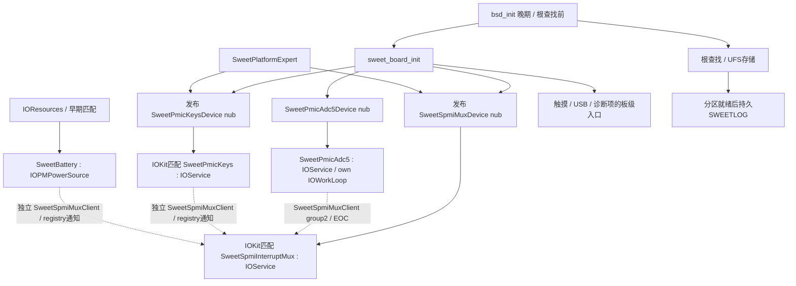
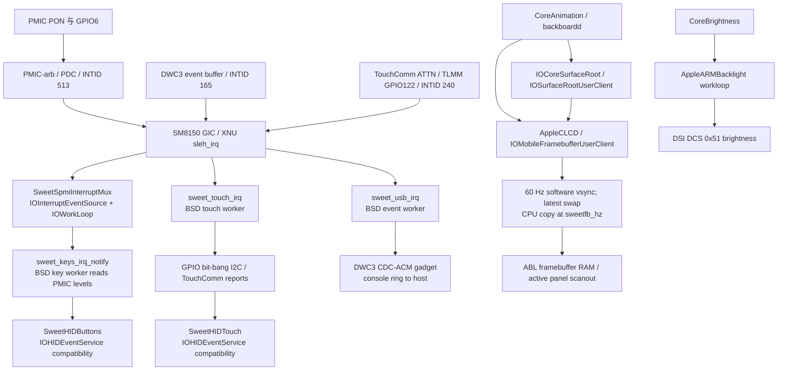
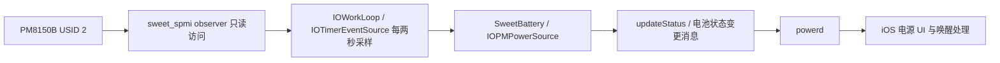

# MH2LM 当前 USB、按键、屏幕与电池驱动架构

**0193当前增量（本地通过，未实机）：** 已补`SweetTouchPanel : IOService`及MDSS真实
匹配绑定，typed暂停/恢复交给原唯一TouchComm worker；消费者不穿透读写寄存器。
暂停fence要求peripheral/GIC禁用读回、active退出和HID触点释放；parked worker/晚IRQ无硬件I/O。
恢复复用实际识别/app/格式读回再arm；无touch reset/电源/固件写入，无轮询回退。
C后端是无实例指针/回调的原子mailbox，未把整个触摸驱动转换成IOService；stop取消是异步收尾，
不伪造硬件静止证明。默认关闭，MDSS本批仍仅绑定，未实际调用pause/reset/完整ONOFF。
14套本地检查、arm64单文件对象和严格重放通过。详见[触摸协调实现与边界](PANEL-TOUCH-D1.md)。
下一步接统一生命周期事务及已确认panel profile；E1与E7实机共享供电证据仍缺，完整驱动未完成。
以下旧段落按当时范围保留，当前以0193及NOTES顶部为准；暂不要求push/刷机，CircleCI未改。

**0192当前增量（本地通过，未实机）：** 已补独立`SweetPanelPins : IOService`及MDSS真实
registry匹配绑定，管理GPIO6/SOUTH reset与GPIO8/NORTH TE。typed请求在provider workloop/
gate/timer执行，分别确认输出latch与实际输入，reset最短10/2/10/5ms；支持park后低保持重激活。
默认关闭，MDSS本批仅绑定，不调用activate/reset/park；实际启动尚未复位面板。
13套本地检查及arm64单文件对象通过，严格重放和114个原CI marker通过；CircleCI未改。
详见[引脚服务架构、时序与边界](PANEL-PINS-D1.md)。PD3仍需实际panel身份、触摸协调、
完整vendor ON/OFF及资源反向释放，整屏冷初始化/ABL退出未完成。继续完整驱动优先，暂不要求push/刷机。
以下旧段落按当时范围保留，当前以0192及NOTES顶部为准。

**0191当前增量（本地通过，未实机）：** 实际 managed 接管已在资源完成后、host 重建前，
加入 PHY v4.0 / PLL 7nm-v2 复位重配和 BYTE/PCLK 时钟重建。沿原 MDSS owner/gate/DSI timer，
显式 `sweetdsilink=2` 要求 host1/core2/managed1；默认0保留0190行为。
先分别确认分支/root 停稳、旧 lock 清除，再配 PHY/分数频率/SSC/分频；新 lock、RCG 更新和
实际运行分别确认，最终仍需 host 重建及 fresh 像素完成。12套本地检查和arm64对象编译通过。
profile 为 LG 板级选择，原始 revision byte 记录不当作自动识别；尚无新实机写入证据。
面板 reset/vendor ON/OFF、反向释放、整屏冷启动及 ABL 退出仍缺，完整驱动未完成。
详见[PHY/PLL/输出时钟实现与验证](PANEL-LINK-D1.md)。下一步面板生命周期/独立重建，
完整驱动优先、之后零拷贝；暂不单独要求 push/刷机，A单缓冲/30Hz拷贝限制不变。
以下0190及更早段落按当时范围保留，当前以0191及NOTES顶部为准。

**0190当前增量（本地通过，未实机）：** 实际 managed 扫描接管在 NoC/DSI0 lease 完成后，
接入 host v2.3 软复位和明确的 RGB888 command-mode 配置重建，再继续原自有 A/fresh 像素完成。
复用 MDSS 唯一 owner/gate/DSI timer；默认关闭，显式 `sweetdsihost=1` 要求 managed1/core2
及原依赖。失败保留资源/部分状态、关闭后续写入，无自动恢复旧配置。PHY/PLL 仍继承，
未发送 vendor 表或操作面板 reset；没有整屏冷启动/独立重建证据，完整驱动仍未完成。
详见[host实现与验证](PANEL-HOST-D1.md)。下一步补 PHY/PLL 和完整面板生命周期；
完整驱动优先、之后零拷贝，暂不单独要求 push/刷机，旧性能限制不变。
以下旧段落按当时范围保留，当前增量以0190为准。

**0189当前增量（本地通过，未实机）：** 显式 core profile2 已将 GDSC 软件票、两颗核心
PLL、AHB75MHz/MDP460MHz 的配置与完成检查接到实际 managed 扫描资源链，复用 MDSS
唯一 owner/gate/clock timer；先实际 ARC/CN0 ACK，失败保票并关闭写入。工作 PLL 保留，
关闭 PLL 才初始化；不改 DSI PHY/PCLK/BYTE。冷态核心引擎已做组件测试，但真实 start 仍为
温态入口，尚无整屏冷启动/完整断电恢复或撤票。详见[核心资源控制](PANEL-CORE-D1.md)。
默认关闭，无新刷机轮次，继续补 DSI host/PHY/PLL 和面板完整 ON/OFF；D1 未整体完成。
以下旧段落按当时范围保留，当前增量以0189为准。

**0188当前显示进度（本地验证通过，未实机投票）：** 已把四路LDO、ARC、CN0/display NoC与
本地clock事务接到实际自有扫描接管，显式managed模式在暂停/idle后顺序获取资源，全部完成
才pin/提交A，并继续要求fresh传输完成。部分失败保留票并关闭写入，不自动恢复旧流。
默认关闭，DCS OFF暂不撤票；冷GDSC/时钟父源、PHY/PLL/host及完整面板ON/OFF仍缺，D1未完成。
见[资源获取与失败边界](PANEL-MANAGED-D1.md)、[NoC](PANEL-NOC-D1.md)、[ARC](PANEL-ARC-D1.md)。
下一段补冷域/时钟/链路，再完成资源反向释放及独立重建；暂不单独要求push或刷机。
下列0185/0184段落保留各自历史范围，当前增量以上述0188为准。

**0185本地时钟增量（本地验证通过，未实机启用）：** SweetMDSS内部已加入typed本地分支lease、
共享引用、token、timer完成/超时和停止保护；温态校验继承GDSC，默认关闭。
仅对已确认XO父源的关闭分支支持恢复/撤回，既有enable不关；没有MMCX/NoC票、GDSC冷上下电、
PLL/PHY/host初始化，不能验收完整D1。另修复OFF跨呈现间隔统计，pending年龄保留。
实现与本地验证见[时钟记录](PANEL-CLOCK-D1.md)；继续合并上游依赖/链路，不单独要求push或刷机。

**0184资源层增量（本地通过，0121a13实机元数据/绑定通过，未测投票）：** 已新增真实匹配的SweetRPMh IOService、唯一
MH2LM apps-DRV writer、有界timer完成与typed consumer投票；MDSS自己的workloop绑定/查询，
没有匹配回调初始化、全局C实例桥或自动电源写入。v1 ADT扩完整DISPCC并追加单一PHY/PLL窗口，
所有权归MDSS；实际clock/GDSC获取、MMCX/NoC、PHY/PLL/host与面板完整初始化仍缺。
见[资源层实现、释放规则与验证](PANEL-POWER-D1.md)及[0121a13实测](PANEL-D1-0121A13.md)。
本轮自有A接管/息屏唤醒通过，用户反馈滑动改善、无新增异常；D1未整体完成，继续下一驱动段。

**2026-11-10优先级调整：用户要求完整面板驱动优先，随后零拷贝。** 不再以拷贝双缓冲、
60Hz CPU拷贝或完整F4性能收口作为PD2/PD3前置。共用DMA停止/完成与生命周期保护仍保留，
随资源、DSI/PHY/PLL和面板初始化实现一起推进；F4拷贝双缓冲改为兼容路径按需。
0121a12已被用户明确反馈滑动卡顿明显加重，只有接管/唤醒日志通过，不作体验验收。
具体D1–D4批次和合并计时项见[更新后的驱动交付顺序](PANEL-FULL-DRIVER-PLAN.md#7-加速后的交付批次与性能回归)。
0183已实现D1的typed命令编码、完整长包传输、可撤销序列及可选计时，
见[代码架构与验证](PANEL-COMMAND-D1.md)；没有自动发送vendor表，完整资源/链路初始化未完成。

**2026-11-10计划边界更新：** 用户要求最终完整接管面板，新增
[PD0–PD5子计划](PANEL-FULL-DRIVER-PLAN.md)，先脱离ABL缓冲，再完成独立初始化/断电恢复。
这是后续设计要求，不表示下述当前驱动已具备这些能力。
PD0[静态清单](PANEL-RESOURCES-PD0.md)已核对现有DCS接口仅支持64-byte编码数据、
旧RPMh helper不具备面板lease及多consumer投票；不能把现有接口视为完整初始化能力。

**F4第二段0182（0121a12接管及OFF/ON日志通过，用户已报告滑动卡顿加重，其它视觉项未单独确认）：** AppleCLCD通过typed
`beginScanout/scanoutStatus/abandonScanout`请求SweetMDSS执行一次own2受控接管。
provider在已有workloop/gate中用有时限timer暂停TE/auto、确认空闲、提交A并观察新传输；
consumer查询成功后CPU目标切A，MMIO仍归provider，无反向同步回调。
默认own0和own1语义不变，仍30Hz原地更新；独立硬件引用令提交池跨服务终止保留至重启。
安全回收、双缓冲、SwapWait及无ABL首帧/console/panic待后续补齐；详见
[架构、生命周期及测试](FRAMEBUFFER-HANDOFF-F4.md)。本段未改USB/按键/电池/触摸/mux或CI。

**F4首段0181（0121a11已实测通过）：** AppleCLCD可选持有`SweetScanoutPool`，通过
标准IOBufferMemoryDescriptor申请两个连续低32位缓冲；显式像素写入前排除与整个ABL保留区
重叠，随后初始化并复制已有面板矩形。新增typed `inspectScanout()`由SweetMDSS在自己的gate
只读已有ADT资源，帧事件最多触发四份快照，无新timer/单例/consumer MMIO。own0默认关闭。
own1仍扫描ABL、CPU30Hz；此阶段未实现地址接管、双缓冲翻页或新SwapWait。原计划误把
`ADDR_SW_STATUS`当作地址生效状态，现已按LG `setup_secure()`纠正为安全属性，不能作fence。
详见[F4实施记录](FRAMEBUFFER-SCANOUT-F4.md)。不涉及USB/按键/电池/触摸源码改动。

**当前显示架构实测（2026-11-10）：** 0121a11完整硬件档验证了
GIC115 → SweetMDSS软件IES/workloop → typed SweetVsyncChannel mailbox → AppleCLCD自己的IES/gate。
FB首真实帧后切硬件vsync，60Hz软件通知timer降为100ms watchdog；OFF停IRQ/通知，ON恢复硬件消费。
十个完整窗59.874–59.915Hz，无显式回退，用户未发现异常，F3正常使用路径验收通过。
仅`sweetmdssirq=2 sweetfbvsync=1`等完整档参数启用此链；默认irq0/vsync0仍走软件通知。
CPU拷贝仍限30Hz、扫描仍用ABL缓冲，无自有双缓冲/硬件翻页；这些留给下一步F4。
真实provider终止/重匹配未全部上机覆盖，详见[F3第12节](FRAMEBUFFER-VSYNC-F3.md#12-0121a11完整硬件档f3正常使用路径验收通过)。

以下0179及更早架构描述按当时状态保留，当前显示增量以上段为准。

**0180实现时进度（2026-11-09）：** 实际MDSS GIC115/RD_PTR IRQ及typed硬件vsync已实现、
通过本地arm64对象编译与ASan/UBSan验证，待云编译及实机验收。新行为默认关闭；完整档首次
真实帧后切硬件vsync、OFF停通知、失败明确回退软件。一次编译可分GIC/RD_PTR/完整档测试，
见[F3实现与测试](FRAMEBUFFER-VSYNC-F3.md#8-0180真实-irq-和硬件-vsync本地验证待实机)。
以下0179及更早描述保留对应阶段边界；不表示0180尚未实现，也不提前认定F3验收通过。

**0121a10实测补充：** 0179只读预检通过，GICv3/INTID115当前禁用且level，INTF1 TE RD_PTR锁存但未使能；用户确认无新增问题。实际MDSS IRQ handler/typed vsync订阅尚未实现，软件timer仍为现行路径；下一步接入真实IRQ。见[F3实测](FRAMEBUFFER-VSYNC-F3.md#7-0121a10-完整只读档实测预检通过)。

**2026-11-09 / 0179补充：** F3新增默认关闭的SweetMDSS IRQ只读预检：provider追加ADT资源，独立timer在30/31/32秒取样，与亮度/电源共享workloop gate；缺资源仅停预检。软件vsync仍为现行路径，尚无MDSS IRQ handler或订阅。见[F3记录](FRAMEBUFFER-VSYNC-F3.md)。

**F2 / 0177（0121a9基础开关屏已验证）：** selector12经AppleCLCD gate，用consumer持有的typed
`SweetDisplayBackend::setPanelPower(on)`请求SweetMDSS；provider自己的gate串行28/29、
亮度及stop admission，consumer不操作MMIO。sweetfbpower默认0，要求service1/mdss1，
强制保留扫描像素；失败单独降级面板电源实验，UNKNOWN仍允许ON恢复，不影响按键/USB。
不等同完整系统睡眠/面板断电；0121a9基础与长时电源键唤醒均通过，用户确认显示/亮度/
触摸正常。完整插拔次数覆盖未补齐，电池组隔离后的充电唤醒段无效；详见[F2架构与实测边界](FRAMEBUFFER-POWER-F2.md)。

**低功耗核对（0121a9长测）：** 息屏前91%→最后78%，息屏段采样跨度约80分钟，平均
净放电约311mA/1.28W（离散采样积分估算）。CPU quiesce/halt-suspend接口仍panic；显示仅
28/29、未做面板sleep/电源域管理，framebuffer OFF仍60Hz定时通知；USB/触摸/UFS尚无
完整设备suspend/resume。按键/触摸/USB线程IRQ等待不是硬件休眠；电池有WillSleep通知
但不能使系统进入睡眠。符合当前低功耗缺失的开发状态，未达到手机待机水平。
源码、数据、后台重复启动及待核实项见[低功耗核对](POWER-MANAGEMENT-AUDIT-0121A9.md)。

**显示0175/0176增量：** F1a资源与背光服务迁移已由0121a5/0121a6正常运行路径实测收口，
SweetMDSS通过ADT映射并在自己的gate里执行原探针/DCS，背光持有独立registry consumer。
0176新增可选AppleCLCD registry consumer、用户接口IOExternalMethodDispatch检查，以及
共享状态的IOWorkLoop/IOCommandGate管理；0121a7正常运行路径实测验收通过，sweetfbservice
默认仍0。F1分层正常使用范围收口；真实provider终止/重匹配仍未上机核验。架构和边界见[F1b](FRAMEBUFFER-SERVICE-F1B.md)。
像素/软件vsync/关屏策略沿用原行为；USB/电池/按键未改，已知bug独立跟踪。

**0168当前充电路径（0120a17实机通过）：** `sweetbattruntime=3`时SweetBattery在自己的
workloop上，由mux电池IRQ（USB/CHG/MSOC/READY/SOURCE/FAULT/TYPEC/INPUT_FAULT/WDOG）
或LG battemp周期定时器（60/30/10s，每次IRQ重置）触发：快照→`sweet_charge_basic.h`
纯策略→`sweet_charger.c`语义命令（逐条回读）→IOPM发布。不建ADC5 client，不依赖
身份/许可/租约。PMIC负责APSD/AICL/CC/CV/截止；软件设FCC2000/FV4400、拉低SMB_EN、
配WD并只在bark IRQ喂狗、按LG温度表降流/停充。硬件JEITA补偿保持关闭（同LG）。
详见[BATTERY-BASIC-CHARGE.md](BATTERY-BASIC-CHARGE.md)。下方0165及更早为历史。

**0165最新增量（本地完成，待push/实机）：** SweetBattery自己的loop可选择执行
身份交叉验证、主PMIC副路禁止和有限watchdog配置/bark IRQ维护。后两项经语义
后端与共享transport，pulse有独立固定API；mux表19路/3组，默认battery订阅仍ff，
watchdog档才1ff。不新增GIC callback或服务单例；三键/DWC3/触摸/显示路径保持。
身份可提供板级限值，外部SMB1355隔离和最终watchdog授权仍缺；所有新档runtime1
不启充。架构图、接口与分档见[依赖分步测试](BATTERY-DEPENDENCY-TESTS.md)。
下方0163的18路和“身份未实现”按当时状态保留，以此段为准。

**0163～0164当前增量：** 0120a12已实测取得短许可，ADC同epoch检查与UV自然
交付正常，重复source IRQ误删来源使长期许可失败。0164已本地修复，待push/
新云产物：保留一致来源历史，pending阻断许可，新采集及新epoch VBUS后恢复。
不放宽真实故障撤销条件，不改变服务边界。SweetBattery内部新增输入
session/permit值类型，按输入IRQ更新CC/APSD来源，经已有SweetAdc5Client取得
精确inputEpoch的VBUS，形成3秒短许可并交给纯策略；不是另一个IOService或全局
桥接。mux表目前18路/3组，新增USBIN UV/OV双边沿；client可检查尚未送到电池
回调的pending。按键、DWC3/触摸和显示路径保持。身份限值、并联隔离与watchdog
仍未闭合，不启充。当前输入架构/边界见[输入会话](BATTERY-INPUT-SESSION.md)。

下文0154～0156/0119段落按当时基线保留，旧“10项/结果不授权任何输入”应以
上方0163增量和NOTES最新交接为准。

0120a5补充：0156的ADC5测量consumer正常路径已实测通过。约24分半、657次
转换/1266次EOC；655个结果被接受，2个因插拔/识别改变epoch正确丢弃，无ADC
超时/ERROR/panic。电池身份、输入能力、并联隔离和watchdog仍缺，充电仍互锁。
详细计数、范围与验收边界见[ADC5 consumer实机结果](BATTERY-ADC5-CONSUMER.md#0120a5-实机结果持续测量与插拔正常路径通过)。

0156实现（现已由0120a5验证正常路径）：SweetBattery 已通过每consumer的
SweetAdc5Client 订阅 ADC5 IOService，自己的workloop发起请求并验证token、
source epoch与时效；插拔撤销旧VBUS，保护monitor维护电压测量，退出同步清理。
没有设置充电授权，身份/输入能力/并联隔离/watchdog仍缺。
接口、时序和下一轮步骤见[ADC5 consumer](BATTERY-ADC5-CONSUMER.md)。

0120a4补充：0155 ADC5 provider实机已得到BAT_ID 889684uV、USBIN 4831136uV，
三次EOC及配置恢复成功，无ADC错误；下一步接入测量provider并核对充电证据。
充电仍互锁，不能把转换成功等同于真实充电。详细数据和回归边界见
[ADC5实机结果](BATTERY-ADC5-PROVIDER.md#0120a4-实机结果转换链路通过)。

## 0155 ADC5 provider（0120a4正常转换已实测）

板级新增专用nub匹配独立 `SweetPmicAdc5` 服务，自己的workloop/timer通过
registry client接mux group2 EOC；默认空闲；typed client 或显式诊断参数可启动转换。
真实ADC转换与恢复在0120a4正常完成，结果尚未接入充电授权。详见
[ADC5 provider](BATTERY-ADC5-PROVIDER.md)。

## 0154电池接口更新（0120a3实机预检及采样回归通过）

0120a2已验证FG初次DMA恢复及温度/容量遥测；0154进一步保持现有电池
IOPMPowerSource自己的workloop，拆出内部PMIC采样组件与语义充电后端。
策略提交mA/mV等操作，后端复用共享SPMI/FG接口；没有另造单例或把普通
内部组件伪装成已经完成的IOService provider。新增 ADC5 只读预检及默认空闲的 ADC5 转换 provider；SMB1355 总线 provider、
真实电池身份/输入能力与 watchdog 维护仍缺。USB/按键/触摸路径未改。
新边界图、API、历史诊断残留和测试状态见
[BATTERY-HARDWARE-INTERFACES.md](BATTERY-HARDWARE-INTERFACES.md)。

## 当前代码架构：0119基线加0151～0156

2026-11-05核对0119最终源码。当前采用 **IOKit服务匹配/生命周期 + 板级GIC
分派 + 各设备下半部**，不是完整的通用GIC/总线provider树。0119各测试镜像
使用同一内核，电池mode2/3/4只改变所订阅事件；以下架构不因换档位重建。
旧阶段说明从下一节开始保留，不能把其中“仍为C桥接”“仅按键consumer”或
“电池固定两秒轮询”视为0119 IRQ档现状。

### 启动与服务归属

图中实线表示启动/发布关系，虚线表示服务发现，不表示consumer挂在mux下成为
子设备。mux、按键和 ADC5 各自有专用 nub 及匹配服务；电池仍由IOResources匹配。
UFS只保留存储及依赖分区的持久日志，不能再把mux或兄弟外设的初始化放回UFS。
关闭按键不会阻止mux/电池启动。USB ACM使用内存console ring，不等待持久线程。

每个按键/电池/ADC5 consumer持有自己的 `SweetSpmiMuxClient`。matched通知只retain、
记录和排队；自己的workloop再prepare（按键）及调用mux公开C++
`attachConsumer()`。mux在自己的gate串行配置路由，成功后consumer才进入READY。
没有全局C单例查询桥接，也没有 `waitForService()` 或定时重试发现服务。
terminated通知只标记离线并排队，detach同步与引用释放在consumer loop执行；
stop/free先停止事件并同步回调，再释放线程/MMIO。真实手机终止路径仍未验收。

### 运行期路径

| 部件 | 0119实际数据流与资源归属 |
| --- | --- |
| 共享PMIC中断 | PMIC-arb/PDC → GIC INTID513 → 短callback屏蔽SPI并排队 → mux软件IOInterruptEventSource/IOWorkLoop扫描路由、确认/清除中断 → 通知consumer自己的loop。mux实例拥有路由状态、绑定、MMIO和workloop。 |
| 按键 | mux group0 → 按键consumer loop → 唤醒原C后端worker读取真实键电平 → SweetHIDButtons → backboardd。SweetPmicKeys拥有连接、workloop和后端退出流程。 |
| 电池 | mux group1 → 电池consumer loop/软件IES → 真实gauge/USB/CHGR采样 → IOPMPowerSource属性与updateStatus → powerd及iOS电源UI。驱动不直接调用SpringBoard画图标。 |
| ADC5 | 专用 `SweetPmicAdc5Device` → `SweetPmicAdc5` 自有 workloop/timer → mux group2 EOC → 固定 BAT_ID/USBIN 转换与恢复。默认空闲，结果不授权充电。 |
| USB | GIC INTID165 → 短callback → BSD事件worker处理DWC3 event buffer、EP0及CDC-ACM，确认后重开IRQ；独立日志发送线程由日志/配置/TX完成事件唤醒。仍是板级gadget，没有通用IOKit USB provider栈。 |
| 触摸 | TLMM GPIO122 / INTID240 → 短callback → BSD触摸worker → GPIO模拟I²C读取TouchComm → SweetHIDTouch → backboardd。仍无独立通用I²C/GPIO provider。 |
| 显示 | CoreAnimation软件渲染 → 本项目IOSurface/IOMobileFramebuffer兼容接口 → AppleCLCD定时模拟vsync与CPU图层复制 → ABL已配置的framebuffer/面板扫描。0119参数sweetfb_hz30；未接管完整MDSS/GPU呈现。 |
| 背光 | CoreBrightness → AppleARMBacklight自己的workloop/fade定时器 → DSI DCS0x51。亮度写入仍有有界硬件状态等待，不是显示IRQ改造。 |

USB连接生命周期补充：这里的gadget指手机作为USB设备向电脑提供CDC-ACM功能，
不是额外的Linux gadget/configfs框架。驱动直接操作DWC3、提供descriptor及
EP0/数据端点，电脑的CDC-ACM驱动再创建ttyACM设备节点，并非物理UART直通。
0119 sweetusb2在启动时默认延迟15秒后初始化一次，不等待PMIC插线事件；
sweetvbus1在QSCRATCH置UTMI_OTG_VBUS_VALID/SW_SESSVLD_SEL，随后RUN_STOP启动。
本版没有将电池USBIN事件接到DWC3启停/override撤销，也没有拔线后runtime suspend。
设备线程空闲时等待IRQ，不是持续扫描；初始化/运行状态与主机完成枚举是两回事。
ud_event处理reset/connect/disconnect，但disconnect分支目前只打印，没有清
configured/dtr/tx_busy或停止控制器；reset分支才清这些状态。该缺口可能与既有
重连问题有关，尚未证明是重连失败或当前禁充的原因。本次只记录，不修改驱动。

上游仍使用板级 `sleh_irq` 分派与直接GIC寄存器管理，没有GIC
`IOInterruptController` provider。mux采用普通软件IES，**未改成
IOFilterInterruptEventSource**。其保留的受锁GIC服务槽仅用于物理投递，不用于
consumer发现。IOService身份并不自动赋予通用中断控制器能力。

路由现在是 **十项固定硬件描述、三个consumer group**：三键、电池的
USBIN/CHGR/MSOC_DELTA/SOC_READY/FAULT，以及 ADC5 EOC；不是硬编码功能switch。attach/detach注册的是消费者身份、
事件mask和回调，尚不接受任意新外设的动态路由描述。未来扩展provider时应保留
consumer接口，另行抽出硬件描述和上游中断注册。

### 事务、事件与故障边界

- SPMI由底层controller级IOLock保护每笔命令提交、完成等待和数据读取；按键、
  电池observer与mux IRQ配置共用同一锁。mux gate串行路由接入/撤回，consumer
  独立计算可并行。不是所有读取必须调用mux实例的spmiRead/spmiWrite；公共
  transport在自己的API内部加锁，早期电池采样无需等待mux服务。
- 按键、USB、触摸固定IRQ，无静默轮询回退。电池mode2+停止两秒扫描，保留
  初始采样、arm-sync以及必要时一次有界确认；mode0/1仍是显式对照轮询档。
  framebuffer/fade定时器与硬件输入轮询是不同用途，并未被本轮IRQ化删除。
- attach回滚/detach清理失败优先验证隔离单个group/APID；验证失败或共享硬件
  故障仍停整个mux，可能同时影响按键和电池。运行期ack耗尽、未知pending、
  storm等并未全部改成单组隔离。USB/触摸有各自显式故障停止路径。
- Sweet驱动日志ERROR始终输出，WARN/INFO/DEBUG按sweetloglevel阈值控制；默认
  INFO。尚未统一整个XNU/userland日志，也未完成按目标独立开关的大计划。

电池当前属于真实状态采集与标准IOPM发布，**充电策略尚未接管**：充电仍依赖
继承的固件/PMIC配置。IRQ配置会写中断寄存器，但没有因此实现限流、温控、
profile/SRAM管理或完整遥测；固定容量/部分占位字段等缺口见下方历史电池说明。
屏幕仍有完整图层状态、息屏后重绘及真实呈现时序缺口，framebuffer修复尚未开始。

实机边界：0119 mode3已验证两组接入、20次USBIN刷新及三键/触摸/息屏唤屏，
没有CHGR独立命中；随后mode4已验证三次独立MSOC中断和73/72/71%刷新，
CHGR/SOC_READY变化仍未覆盖，现转入同内核实际充电诊断。故障隔离与真实
服务stop/free不能以正常使用或本地模拟通过替代验收。最新结果见
[`BATTERY-IRQ-TESTING.md`](BATTERY-IRQ-TESTING.md)，接口细节见
[`MUX-CONSUMERS.md`](MUX-CONSUMERS.md)。

## 历史阶段说明：0114a15～0118（以下状态不代表0119）

**0145 当前实现：** mux consumer 已改为 registry matching/terminated 通知与
公开 C++ 接口，按键新增 IOService owner，全局 mux C 桥接已移除。本地验证
通过；0118 原生构建已核对，三档 boot 已生成，实机待进行。当前服务关系、引用和退出边界见
[`MUX-CONSUMERS.md`](MUX-CONSUMERS.md)；以下保留各阶段实测基线。

**基线：** 0114a15 内核；以 `logs/xnu-buildtree-0114a15.gz` 中的最终 XNU
源码为准，结合 `live-e-0114a15-irq-only-debug.txt`（默认 INFO 档）和
`live-e-0114a15-irq-only-debug1.txt`（`sweetloglevel=3`）实机日志。
“屏幕”在本文同时包含触摸输入、画面呈现和背光；这三条路径相互关联，
但不是同一个驱动。`AI-GUIDE.md` 的 2026-10-30 启动状态已经过时，
当前状态以本文件和 `NOTES.md` 顶部为准。

**待验证变更（0141/0142）：** 新补丁在现有唯一 PMIC mux 中增加电池路由和
consumer 绑定接口，由 mux 仅排队唤醒 `SweetBattery` 自己的软件
`IOInterruptEventSource/IOWorkLoop`，再执行真实采样与标准 `updateStatus()`。
可分阶段启用 USBIN、CHGR、MSOC_DELTA/SOC_READY；IRQ 档停止两秒扫描，
故障显式停用，没有静默轮询兜底。现有三键路由继续使用同一个 INTID513，
USB 和触摸 IRQ 实现保持原样。已完成本地编译与模拟检查，0115 最终源码及
内核符号/标记核对通过、测试镜像已生成，**尚未实机验收**；
0115 mode1 预检通过，但 mode2 在 BSD mux 启动之前已因十秒等待超时停用，
未接入电池路由。0142 改为 mux 发布单次 READY/FAILED 通知，电池在自己的
workloop 接入，取消订阅同步回调寿命；等待不设置重试定时器或状态扫描。
该启动修正仅通过本地检查，待新云产物实测，不改变既有按键 GIC 初始化阶段。
下文仍描述 0114a15 实测基线。详细数据流、故障边界与测试入口见
[`BATTERY-IRQ-TESTING.md`](BATTERY-IRQ-TESTING.md)。

**当前追加变更（0143，尚未实机验证）：** 共享 mux 改由独立
`sweet_board_init()` 启动，入口在 BSD autoconf/inittodr 后、root lookup 前。
按键与电池均注册到 mux，mux 不再引用按键函数；关闭按键不阻止公共设施启动。
触摸、USB、sampler 和显示探针也从 UFS 移至板级入口，UFS 保留存储与持久日志。
这次只调整启动归属和 consumer 路由生命周期，下文实测基线中的 IRQ/HID/显示
数据通路继续保留。完整前后调用链与电池暂停点见
[`DRIVER-STARTUP.md`](DRIVER-STARTUP.md)。

**当前追加变更（0144，尚未实机验证）：** mux 已继承 IOService，
层级为 `SweetPlatformExpert -> SweetSpmiMuxDevice -> SweetSpmiInterruptMux`。
board 只发布晚期 nub，IOKit 同步匹配并 start；mux 实例拥有 route、consumer、
MMIO、workloop 与软件事件源，stop/free 同步 IRQ 和回调后清理。按键与电池
仍经 C 接口 attach，不是新建的子 IOService。上游继续是专用 GIC callback，
尚无通用 GIC IOInterruptController；评估后保留普通软件事件源，不引入无实际
筛选收益的 filter。源码依据、16K 可释放映射与完整边界见
[`MUX-IOSERVICE.md`](MUX-IOSERVICE.md)。

## 一眼看清数据流

`sleh_irq` 对这三个板级 INTID 做分派，设备处理放在下半部。按键的 mux
下半部使用 IOKit；USB 和触摸下半部是按 IRQ 唤醒的 XNU 内核线程。
画面呈现使用另一个 IOKit workloop，但它的定时器不是面板真实 TE/vblank。

## IRQ 与输入路径

| 组件 | 当前硬件到用户态路径 | 与预定/XNU 方式的关系 |
| --- | --- | --- |
| 按键 | `sleh_irq` → INTID 513 → mux 屏蔽 GIC SPI → 软件 `IOInterruptEventSource` → `IOWorkLoop` 扫描 PMIC route、确认 latch → 唤醒按键线程读取电平 → `sweet_hid_key` → `SweetHIDButtons` → backboardd | 符合原定的 **GIC callback + software IOInterruptEventSource/IOWorkLoop**。上半部不做 PMIC 读取或 HID。mux 用三项路由表，不用按功能写死的 `switch`；consumer 当前仍静态绑定按键。 |
| USB | `sleh_irq` → INTID 165 → `sweet_usb_irq` 屏蔽 SPI、唤醒事件线程 → 读取 DWC3 event buffer、处理 EP0/CDC-ACM、确认事件 → 重开 SPI；另一日志线程由新日志、配置或 TX 完成唤醒 | 已从周期扫描改成 IRQ 驱动；GIC callback 很短。DWC3 gadget 是 `bsd/dev/sweet_usb.c` 中的板级实现，没有作为 IOKit USB provider/USB 类服务注册。ACM 主要把控制台环送到主机；当前 RX 数据缓冲读后丢弃，不是完整双向 USB 设备框架。 |
| 触摸 | `sleh_irq` → INTID 240 → `sweet_touch_irq` 屏蔽 SPI、唤醒触摸线程 → 清 TLMM 状态、GPIO 模拟 I²C 读取 TouchComm → 解码最多十指 → `sweet_hid_touch` → `SweetHIDTouch` → backboardd | 已由硬件 IRQ 唤醒，没有持续 10 ms 触摸轮询；HID 用户态接口符合 iOS 所需形态。总线仍由驱动直接操作 TLMM GPIO 和软件 I²C，尚无独立的 IOKit I²C/GPIO provider。 |

按键 mux 的物理 SPI 只有一个所有者；route 表分别处理 Power、Volume Down、
Volume Up。mux 失败会停用按键路径，USB/触摸 IRQ 失败也会显式停止各自功能，
没有静默回退到周期轮询。测试用的 GIC software-pending probe 是启动期
有界检查，不是运行期轮询。USB 和触摸 worker 在一次唤醒后清空已到达
的数据，再用 `assert_wait` 睡眠；日志发送线程也按事件睡眠。

**XNU 集成边界：** 目前 `SweetPlatformExpert` 给设备树创建 nub，但没有
GIC controller nub。`sleh_irq` 针对 513、165、240 顺序调用三个板级函数，
各驱动直接映射 GIC Distributor 寄存器。XNU 的异常入口、线程调度、
IOKit 事件源和 HID 发布都在使用；中断源的注册/路由尚未交给通用
`IOInterruptController`/provider 管理。因此这是合理的 bring-up 结构，
不能称为完整的、可动态注册子驱动的 XNU 中断控制器架构。未来设备增多时，
先把 `sleh_irq` 的板级分派抽成受控注册/路由层，再让 PMIC consumer
注册到 mux；不必改已工作的按键上层 HID 处理。

`SweetHIDButtons` 与 `SweetHIDTouch` 使用项目内构建的
`IOHIDEventService`/user client 兼容实现，将消费控制键和数字化触摸事件
交给 iOS。它们不是直接调用 SpringBoard，也不是把触摸当鼠标事件。

## 画面、背光与电源

> 2026-11-08：重构计划见 [FRAMEBUFFER-PANEL-PLAN.md](FRAMEBUFFER-PANEL-PLAN.md)；下文是重构前的现状。

1. `SweetPlatformExpert` 从 ADT 发布 `/arm-io/disp0` nub；`AppleCLCD`
   作为 `IOService` 匹配它，`IOMobileFramebufferUserClient` 实现 iOS
   `IOMobileFramebuffer` 所需的部分 selector。`IOCoreSurfaceRoot` 与
   `IOSurfaceRootUserClient` 是本项目的 IOSurface 兼容实现，并在内核中
   管理 surface、引用和用户态映射。
2. `AppleCLCD` 从 `PE_current_console` 接管 ABL 留下的物理 framebuffer。
   MH2LM 实际面板是 **1080×2340**，默认向 iPhone X 用户态报告
   **1125×2436**，呈现时做坐标偏移。CoreAnimation 的软件渲染结果通过
   surface 提供；`SwapEnd` 仅保存**最新一份**交换记录，定时器到期后
   CPU 把其中启用的图层复制到面板内存。
3. `IOTimerEventSource` 每约 16.7 ms 向客户端发送一次模拟 vsync，
   `sweetfb_hz` 决定复制频率。0114a15 镜像使用 `sweetfb_hz=30`，即约
   每两个软件 vsync 复制一次。这里没有真实 TE/vblank IRQ、MDSS 提交
   队列或 GPU 合成；显示控制器仍沿用 ABL 配好的持续扫描状态。
4. `RequestPowerChange(0/1)` 管理逻辑亮灭。默认 off 分几次直接把面板
   framebuffer 像素变黑；`sweetfbpreserveoff=1` 可保留像素，是已有的
   保守实验开关。`AppleARMBacklight` 是另一项 `IOService`，接受
   CoreBrightness 的亮度和 fade 请求，使用自身 workloop 定时分步调用
   `sweet_display_brightness_set()`，通过 DSI DCS `0x51` 写实际亮度。
   DSI 写入采用寄存器直访和有界状态轮询，发生在 workloop 中而非 IRQ。

这里的 `IOMobileFramebuffer`、`IOSurface` 和背光上层接口是为了让 iOS
用户态运行的**兼容实现**；并不代表 Apple 原有显示驱动或完整的 MDSS/DSI
驱动已移植。`SwapWait` 当前是空操作，其余未实现的 selector 多数返回成功；
这使界面能启动，但时序和完整帧语义不能按原生显示栈理解。

已观察到的锁屏局部黑屏与此结构相符：off 默认会改黑扫描内存，on
只重放最新 swap 中启用的图层；如果该 swap 没有时钟图层，状态栏和
底部横条能出现而中间仍黑。这是**与现象吻合的源码解释**，不是已经
通过图层抓取证明的唯一原因。触摸 IRQ/HID 路径不会自动修复这类渲染问题。

## 电池采样、IOPM 通知与充电控制（2026-11-05 补充）

原始 0114a15 的 `irq-only` 和 `irq-only-debug` 镜像都漏掉了
`sweetbattery=1 sweetbatt=1`，实机日志的 boot-args 也确认缺少它们。
因此虽然电池修复代码存在，`SweetBattery` 实际发布的是静态 100%、
外接电源、已满状态，没有启动真实 PM8150B 采样。此前的三路 IRQ 组合
日志不能作为“真实电池轮询与按键 mux 并行已验收”的证据。

打包脚本已在 `d84ac7f` 补回这两个参数，并用同一内核生成
`0114a15-batt` 普通/DEBUG 镜像。随后实机日志
`live-0114a15-batt-irq-only.txt` 确认参数生效并恢复真实采样，当前修复
改变的是启动配置，既有 MSOC 换算仍在。

**标准框架部分：** `SweetBattery` 继承真正的 `IOPMPowerSource`。
它先发布完整的初始状态，再 `registerService()`；后续在自己的 workloop
上更新容量、电压、外接电源和充电状态，经 `setPSProperty` 等标准 setter
写入，再调用 `updateStatus()`。0114a15 的 XNU 基类实现会在属性变化时
更新 IORegistry 并调用 `messageClients(kIOPMMessageBatteryStatusHasChanged)`。
这条通知链符合 XNU 电源源的常规方式；驱动不直接调用 SpringBoard 绘制
充电图标。`AppleSmartBatteryManager : SweetBattery` 是为了让 iOS 匹配
而使用的兼容类名，与上述电源源是同一个实例，不是另一个充电控制器。

**采样仍是定时器：** 当前未把 USBIN_PLUGIN、CHG_STATE_CHANGE 等
PMIC 事件接到 `SweetSpmiInterruptMux`；mux 的 consumer 仍只有按键。
`pollSid2()` 每两秒校验 SOC_READY 和匹配的 MSOC shadow pair，读取电压
与充电状态，再发布。只有电量计无效时才使用电压曲线估值。IOKit 定时器
采样本身是合理的 XNU 驱动模式，但不能把后续 IOPM 事件通知等同于硬件
已经 IRQ 化。未来可用 PMIC IRQ 触发状态刷新，低频定时器用于周期量测；
这不要求改变上层 `IOPMPowerSource` 接口。

**充电控制尚未接管：** 这条 `sweet_spmi` observer 路径只读；MMIO 写入
用于提交读取命令，不向 PMIC 外设写充电使能、限流或温控配置。实际充电
依赖进入 XNU 时继承的固件/PMIC 配置及硬件状态机。此前 0112m19/m20 的
电流、电压和 SOC 变化证明那些测试期间存在真实充电，但不证明 XNU 已有
完整充电策略，也不保证所有 USB 供电条件下都充电。

目前还不能称为完整电池管理，以下字段与策略仍有明确缺口：

| 项目 | 当前实现 |
| --- | --- |
| 电量与电压 | 来自真实 gauge/电压寄存器；容量按固定 5020 mAh 与百分比换算，未实现容量学习。5020 是移植占位值；目标 mh2lm DTS 实际引用 BLT42 4000mAh 命名的 profile，电池 ID/加载状态仍需核对。 |
| 电流 | SID2 发布值固定 0，`SweetBatteryCurrentValid=false`；可选诊断能读取电流，但没有送入标准电源字段。 |
| 温度、循环次数、剩余时间 | 固定 25°C（带估计标记）、0 次、未知 -1；不是完整遥测。 |
| 外接电源能力 | `ExternalChargeCapable` 暂随 VBUS 存在，未完整推导协商/限流能力。 |
| 低电量与生命周期 | warn/critical 当前固定 false；尚无完整低电量关机、休眠恢复、热管理和充电策略。 |
| Apple manager user client | 能匹配和打开，但所有 `externalMethod` selector 返回 unsupported；不是完整 AppleSmartBatteryManager ABI。日志中的 powerd selector 4 属于这一边界。 |

**本次日志证据：** `live-0114a15-batt-irq-only.txt` 共 3017 行、63 次 SID2
采样，SHA256 `1a1ed7062cec374202bcfbc6546073ef4da06f1be94b5f49e33693ed75eea62e`。
所有样本均 `msoc=0xb4 scaled=70% ready=1 src=gauge held=0`，电压
4012–4013 mV；`usb=0x10 external=1`，`chgr=0x47` 低三位为 7
（DISABLE_CHARGE），发布 `charging=0 full=0`。因此真实采样已恢复且稳定，
这份日志报告的是“已插 USB、当前未充电”。没有启用电流诊断，不能据此
判断不充电的具体原因。USB 达 768 次 IRQ、TX 错误为 0，触摸有 down/up；
没有按键 HID/mux route 命中，也没有插拔转换，完整的真实电池与三键并发
及插拔通知回归仍未覆盖。

## 当前结论和证据

| 目标 | 0114a15 观察 | 判断 |
| --- | --- | --- |
| 三键 IRQ | 默认档日志记录 32 次 PMIC mux route 命中，三键均有 HID down/up | 正常组合路径按预期工作；0138 ack 重试的异常路径未触发。 |
| USB IRQ 与 ACM | 默认档达 1536 次 USB IRQ，ACM 持续输出，TX 错误 0 | IRQ 和日志输出并行工作；不代表所有 USB 设备模式或长期插拔稳定性已验证。 |
| 触摸 IRQ | 默认档达 689 次 IRQ，含双指和息屏再亮屏后的触摸 HID 事件 | 输入事件路径按预期工作；软件 I²C 的时延和功耗尚未量测。 |
| 分级日志 | 默认档无 `[DEBUG]`；DEBUG 档启动参数含 `sweetloglevel=3` 并出现 279 条 `[DEBUG]` | 两档过滤生效；驱动故障时 `[ERROR]` 写入持久日志尚未实测。 |
| 显示正确性 | iOS UI 已可见，既往 0113 锁屏/充电唤醒出现局部黑屏 | IOMFB/IOSurface 兼容层足以启动 UI；完整重绘、真实 vsync 和显示电源管理未达到原生水准。 |

**优先级判断：** 输入和 USB 的 IRQ 执行模型符合这轮计划，可以固定为
目前基线。2026-11-05 用户追加电池 IRQ 子目标，先按
`IRQ-FRAMEBUFFER-PLAN.md` 子目标 4 完成，再进入 framebuffer。
显示的主要结构性缺口在 framebuffer：保留现有
IOMFB/IOSurface 用户态接口，先解决完整图层状态/唤醒重绘，再评估真实
TE/vblank 和 MDSS 提交。PMIC 未来接入充电事件或更多传感器时，需要
完善中断注册与 mux consumer 接口；电池的本轮扩展见
`BATTERY-IRQ-HARDWARE-BASELINE.md`，不影响当前三键
IRQ 已验证的事实。详细实施和验收仍由 `IRQ-FRAMEBUFFER-PLAN.md`
另行制定。

### 源码定位

下表行号对应 **0114a15 buildtree 内的最终源码**，不是单个补丁中的
中间版本。可用 `tar -xzf logs/xnu-buildtree-0114a15.gz xnu/...`
取出核对。

| 路径 | 关键位置 |
| --- | --- |
| `xnu/osfmk/arm64/sleh.c` | `sleh_irq` 1851–1904：GIC 分派与通用 handler 兜底。 |
| `xnu/iokit/Kernel/arm/SweetSpmiInterruptMux.cpp` | 路由表 29–61；workloop 375–451；GIC callback 457–477。 |
| `xnu/bsd/dev/sweet_keys.c` | mux 通知 58–71；按键线程 224–306；三路启用 449–460。 |
| `xnu/bsd/dev/sweet_usb.c` | IRQ callback 514–540；日志线程 881–935；事件线程 1019–1078。 |
| `xnu/bsd/dev/sweet_touch_tcm.c` | IRQ callback 259–282；触摸线程 1049–1201；软件 I²C 364–508。 |
| `xnu/iokit/Kernel/arm/hid/SweetHID.cpp` | HID 服务 330–565。 |
| `xnu/iokit/Kernel/arm/SweetFramebuffer.cpp` | framebuffer 316–596；user client 597–763；背光 155–315。 |
| `xnu/iokit/Kernel/arm/SweetSurface.cpp` | surface 管理 70–350；user client 380–884。 |
| `xnu/bsd/dev/sweet_display_probe.c` | 显示状态探针 1–155；DCS 亮度 157–307。 |
| `xnu/iokit/Kernel/arm/SweetBattery.cpp` | 继承/兼容类 83–130；user client 185–208；发布 275–359；SID2 采样 591–721；启动 734–788。 |
| `xnu/bsd/dev/sweet_spmi.c` | 电池 observer 只读 SPMI 访问，文件头明确不写 PMIC 外设配置。 |
| `xnu/iokit/Kernel/IOPMPowerSource.cpp` | 177–218：`updateStatus()` 发布属性并发送标准电池状态变更消息。 |

相关历史、实机日志 SHA256 和后续目标见 `NOTES.md` 与
`IRQ-FRAMEBUFFER-PLAN.md`。本次仅做架构核对和文档记录，没有改变内核代码。
