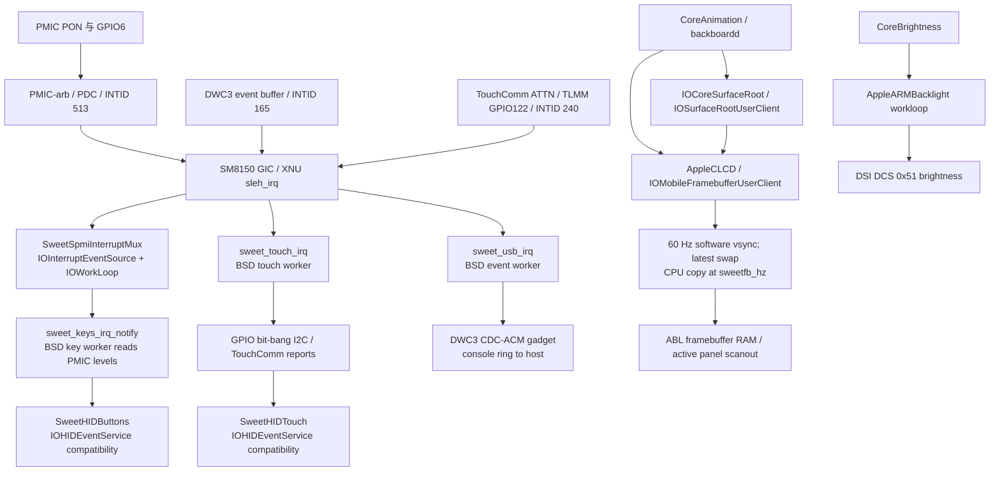
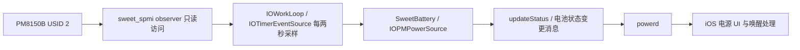

# MH2LM 当前 USB、按键、屏幕与电池驱动架构

**基线：** 0114a15 内核；以 `logs/xnu-buildtree-0114a15.gz` 中的最终 XNU
源码为准，结合 `live-e-0114a15-irq-only-debug.txt`（默认 INFO 档）和
`live-e-0114a15-irq-only-debug1.txt`（`sweetloglevel=3`）实机日志。
“屏幕”在本文同时包含触摸输入、画面呈现和背光；这三条路径相互关联，
但不是同一个驱动。`AI-GUIDE.md` 的 2026-10-30 启动状态已经过时，
当前状态以本文件和 `NOTES.md` 顶部为准。

## 一眼看清数据流

`sleh_irq` 对这三个板级 INTID 做分派，设备处理放在下半部。按键的 mux
下半部使用 IOKit；USB 和触摸下半部是按 IRQ 唤醒的 XNU 内核线程。
画面呈现使用另一个 IOKit workloop，但它的定时器不是面板真实 TE/vblank。

## IRQ 与输入路径

| 组件 | 当前硬件到用户态路径 | 与预定/XNU 方式的关系 |
| --- | --- | --- |
| 按键 | `sleh_irq` → INTID 513 → mux 屏蔽 GIC SPI → 软件 `IOInterruptEventSource` → `IOWorkLoop` 扫描 PMIC route、确认 latch → 唤醒按键线程读取电平 → `sweet_hid_key` → `SweetHIDButtons` → backboardd | 符合原定的 **GIC callback + software IOInterruptEventSource/IOWorkLoop**。上半部不做 PMIC 读取或 HID。mux 用三项路由表，不用按功能写死的 `switch`；consumer 当前仍静态绑定按键。 |
| USB | `sleh_irq` → INTID 165 → `sweet_usb_irq` 屏蔽 SPI、唤醒事件线程 → 读取 DWC3 event buffer、处理 EP0/CDC-ACM、确认事件 → 重开 SPI；另一日志线程由新日志、配置或 TX 完成唤醒 | 已从周期扫描改成 IRQ 驱动；GIC callback 很短。DWC3 gadget 是 `bsd/dev/sweet_usb.c` 中的板级实现，没有作为 IOKit USB provider/USB 类服务注册。ACM 主要把控制台环送到主机；当前 RX 数据缓冲读后丢弃，不是完整双向 USB 设备框架。 |
| 触摸 | `sleh_irq` → INTID 240 → `sweet_touch_irq` 屏蔽 SPI、唤醒触摸线程 → 清 TLMM 状态、GPIO 模拟 I²C 读取 TouchComm → 解码最多十指 → `sweet_hid_touch` → `SweetHIDTouch` → backboardd | 已由硬件 IRQ 唤醒，没有持续 10 ms 触摸轮询；HID 用户态接口符合 iOS 所需形态。总线仍由驱动直接操作 TLMM GPIO 和软件 I²C，尚无独立的 IOKit I²C/GPIO provider。 |

按键 mux 的物理 SPI 只有一个所有者；route 表分别处理 Power、Volume Down、
Volume Up。mux 失败会停用按键路径，USB/触摸 IRQ 失败也会显式停止各自功能，
没有静默回退到周期轮询。测试用的 GIC software-pending probe 是启动期
有界检查，不是运行期轮询。USB 和触摸 worker 在一次唤醒后清空已到达
的数据，再用 `assert_wait` 睡眠；日志发送线程也按事件睡眠。

**XNU 集成边界：** 目前 `SweetPlatformExpert` 给设备树创建 nub，但没有
GIC controller nub。`sleh_irq` 针对 513、165、240 顺序调用三个板级函数，
各驱动直接映射 GIC Distributor 寄存器。XNU 的异常入口、线程调度、
IOKit 事件源和 HID 发布都在使用；中断源的注册/路由尚未交给通用
`IOInterruptController`/provider 管理。因此这是合理的 bring-up 结构，
不能称为完整的、可动态注册子驱动的 XNU 中断控制器架构。未来设备增多时，
先把 `sleh_irq` 的板级分派抽成受控注册/路由层，再让 PMIC consumer
注册到 mux；不必改已工作的按键上层 HID 处理。

`SweetHIDButtons` 与 `SweetHIDTouch` 使用项目内构建的
`IOHIDEventService`/user client 兼容实现，将消费控制键和数字化触摸事件
交给 iOS。它们不是直接调用 SpringBoard，也不是把触摸当鼠标事件。

## 画面、背光与电源

1. `SweetPlatformExpert` 从 ADT 发布 `/arm-io/disp0` nub；`AppleCLCD`
   作为 `IOService` 匹配它，`IOMobileFramebufferUserClient` 实现 iOS
   `IOMobileFramebuffer` 所需的部分 selector。`IOCoreSurfaceRoot` 与
   `IOSurfaceRootUserClient` 是本项目的 IOSurface 兼容实现，并在内核中
   管理 surface、引用和用户态映射。
2. `AppleCLCD` 从 `PE_current_console` 接管 ABL 留下的物理 framebuffer。
   MH2LM 实际面板是 **1080×2340**，默认向 iPhone X 用户态报告
   **1125×2436**，呈现时做坐标偏移。CoreAnimation 的软件渲染结果通过
   surface 提供；`SwapEnd` 仅保存**最新一份**交换记录，定时器到期后
   CPU 把其中启用的图层复制到面板内存。
3. `IOTimerEventSource` 每约 16.7 ms 向客户端发送一次模拟 vsync，
   `sweetfb_hz` 决定复制频率。0114a15 镜像使用 `sweetfb_hz=30`，即约
   每两个软件 vsync 复制一次。这里没有真实 TE/vblank IRQ、MDSS 提交
   队列或 GPU 合成；显示控制器仍沿用 ABL 配好的持续扫描状态。
4. `RequestPowerChange(0/1)` 管理逻辑亮灭。默认 off 分几次直接把面板
   framebuffer 像素变黑；`sweetfbpreserveoff=1` 可保留像素，是已有的
   保守实验开关。`AppleARMBacklight` 是另一项 `IOService`，接受
   CoreBrightness 的亮度和 fade 请求，使用自身 workloop 定时分步调用
   `sweet_display_brightness_set()`，通过 DSI DCS `0x51` 写实际亮度。
   DSI 写入采用寄存器直访和有界状态轮询，发生在 workloop 中而非 IRQ。

这里的 `IOMobileFramebuffer`、`IOSurface` 和背光上层接口是为了让 iOS
用户态运行的**兼容实现**；并不代表 Apple 原有显示驱动或完整的 MDSS/DSI
驱动已移植。`SwapWait` 当前是空操作，其余未实现的 selector 多数返回成功；
这使界面能启动，但时序和完整帧语义不能按原生显示栈理解。

已观察到的锁屏局部黑屏与此结构相符：off 默认会改黑扫描内存，on
只重放最新 swap 中启用的图层；如果该 swap 没有时钟图层，状态栏和
底部横条能出现而中间仍黑。这是**与现象吻合的源码解释**，不是已经
通过图层抓取证明的唯一原因。触摸 IRQ/HID 路径不会自动修复这类渲染问题。

## 电池采样、IOPM 通知与充电控制（2026-11-05 补充）

原始 0114a15 的 `irq-only` 和 `irq-only-debug` 镜像都漏掉了
`sweetbattery=1 sweetbatt=1`，实机日志的 boot-args 也确认缺少它们。
因此虽然电池修复代码存在，`SweetBattery` 实际发布的是静态 100%、
外接电源、已满状态，没有启动真实 PM8150B 采样。此前的三路 IRQ 组合
日志不能作为“真实电池轮询与按键 mux 并行已验收”的证据。

打包脚本已在 `d84ac7f` 补回这两个参数，并用同一内核生成
`0114a15-batt` 普通/DEBUG 镜像。随后实机日志
`live-0114a15-batt-irq-only.txt` 确认参数生效并恢复真实采样，当前修复
改变的是启动配置，既有 MSOC 换算仍在。

**标准框架部分：** `SweetBattery` 继承真正的 `IOPMPowerSource`。
它先发布完整的初始状态，再 `registerService()`；后续在自己的 workloop
上更新容量、电压、外接电源和充电状态，经 `setPSProperty` 等标准 setter
写入，再调用 `updateStatus()`。0114a15 的 XNU 基类实现会在属性变化时
更新 IORegistry 并调用 `messageClients(kIOPMMessageBatteryStatusHasChanged)`。
这条通知链符合 XNU 电源源的常规方式；驱动不直接调用 SpringBoard 绘制
充电图标。`AppleSmartBatteryManager : SweetBattery` 是为了让 iOS 匹配
而使用的兼容类名，与上述电源源是同一个实例，不是另一个充电控制器。

**采样仍是定时器：** 当前未把 USBIN_PLUGIN、CHG_STATE_CHANGE 等
PMIC 事件接到 `SweetSpmiInterruptMux`；mux 的 consumer 仍只有按键。
`pollSid2()` 每两秒校验 SOC_READY 和匹配的 MSOC shadow pair，读取电压
与充电状态，再发布。只有电量计无效时才使用电压曲线估值。IOKit 定时器
采样本身是合理的 XNU 驱动模式，但不能把后续 IOPM 事件通知等同于硬件
已经 IRQ 化。未来可用 PMIC IRQ 触发状态刷新，低频定时器用于周期量测；
这不要求改变上层 `IOPMPowerSource` 接口。

**充电控制尚未接管：** 这条 `sweet_spmi` observer 路径只读；MMIO 写入
用于提交读取命令，不向 PMIC 外设写充电使能、限流或温控配置。实际充电
依赖进入 XNU 时继承的固件/PMIC 配置及硬件状态机。此前 0112m19/m20 的
电流、电压和 SOC 变化证明那些测试期间存在真实充电，但不证明 XNU 已有
完整充电策略，也不保证所有 USB 供电条件下都充电。

目前还不能称为完整电池管理，以下字段与策略仍有明确缺口：

| 项目 | 当前实现 |
| --- | --- |
| 电量与电压 | 来自真实 gauge/电压寄存器；容量按固定 5020 mAh 与百分比换算，未实现容量学习。 |
| 电流 | SID2 发布值固定 0，`SweetBatteryCurrentValid=false`；可选诊断能读取电流，但没有送入标准电源字段。 |
| 温度、循环次数、剩余时间 | 固定 25°C（带估计标记）、0 次、未知 -1；不是完整遥测。 |
| 外接电源能力 | `ExternalChargeCapable` 暂随 VBUS 存在，未完整推导协商/限流能力。 |
| 低电量与生命周期 | warn/critical 当前固定 false；尚无完整低电量关机、休眠恢复、热管理和充电策略。 |
| Apple manager user client | 能匹配和打开，但所有 `externalMethod` selector 返回 unsupported；不是完整 AppleSmartBatteryManager ABI。日志中的 powerd selector 4 属于这一边界。 |

**本次日志证据：** `live-0114a15-batt-irq-only.txt` 共 3017 行、63 次 SID2
采样，SHA256 `1a1ed7062cec374202bcfbc6546073ef4da06f1be94b5f49e33693ed75eea62e`。
所有样本均 `msoc=0xb4 scaled=70% ready=1 src=gauge held=0`，电压
4012–4013 mV；`usb=0x10 external=1`，`chgr=0x47` 低三位为 7
（DISABLE_CHARGE），发布 `charging=0 full=0`。因此真实采样已恢复且稳定，
这份日志报告的是“已插 USB、当前未充电”。没有启用电流诊断，不能据此
判断不充电的具体原因。USB 达 768 次 IRQ、TX 错误为 0，触摸有 down/up；
没有按键 HID/mux route 命中，也没有插拔转换，完整的真实电池与三键并发
及插拔通知回归仍未覆盖。

## 当前结论和证据

| 目标 | 0114a15 观察 | 判断 |
| --- | --- | --- |
| 三键 IRQ | 默认档日志记录 32 次 PMIC mux route 命中，三键均有 HID down/up | 正常组合路径按预期工作；0138 ack 重试的异常路径未触发。 |
| USB IRQ 与 ACM | 默认档达 1536 次 USB IRQ，ACM 持续输出，TX 错误 0 | IRQ 和日志输出并行工作；不代表所有 USB 设备模式或长期插拔稳定性已验证。 |
| 触摸 IRQ | 默认档达 689 次 IRQ，含双指和息屏再亮屏后的触摸 HID 事件 | 输入事件路径按预期工作；软件 I²C 的时延和功耗尚未量测。 |
| 分级日志 | 默认档无 `[DEBUG]`；DEBUG 档启动参数含 `sweetloglevel=3` 并出现 279 条 `[DEBUG]` | 两档过滤生效；驱动故障时 `[ERROR]` 写入持久日志尚未实测。 |
| 显示正确性 | iOS UI 已可见，既往 0113 锁屏/充电唤醒出现局部黑屏 | IOMFB/IOSurface 兼容层足以启动 UI；完整重绘、真实 vsync 和显示电源管理未达到原生水准。 |

**优先级判断：** 输入和 USB 的 IRQ 执行模型符合这轮计划，可以固定为
目前基线。下一个目标的主要结构性缺口在 framebuffer：保留现有
IOMFB/IOSurface 用户态接口，先解决完整图层状态/唤醒重绘，再评估真实
TE/vblank 和 MDSS 提交。PMIC 未来接入充电事件或更多传感器时，需要
完善中断注册与 mux consumer 接口；这属于后续扩展，不影响当前三键
IRQ 已验证的事实。详细实施和验收仍由 `IRQ-FRAMEBUFFER-PLAN.md`
另行制定。

### 源码定位

下表行号对应 **0114a15 buildtree 内的最终源码**，不是单个补丁中的
中间版本。可用 `tar -xzf logs/xnu-buildtree-0114a15.gz xnu/...`
取出核对。

| 路径 | 关键位置 |
| --- | --- |
| `xnu/osfmk/arm64/sleh.c` | `sleh_irq` 1851–1904：GIC 分派与通用 handler 兜底。 |
| `xnu/iokit/Kernel/arm/SweetSpmiInterruptMux.cpp` | 路由表 29–61；workloop 375–451；GIC callback 457–477。 |
| `xnu/bsd/dev/sweet_keys.c` | mux 通知 58–71；按键线程 224–306；三路启用 449–460。 |
| `xnu/bsd/dev/sweet_usb.c` | IRQ callback 514–540；日志线程 881–935；事件线程 1019–1078。 |
| `xnu/bsd/dev/sweet_touch_tcm.c` | IRQ callback 259–282；触摸线程 1049–1201；软件 I²C 364–508。 |
| `xnu/iokit/Kernel/arm/hid/SweetHID.cpp` | HID 服务 330–565。 |
| `xnu/iokit/Kernel/arm/SweetFramebuffer.cpp` | framebuffer 316–596；user client 597–763；背光 155–315。 |
| `xnu/iokit/Kernel/arm/SweetSurface.cpp` | surface 管理 70–350；user client 380–884。 |
| `xnu/bsd/dev/sweet_display_probe.c` | 显示状态探针 1–155；DCS 亮度 157–307。 |
| `xnu/iokit/Kernel/arm/SweetBattery.cpp` | 继承/兼容类 83–130；user client 185–208；发布 275–359；SID2 采样 591–721；启动 734–788。 |
| `xnu/bsd/dev/sweet_spmi.c` | 电池 observer 只读 SPMI 访问，文件头明确不写 PMIC 外设配置。 |
| `xnu/iokit/Kernel/IOPMPowerSource.cpp` | 177–218：`updateStatus()` 发布属性并发送标准电池状态变更消息。 |

相关历史、实机日志 SHA256 和后续目标见 `NOTES.md` 与
`IRQ-FRAMEBUFFER-PLAN.md`。本次仅做架构核对和文档记录，没有改变内核代码。
