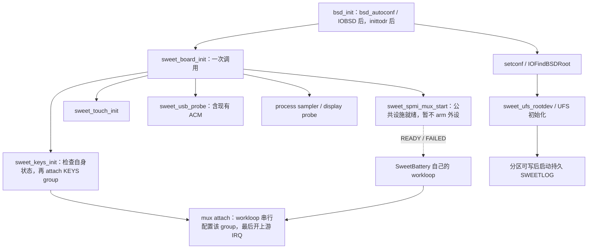

# MH2LM 驱动启动归属与依赖清理

**0145 当前改造：** board 的 keys 入口改为发布晚期 nub，匹配 SweetPmicKeys
IOService；按键与电池各自通过 registry 通知接入 mux，不再使用全局 C 桥接。
实际按键 arm 在 consumer workloop 异步完成，不要求先于 UFS；board 发布仍在
root lookup 前。新实现与 terminated 清理见 [`MUX-CONSUMERS.md`](MUX-CONSUMERS.md)。
下一轮先测包含 0145 的新 baseline，再测 no-keys/usbin；下文保留此前基线证据。

更新：2026-11-05。0143 基于 0115 最终源码叠加 0142；0117 原生内核已包含
0142/0143/修正后的 0144，baseline 启动与输入/USB 实机回归通过。
关闭按键时的电池独立接入及并行 USBIN 尚待测试。旧 0115 镜像不包含此变更。

**0144 继续改造：** 共享 mux 已实现为真正的 IOService。
board 原入口改为发布晚期 `SweetSpmiMuxDevice` nub，由 KernelConfigTables
同步匹配；路由、状态及资源归 mux 实例，并补齐 stop/free。0143 与 0144
已在 0117 baseline 验证正常启动和按键接入，stop/free 尚未实机验证。
最新匹配层级、filter/controller 选择和生命周期规则见
[`MUX-IOSERVICE.md`](MUX-IOSERVICE.md)。下文的 0143 是本次改造的基线。

## 电池进度检查点

按用户要求，先暂停电池 IRQ 验收，清理错误的启动调用关系。

| 已有证据 | 结论与边界 |
| --- | --- |
| `sweetlog-0115-battery-irq-preflight.bin` | mode1/preflight=1；PM8150B 型号得到 REVID 与 FG SOC subtype 实测确认；USBIN APID269、CHGR APID266、FG APID283。真实采样稳定 70%、4008–4009mV，external=1、charging=0。 |
| FG 预检 | 元数据/owner 与 observer 寄存器可读；未测实际 FG channel gate、SRAM MSOC 阈值或真实 FG IRQ 投递。元数据预检中的 gate/status=0 是占位，不能当实测。 |
| `sweetlog-0115-battery-irq-usbin.bin` | 电池先启动、只读初始状态；十秒等待耗尽后停止，随后 keys 才启动 mux。没有电池 attach/arm/route。70% 与插线状态冻结、息屏插拔不唤醒有明确启动顺序原因；尚不能据此判断 USBIN 硬件 IRQ。 |
| 0142，提交 `a312626` | 改为单次 READY/FAILED 订阅，解除任意十秒等待期限；本地检查通过，尚未实机测试。仍由 keys 启动 mux，故需要本次 0143。 |

原日志 SHA256、解码路径和详细读回见 `NOTES.md`；不要继续旧 0115 的
charger/all 档。实际充电仍依赖继承的 PMIC 配置；本轮不修改充电策略、SRAM、
profile、容量或 SOC 算法。电池 IRQ 子目标保持未验收，framebuffer 继续排后。

## 原调用链为什么有问题

```text
bsd_init → setconf → IOFindBSDRoot → sweet_ufs_rootdev → sweet_ufs_init
  ├─ UFS 初始化 / 磁盘节点 / 分区边界
  ├─ sweet_log_start（确有 UFS 存储依赖）
  ├─ sweet_sample_start
  ├─ sweet_keys_init → sweet_spmi_mux_start(3)
  ├─ sweet_touch_init
  ├─ sweet_usb_probe
  └─ sweet_display_probe_init

IOKit 早期匹配 → SweetBattery::start → 等待后面的 keys/mux
```

这是历轮 bring-up 在“可睡眠、scheduler 已工作”的 UFS 入口追加启动调用形成的
历史耦合，不代表按键、USB、触摸或 PMIC 中断硬件依赖 UFS。具体追加来源为
0054 sampler、0060 输入、0072 USB、0108 显示探针；0134 又把共享 mux 启动放进 keys。
选择其他 root 或 UFS 提前失败会绕过全部外设；`sweetkeys=0` 或按键预检失败也会
绕过共享 mux，使电池失去独立启动能力。mux 内静态调用按键函数进一步倒置了依赖。

## 0143 调整后的调用链



- `bsd/dev/sweet_board.c` 是板级组织入口，既不属于 UFS，也不属于按键。
  `bsd_init()` 在 `bsd_autoconf()` 发布 IOBSD、`inittodr(0)` 返回后，进入根挂载
  重试循环之前调用。保留晚期、可分配/可睡眠/可接收 GIC IRQ 的初始化环境，
  不把已知敏感的 MMIO 和 GIC probe 提前到早期平台匹配。比旧路径更早于
  `IOFindBSDRoot()` 中资源等待与 UFS 接管；这个时序变化必须实机回归。
- 板级入口先启动共享 mux，再分别调用按键、触摸、USB 和诊断项；mux 的返回
  失败只记录错误，仍继续其他独立驱动。入口在 root retry 循环外，并有单次防护。
  各驱动仍自行解析启动参数。该调用序列不是运行期父子 provider 树。
- `sweet_spmi_mux_start(void)` 仅建立 workloop/软件 IES、映射公共寄存器、
  检查 PMIC-arb/PDC/GIC 与有界软件 pending 投递；然后发布 READY。
  此时没有 key channel 映射，没有外设 route arm，GIC 保持屏蔽，PDC 未开启。
- 按键和电池都通过 `sweet_spmi_mux_attach/detach()` 注册回调及 context。
  group0 是 KEYS、group1 是 BATTERY；key event token 改为位掩码，Power/Up/Down
  分别为 1/2/4。keys 上层仍只合并唤醒并读真实电平，HID 逻辑不变。
  mux 不再引用 `sweet_keys_irq_notify/failed`，也没有按功能写死的 switch。
- `sweetkeys=0` 或初始状态校验失败时，按键不会 attach；mux/电池不受此开关
  影响。按键线程创建失败则撤回 KEYS group。路由配置局部失败先撤回自身位；
  回滚成功保留另一 consumer。无法安全清理或共享硬件故障仍停止全部 PMIC
  consumer，这是共享 IRQ 的真实故障边界，不能承诺按键/电池永远互不影响。
- 第一个 consumer attach 配置完路由后才开启 PDC 和 GIC。最后一个退出后
  GIC 保持屏蔽，包括已排队的 IRQ drain；PDC 可以保留已开启状态，下一次接入
  仍由 mux 统一控制。上游开启失败也会在 attach 返回错误前清除 callback/context。
- UFS 只负责存储及依赖该分区的持久日志。早期内存 console ring 原本就在捕获，
  持久线程仍等分区与写边界确认后启动；USB ACM 不等待这个存储线程。
  UFS 作为 root 失败仍会导致根挂载失败，但外设不再因代码分支被跳过。

保留了共享源码中已有其他板型编译条件，没有增加其他设备支持或实测范围。

## 与 XNU 常规结构的关系

初始化归属已变成“板级组织公共设施及设备、consumer 接入共享 mux”，避免叶子
设备启动父设施或兄弟设备。运行期仍沿用 XNU `sleh_irq`、短 GIC callback、
软件 `IOInterruptEventSource/IOWorkLoop` 和既有 HID/IOPM 上层。

这仍是显式板级 bring-up 入口，不是完整的 `IOService` provider 匹配树，mux
也没有变成 `IOInterruptController`。真实 framebuffer/backlight 继续由原有
IOKit 服务匹配；搬出的 display probe 只是诊断，不能把它当作屏幕驱动本体。
未来再抽出 GIC/总线 provider 时，保留 consumer 回调与 route 描述接口。

## 本地检查与下一轮测试

0117 baseline 的完整持久日志显示 BOARD → mux infrastructure ready →
IOService started → group0/三键 armed → UFS userdata/root，确认新启动顺序。
三键真实路由命中 18 次并产生 18 条成对 HID 事件，含息屏后电源键亮屏；
触摸 115 次 IRQ，USB live 达 1664 次 IRQ、TX err=0。四条已有 USB endpoint
WARN 未中断传输，未见相关驱动 ERROR 或 panic。下一档是 no-keys，再测 usbin；
baseline 的 battery IRQ mode0 不能证明电池接入/事件交接已成功。

本地源目录：`scratch/driver-startup-0115/`（工作区，未入 git）。补丁在 0115
精确源码上先应用 0142 再应用 0143；新鲜应用结果需与编译输入逐字节一致。
六个单元做 ARM64 编译：bsd_init、board、UFS、keys、mux、battery。C++ 沿用
Linux clang 的 Apple type builtin 编译替身，仅在 scratch 编译器参数中，不进补丁；
不能替代原生云端完整链接。

```bash
python3 tools/tests/test-mh2lm-board-startup.py EXTRACTED_XNU_DIRECTORY
python3 tools/tests/test-mh2lm-battery-irq.py EXTRACTED_XNU_DIRECTORY
```

第一项编译真实 board 入口并注入子驱动关闭/失败，核对一次调用、阶段和旧调用
边删除；第二项运行真实 mux 与部分 battery 方法，覆盖无按键、缺失按键 APID、
按键部分配置回滚、带 pending 的 detach、上游开启失败清 context，以及原有
readiness 寿命、延迟启动、storm、RW timeout 检查。ASAN/UBSAN 模拟不证明实机
MMIO、GIC 时序或完整 IOKit 调度。

用户 push 后用同一新内核打包：

```bash
tools/mk-mh2lm-event-matrix.sh logs/xnu-kernel-新编号.gz 新编号 --board-startup
```

| 后缀 | 配置与目的 |
| --- | --- |
| board-startup-baseline | keys=1、battery IRQ mode0。先验证新的板级入口、桌面、三键/组合键、触摸、USB ACM 和持久日志；真实电池仍两秒采样。 |
| board-startup-no-keys | keys=0、battery IRQ mode2。验证公共 mux 无需按键也会 READY、接入 USBIN；触摸和 ACM 保持。按键包括唤醒/组合键均主动关闭，使用 USB 日志或恢复环境导出，测试后切回有按键镜像。 |
| board-startup-usbin | keys=1、battery IRQ mode2。同一内核验证按键与 USBIN consumer 并行；若只有真实 IRQ 失败，先判断 attach/arm 与硬件投递的分界。 |

先验收第一项并读日志，再测第二、第三项。0143 两种 consumer 的 attach 先后
可互换，不要求日志中 keys 一定先于 battery。必须看到 BOARD 入口在 UFS root
日志之前、mux infrastructure ready、对应 consumer attached 与 key/battery armed。
no-keys 档应没有 group0 和 key routes，但必须有 group1/USBIN；之后才看真实
插拔 route → refresh → IOPM 状态变化。若未 arm，停止硬件结论，保留新鲜持久日志。
已有 `--battery-irq` 六阶段打包仍保留，CHGR/MSOC 后续再按原计划推进。

CircleCI 的构建命令未改；增加 0143 的 board/consumer 源码门禁与旧依赖反向
检查，避免 dxb 跳过补丁后仍把旧内核当成功产物。未 push、未触发 CI、未写设备。
