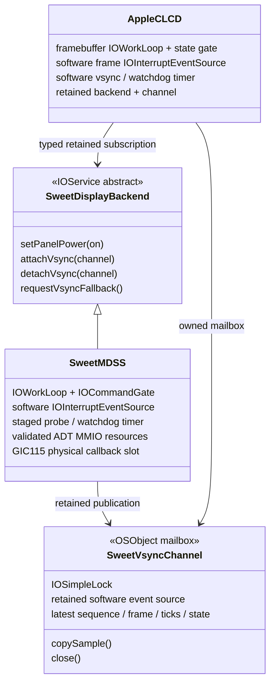

# F3：硬件 vsync 接入记录

2026-11-09。**0180 实际 MDSS IRQ / typed 硬件 vsync 已实现并完成本地验证，待云编译和实机验收。**
0121a10 / 0179 只读预检已实测通过；0180 新行为默认关闭，尚无实际 IRQ 投递/频率的实机结果。
F3 整体尚未验收。最新实现、分档与下一步见第8节；第2–7节保留0179阶段记录。
本步接续已验证正常使用路径的 F2，不重开 BUG-003；BUG-002 随日常使用观察。
完整系统/设备低功耗已排到大目标四，当前只推进既定显示路线。

## 1. 已核对的硬件链

参考本地 `ref/android_kernel_lge_sm8150` 的 LG SM8150 实现，按硬件定义独立实现小型预检，
未搬入 Linux DRM/SDE 驱动栈。主要依据：

| 项目 | 已知事实 | 参考源码 |
|---|---|---|
| 父中断 | DT `interrupts=<0 83 0>`；SPI 编号 83 加 32 得 **GIC INTID 115** | `arch/arm64/boot/dts/qcom/sm8150-sde.dtsi:44` |
| 显示类型 | 本板是 command mode；SDE 5.x catalog 声明 INTF TE 能力，command encoder 选择 `SDE_IRQ_TYPE_INTF_TEAR_RD_PTR` | `drivers/gpu/drm/msm/sde/sde_hw_catalog.c:1864`、`sde_encoder_phys_cmd.c:1784,1814` |
| 顶层状态 | MDSS 基址 `0x0ae00000`，`HW_INTR_STATUS=+0x10`；MDP 汇总为 bit0，另有 DSI 等来源 | `sde_hw_interrupts.c:25`、`sde_hw_interrupts.h:23`、`sde_irq.c:55` |
| INTF1 TE IRQ | **`0x0ae6e800`**：ENABLE +0、STATUS +4、W1C CLEAR +8；RD_PTR 是 **bit2** | `sde_hw_interrupts.c:37–41,194–198,1437–1443` |
| INTF2 TE IRQ | `0x0ae6e900`，布局相同；仅观察，当前未选择它作为刷新源 | 同文件 |
| INTF1 tear-check 配置 | `0x0ae6b800`：EN +0x284、CFG +0x288、RD_PTR 阈值 +0x2a4、LINE +0x2b0、AUTOREFRESH +0x2b4 | `sde_hw_intf.c` |
| MDP 主 IRQ | MDSS+0x1000：EN/STATUS +0x10/+0x14，EN2/STATUS2 +8/+0xc | `sde_hwio.h:22–27`、`sde_hw_interrupts.c:1357` |
| GICD | 物理地址 `0x17a00000`；本项目现有按键/USB/mux 已使用此控制器 | 既有驱动及 ADT |

INTF1 **配置窗口**与 **TE 中断窗口**是两个地址，不能在现有 INTF1 映射上直接加 0/4/8
当作中断寄存器。LG 表里的 INTF1 RD_PTR 逻辑索引 322 也不是 GIC INTID。
主 MDP 中的 video INTF1 VSYNC bit27、PINGPONG RD_PTR bit12 等与这里的 TE RD_PTR bit2 不同。
DT 触发字段为 0，不能把它直接当作已证明的 GIC edge/level 配置；本轮读取实际 ICFGR。

0121a9 已有探针观察到 INTF1 tear-check=1、CFG=0x180088、RD_PTR=0x925、
AUTOREFRESH=0x80000001，INTF2 配置为零。这支持选取 INTF1 作为候选；
旧 frame counter 为零，**不证明 60 Hz**。GIC115 的实际投递、使能后的 RD_PTR 频率、
父线上是否还存在其他 enabled source，均需后续证据。

## 2. 0179 的架构与边界

- 只改内核 `SweetMDSS.cpp`；AppleCLCD、背光接口及 F2 DCS28/29 路径保持既有实现。
- 新参数 `sweetmdssirqprobe=0/1/2`，默认 0。0 不映射、不读取新增窗口；
  1 仅读 GICD；2 再读取 MDSS/MDP/两组 TE 状态和 INTF1 配置。
- 新窗口由 `/arm-io/mdss` 的 ADT `reg` **追加**提供，provider 映射并校验实际物理地址及长度。
  原九窗口顺序不变，不增加 consumer MMIO 路径；不发布标准 `interrupts` 属性。
- 任一新增窗口缺失、地址/长度不符，或新 timer 分配/加入失败：ERROR，释放新增资源，
  仅停用预检，保留工作中的显示服务。`SweetDisplayIRQPreflightReady=false`。
- 独立 `IOTimerEventSource` 在服务启动约 30、31、32 秒各取一次样本，然后停止。
  不依赖 `sweetdispprobe`，不做持续轮询。与亮度、电源、stop 共用 MDSS workloop/gate。
- 先读 GICD；仅在既有 GCC/DISPCC AHB 条件满足时读 MDSS。时钟条件不满足则 WARN 并跳过
  该次显示寄存器读取；不自行开启时钟。
- 新探针只读 EN/STATUS，不读 CLEAR、不 ACK、不写使能/路由/配置，不做软件 pending 注入。
  系统原有亮度和电源操作仍按正常路径执行，不能把整台设备称作“零 MMIO 写入”。
- stop 关闭 admission、Ready=false、取消 timer，再移除事件源；映射保留到 free，
  保证已取得引用的旧调用和在途回调不会使用释放后的资源。

| ADT reg 下标 | 物理窗口 | 用途 |
|---|---|---|
| 0–8 | 原 F1a 九窗口 | 不变 |
| 9 | `0x0ae00000 / 0x2000` | MDSS revision、汇总状态、MDP IRQ EN/STATUS |
| 10 | `0x0ae6e800 / 0x200` | INTF1/2 TE IRQ EN/STATUS |
| 11 | `0x17a00000 / 0x10000` | GICD 只读快照 |

GIC115 对应 word3 bit19；ICFGR7 bits7:6；优先级在 +0x470 的最高字节，
IROUTER115 位于 +0x6398/+0x639c。记录 CTLR/TYPER/IIDR/PIDR2、GROUP/GROUPMOD 原字、
enable/pending/active、config、priority、route。Nonsecure GROUP/GROUPMOD 可能 RAZ，
**不得仅凭 group=0 判 secure 或不能投递**。记录的 enable/pending 是瞬时观察。

输出为 `[INFO] SWEET MDSS IRQ PREFLIGHT: ...`，拒绝资源为 ERROR，时钟不可用为 WARN。
属性 `SweetDisplayIRQPreflightMode/Ready/Samples` 分别表示已准备的模式、资源就绪、
采样尝试次数；Samples 包含 MDSS 因时钟未读的尝试，不等于有效 MDSS 样本或 IRQ 次数。

STATUS 是锁存位，三次相同值不能解释成“中断卡死”，也无法计算帧率。
读取 LINE 的变化只作辅助；本步不证明 RD_PTR 已送达 CPU。
`SweetDisplayInterruptEnabled` 仍为 false，60 Hz 软件 timer 仍运行，OFF 通知行为尚未改变。

## 3. 本地验证

基线：0121a9 实际云源码（0177）严格应用 0178，再应用 0179；只有 SweetMDSS.cpp 改变。

- `git apply --check`、零 fuzz/零 offset 重放、生成结果逐字节匹配；原 CI 114 项源码 marker 通过。
- SweetMDSS baseline/新源码均完成 arm64-apple-darwin 对象编译。clang19 的
  `-Wunsafe-buffer-usage` 新增 15 条，均为新增数组访问：常量下标 9/10/11，或有界
  i/j=9..11、i-9=0..2；逐项审阅，host 故障注入验证边界。其他告警类别和数量不变。
- 实际 provider/client/backlight 的 ASan/UBSan suite 通过，含默认 DCS 完整 MMIO 轨迹对照，
  F2 电源/恢复路径；新增预检默认零访问、GIC 解码、三次后停止、完整只读且不清锁存位、
  缺失/错位/过短资源、timer 失败、时钟关闭、inactive、stop 与采样并发、释放归零。
- 实际 framebuffer service suite、ADT 测试通过；ADT 新扩展 12 窗口翻译及既有树逐字节保留，
  原 9 窗口默认输出不变；真实基础 ADT 经 CLI 派生通过。
- 打包 shell 语法、三档参数一致性（仅 mode 不同）、旧 0121a9 内核缺少 F3 marker 时拒绝通过。
  此检查未生成假测试 boot。

本地环境无法使用 LSan（ptrace 限制），禁用 leak sanitizer；ASan/UBSan 和对象/映射归零断言仍运行。
底稿：`work1/scratch/framebuffer-0179/{base,edited,verify,verification.json,warning-counts.json,
tests.json,test-*.txt,packaging-checks.json,old-kernel-rejection.txt}`。
CircleCI 配置未改，blob 仍 `da0b6c0947a66f03491b3a9023590b49665292df`。
以上为本地验证阶段记录；云产物及只读预检实测见第6、7节。

## 4. 0179 阶段的编译与测试（已完成）

用户 push 后下载同轮 kernel/buildtree/build-log；先核对 0178/0179 源码及 marker，再打包：

```bash
tools/mk-mh2lm-event-matrix.sh /home/shenli/work1/logs/xnu-kernel-编号.gz 编号 --framebuffer-irq-preflight
```

提供同核三档：`fb-irq-preflight`（mode2）、`fb-irq-gic`（mode1）、`fb-irq-baseline`（mode0）。
三档均保留 service1/mdss1/power1、按键/触摸/USB/电池 IRQ、ACM、runtime3；
使用同一扩展 ADT，关闭档不映射追加窗口。原 `--framebuffer-power` 的九窗口及两档行为不变。

**正常先只测完整只读档**：`fastboot boot`，进入系统后保持亮屏等待至少 35 秒，
确保取得三次快照；随后简测亮度、触摸、按键和手动息屏/唤醒，记录新增显示问题。
持久日志即可，建议 `sweetlog-编号-fb-irq-preflight.bin`，不要求实时 USB 日志或重复插拔压力测。
只有完整档出现新启动问题才用 GIC 档分离地址访问阶段；仍异常再用关闭档，不默认重跑三档。
0121a10云内核和三档boot已核对，路径见第6节；完整只读档已取得实测日志，见第7节。

## 5. 0179 阶段登记的后续工作（0180实现见第8节）

结合实机 revision、GIC 及来源状态确认资源/路线，随后接既定 GIC callback → software
IOInterruptEventSource/IOWorkLoop：上半部屏蔽/时间戳，worker 清所选 RD_PTR/计帧/排队通知/再使能。
仍需定义 typed provider 的 vsync 订阅/撤回、终止同步、OFF 禁用与唤醒重启、风暴停用和
显式 timer watchdog 回退，不能在 provider gate 中反调 framebuffer gate 形成锁环。
最终以 60 秒 60±1 Hz、间隔 p50/p99、OFF 计数停止、输入/USB/电池并行健康验收。
这些尚未实现，不将本轮三次寄存器快照当作替代验收。

## 6. 0121a10 云产物与测试镜像

已核对 kernel/buildtree：44 个已跟踪源码与本地 0179 验证树逐字节匹配，包含 0178 mux 修复与
0179 SweetMDSS；114 个既有 CI 源码 marker 和新增 F3 内核 marker 通过，内核归档 manifest
通过。未收到完整 build log/CI run ID，因此不声称完成全量云编译告警审阅。

内核 SHA256：`b6a0732a419f28276b6b6f8fba7c15f711d66394e66ee200043066a0aeda397e`，与 0121a9 不同。

三档均为 35,667,968 字节：

| 镜像（work1/out-bs/） | 预检模式 | SHA256 |
|---|---|---|
| `boot-16k-0121a10-fb-irq-preflight.img` | 2 | `641c1b0aefc1be781b71e146c176e060976e425bd339638b69fd5fd74511c9dd` |
| `boot-16k-0121a10-fb-irq-gic.img` | 1 | `0e9dd9ef014e7fad818f28e9777f112d00615cf8aba3bd38fc28d10740a12060` |
| `boot-16k-0121a10-fb-irq-baseline.img` | 0 | `9b79a1ad447470b30b374aef79eb7587cd78ab4e0c2609cbeb05dc15aed72614` |

最终 boot 回读 Android header、UEFI kernel blob、FAT ramdisk 内的 XNU/ADT/TOML 全部通过；
三档仅 sweetmdssirqprobe=2/1/0 不同，无重复参数；扩展 ADT 一致，原基础 ADT 保持不变。
ACM/原有 IRQ/runtime3/F2 power1 保留。打包环境缺少 `file` 命令，本轮用本地 Python
Android header 检测替代该条显示信息，随后独立完整回读核验，未修改项目打包脚本。
底稿：`work1/scratch/artifact-0121a10/{verification.json,source-compare.json,
boot-verification.json,verify-artifacts.py,verify-boots.py,packaging.txt,mdss.adt}`。

**下一步先仅 fastboot boot 完整 fb-irq-preflight 档**：进入系统保持亮屏至少 35 秒，
再简测亮度/触摸/按键和手动息屏唤醒；导出 `sweetlog-0121a10-fb-irq-preflight.bin`。
有新增启动问题才用 GIC/关闭档定位。不要求重复插拔压力测试或专项 BUG-002 测试。
本轮只完成产物和镜像核对，尚无 MDSS 寄存器实机快照或真实 vsync IRQ 证据。

## 7. 0121a10 完整只读档实测：预检通过

日志：`work1/logs/sweetlog-0121a10-fb-irq-preflight.bin`，SHA256
`504d8167c635b24fbc8bea4385ba1fda9eb0c0692bf2805b58d12325bcba46b3`。
SWEETLOG v1，4194304字节ring，有效318413字节、flush22、未回卷，解码4240行。
第89行确认mode2/INTID115；370行boot args确认mdss1/service1/power1/irqprobe2。
用户回复“都正常，未见新增问题”，包括画面、亮度、触摸、按键及手动息屏唤醒。

### 中断寄存器实值

三次pass0/1/2均取得完整GIC、MDSS及INTF1快照（197–199、402–404、606–608行），
无资源缺失/错位、时钟门禁跳过或预检失败。启动日志能证明新增窗口已通过provider校验，
不能将原九条resource日志误说成新增窗口没有映射。

| 项目 | 三次观察 | 结论/边界 |
|---|---|---|
| GICD | CTLR=0x12，TYPER=0x7b041d，IIDR=0x201143b，PIDR2=0x3b | PIDR2架构字段=3；TYPER数量字段覆盖960个INTID，包含115 |
| GIC115 | enable=0、pending=0、active=0，cfg=0，priority=0x80，route=0:00000000 | 当前禁用、配置为level；尚无CPU投递证据；route是读取值，不证明将来目标CPU正确 |
| GROUP/GROUPMOD | 原字均0 | 保留NS视图RAZ边界，不能仅凭零值认定secure或不可用 |
| MDSS revision | 0x50000001 | 与LG SDE5.x INTF TE布局匹配 |
| 顶层/MDP | sources=0；MDP EN=0、STATUS=0x100，EN2=0、STATUS2=0x200 | 有原始锁存状态、未使能所读两组；不将其自动当作故障 |
| INTF1 TE IRQ | EN=0、STATUS=0xf | RD_PTR bit2已锁存但未使能；其余AUTOREFRESH_DONE/WR_PTR/TE_DETECTED也有锁存 |
| INTF2 TE IRQ | EN=0、STATUS=0 | 本轮无相同锁存证据，不选择INTF2 |
| INTF1配置 | TE=1、CFG=0x180088、RD_PTR阈值=0x925、AUTO=0x80000001 | 符合既有command-mode autorefresh候选链 |
| INTF1 LINE | 0x924 → 0x99 → 0x23a | 读取时计数有变化，仅辅助证明配置在运行；不能推算频率 |

父GIC和TE两端均未使能，因此顶层sources=0、GIC pending=0与原始RD_PTR锁存不矛盾。
STATUS三次相同是只读不清锁存的预期，不是“连续三轮ACK失败”。本轮不做ACK，无法证明
每个采样间新增多少事件；不宣称60Hz、中断送达或IRQ ACK/rearm已经成功。

### 其他功能和证据边界

- FB及背光后端95/96行匹配；唯一CoreBrightness请求2838，2408行DCS rc0。
  三键12条HID：power2、volume-up6、volume-down4；触摸48条事件。
- 本日志仅有初始FB on（2332/2333行），**没有实际MDSS POWER off/on事务**。
  用户确认唤醒表现正常，仍不能给本轮补造28/29事务或五轮开关屏覆盖；本步是只读预检验收。
- 电池29份样本、28次IRQ refresh全部healthy=1；无mux隔离/SPMI timeout/驱动级ERROR或
  kernel panic。0178已在本轮内核中，未见复发仅作正常使用记录，不作为专项BUG-002验收。
- USB两次ACM配置、10次bus reset及10条端点命令WARN（9条ep0、1条ep5）。
  不能仅凭这些条目判定Windows枚举失败或把旧USB问题归因预检。
- id10/17两份USBIN VERIFY(-12)仍出现（3188/3471行），当时先前已分别有
  step2/reasons0x2停充，随后step0/reasons0x1保持禁用，再于3238/3521行启充。
  不算两次“从启充态被遥测主动停充”，用户未报告图标闪烁。旧采样问题保留独立记录，
  不要求重复插拔或回到电池阶段。

底稿：`work1/scratch/artifact-0121a10/{analyze-preflight.py,preflight-log-analysis.json,
analysis-summary.json,preflight-selected.txt,fb-irq-preflight.txt}`。

**下一步：** 只读预检收口，无需再测GIC/关闭预检档。实现实际MDSS IRQ接管和typed
vsync订阅/撤回，既定GIC callback上半部屏蔽/记时、MDSS worker精确ACK bit2/统计/排队
通知/再使能，并加入OFF禁用及唤醒恢复、风暴停用、显式看门狗回退。
父线开始使能前必须确认当前其他enabled source不会无人处理；原始非目标锁存位不应
一律清除。跨provider/FB gate只排队，不反向同步调用。下一批实现后同核分档验证投递、
RD_PTR频率与完整vsync路径；当前尚无这些代码或新boot，F3整体尚未验收。
本轮仅分析及文档，无驱动/CI改动或push。


## 8. 0180：真实 IRQ 和硬件 vsync（本地验证，待实机）

补丁 `xnu/patches/0180-mh2lm-mdss-hardware-vsync.patch` 接在0179之后，基线取自
0121a10实际云源码。修改SweetDisplayBackend.h、SweetMDSS.cpp、SweetFramebuffer.cpp、
SweetFBService.inc和sleh.c，新增SweetMDSSIRQ.inc、SweetFBVsync.inc；无USB、按键、
电池、SPMI/mux或CircleCI修改。新增inc由既有翻译单元包含，无需改编译文件列表。

### 服务结构与接口



已有SweetDisplayClient负责IORegistry匹配/撤回，回调仍只保留引用和排队；AppleCLCD
在自己的workloop完成typed attach/detach。一个pipeline只允许一个channel，第二个订阅返回Busy。
后端持gate时，publish只在channel短自旋锁内更新数据并排队软件IES；不执行消费者代码，
不获取framebuffer gate。消费者在自己workloop读快照并检查当前匹配仍为该后端。
允许FB gate→provider gate同步调用；禁止provider gate→FB gate同步反调。

物理入口沿用本项目的GIC callback，不引入Linux irq_domain或新IOInterruptController。
唯一全局服务指针只用于GIC115物理投递，受永久dispatch短自旋锁保护；消费者不通过全局
指针寻找后端。顶半部持该锁，只屏蔽自己的父线、原子状态迁移/计数/记时、排队worker。
不读取TE、不做DSI/SPMI、不等待RWP、不直接通知FB。

### 分阶段硬件接管

- `sweetmdssirq=0`为默认，无新IRQ映射/配置/注入；原软件vsync保持不变。
- `sweetmdssirq=1`：启动约35秒配置并软件pending注入**自己的INTID115**，约50ms后
  检查恰好一次投递、pending/active清零，成功后父线保持masked；不使能外围TE。
- `sweetmdssirq=2`：先做同样投递验证，通过后只开启INTF1 TE RD_PTR bit2。
- `sweetfbvsync=1`须同时有service1/mdss1/power1/contract0及mdssirq2；配置不完整时
  framebuffer明确拒绝启动，避免把未实际开启的实验误当成功。
- 新profile复用0179追加资源9–11，provider校验物理地址/长度。配置前核对GICv3、INTID范围、
  父线原先disabled/nonpending/nonactive、已知MDSSrevision/INTF1配置，且其他已知IRQ使能组
  均关闭。条件不符报ERROR并停用新IRQ，不重置继承的显示配置。
- GIC只修改115的group/config/priority/route，保存并在停止时恢复自己的字段，父线保持禁用。
  NS group可能RAZ，投递证明以软件probe实际命中为准。worker内RWP等待上限1ms
  （delay(1)×1000），不在自旋锁或中断上下文等待。
- RD_PTR worker精确W1C bit2，保留ABL锁存的其他raw位，检查非目标enabled来源，记帧并
  重新开父线。ACK后status再次置位不视为失败，新帧交给后续IRQ。
- IRQ时间戳原子交给worker，worker另存**已处理帧时间戳**；发布不会误用下一次顶半部
  覆盖的新时间戳。channel含累积帧数，消费者合并事件时推进相应计数、记录coalesced，
  不把最新一份样本伪装成每一帧均单独送达。

### 定时器、OFF与退出

完整档收到第一份真实Frame前仍用软件vsync；收到后取消60Hz通知timer，切成100ms检查。
正常通知来自RD_PTR的真实mach ticks。CPU拷贝限频sweetfb_hz=30仍保留，扫描缓冲/翻页属F4。
provider每100ms检查已处理帧年龄；超过250ms报ERROR、mask父线/停本地bit2并发布Failed。
consumer也检查最新channel时间戳；超时明确回软件vsync，并通过非阻塞接口只排队请求
provider停用。该回退为F3计划既定机制，ERROR不受日志过滤隐藏，属性公开状态，
不会静默恢复到硬件；新provider重新匹配才重置失败订阅。首次等待期间的软件通知有INFO说明。

OFF先停止FB timer/通知/提交，再由provider屏蔽IRQ、禁用并清除自己的bit2、取消看门狗，
之后执行F2 DCS28。即使28失败并补偿29，逻辑OFF仍不恢复vsync。ON成功后才重开IRQ；
FB暂用软件ticks，下一真实帧转硬件。OFF期间无软件60Hz通知/复制。
初始软件GIC probe不依赖面板状态，若OFF恰逢该短probe，仅完成probe，不开RD_PTR。
在途顶半部可能在OFF边界结束，不能将这一条尾部投递当成持续OFF风暴；处理后的帧数须停止。

provider的willTerminate/stop在gate下关admission、屏蔽父/本地源、停事件、发布Stopped、
撤回channel并在dispatch锁下摘掉物理指针，映射及事件保留到free；迟到GIC115只走EOI。
consumer在自己gate内detach、release backend、close channel、禁用/移除软件IES，
再清理客户端；通知remove仍在gate外执行。close与publish用同一个短锁同步，
事件移除与owner销毁前不再有新的有效通知。部分start失败也覆盖此清理路径。

统计每完整亮屏60秒输出frames、milli-hz、间隔p50/p99(us)、samples/dropped、total/entries。
每窗最多4096个间隔，使用运行期分配16KiB缓冲及有界heapsort；超过容量显式dropped。
OFF输出partial=1摘要，不能将其作为60秒验收。>200帧/一秒统计窗会停用并报ERROR，
这是有界计数保护，不是任意滑动一秒的严格限流器。常态不逐帧打日志。

### 本地验证及限制

- 对0121a10基线严格git apply，零offset/fuzz，所有输出逐字节一致；原CI114条源码marker通过。
- SweetMDSS、SweetFramebuffer、sleh基线与补丁树均通过arm64-apple-darwin对象编译。
  FB及sleh告警类别/数量不变；SweetMDSS新增channel元类宏相关的4条既有类别告警及
  29条unsafe-buffer-usage（校验后常量映射下标、有界4096采样/heapsort索引），已逐项审阅。
  本地clang19与云Xcode环境不同，不宣称全量云构建已经通过。
- 实际provider/背光/client的ASan/UBSan：原DCS逐操作轨迹、F2、0179预检回归通过；新增
  GIC-only、实际顶/底半部隔离、bit2精确ACK、新pending不误判、60秒样本统计、
  订阅遇到下一帧顶半部仍保留已处理时间戳、OFF/ON、watchdog、风暴、未知使能源、
  RWP超时、终止后迟到IRQ无MMIO、非阻塞回退请求和对象/映射归零通过。
- 实际framebuffer/channel的ASan/UBSan：保留F1b/F2；新增首次帧切换、timer不造硬件通知、
  合并计数、OFF零通知、ON恢复、明确一次回退、provider撤回/重匹配、排队中stop、
  close与publish并发及部分start失败清理通过。LSan受本地ptrace限制关闭，资源计数仍检查。
- ADT扩展及真实基础ADT CLI通过；四档参数无重复且只在irq/vsync不同，
  保留原IRQ/ACM/runtime3/F2；旧0121a10内核缺F3v2 marker会在生成boot前被拒绝。
  本地仅验证打包逻辑，没有用旧内核制造新功能测试boot。

底稿在`work1/scratch/framebuffer-0180/`：verification.json、strict-apply.txt、warning-counts.json、
各native编译日志、test-display.txt/test-framebuffer.txt/test-adt.txt、packaging-checks.json。
CircleCI配置blob仍`da0b6c0947a66f03491b3a9023590b49665292df`。

### 云编译后同核分档测试

```bash
tools/mk-mh2lm-event-matrix.sh /home/shenli/work1/logs/xnu-kernel-编号.gz 编号 --framebuffer-vsync
```

| profile后缀 | sweetmdssirq | sweetfbvsync | 用途 |
|---|---|---|---|
| fb-vsync-baseline | 0 | 0 | 仅出新问题时回退定位 |
| fb-vsync-gic | 1 | 0 | 首先证明真实GIC投递，外围IRQ仍关闭 |
| fb-vsync-rdptr | 2 | 0 | 计数/ACK/OFF，前端保持软件vsync |
| fb-vsync-hardware | 2 | 1 | 完整硬件vsync及消费者生命周期 |

三档实验顺次验证，同一次编译即可；无需默认重跑baseline。先GIC档进入系统亮屏等约40秒取日志；
通过后RD_PTR档进入系统后亮屏至少110秒（若看实时日志，则RD_PTR armed后再计70秒），
取得partial=0完整统计，再手动息屏20–30秒并电源键唤醒，
检查画面/亮度/触摸/三键及正常USB/电池状态。最后完整档同样验证统计和手动OFF/ON。
只用fastboot boot，持久日志即可；不要求自动锁屏、USB重复插拔压力测试或专项BUG-002复测。
关键验收仍是60秒60±1Hz、p50/p99、OFF不增长、无watchdog/风暴/新增功能异常。
若失败先停在对应档分析日志，不把显式fallback后画面正常记为硬件vsync成功。
通过后再进入F4自有扫描缓冲/翻页；本轮不改GPU、扫描地址或整机休眠。
