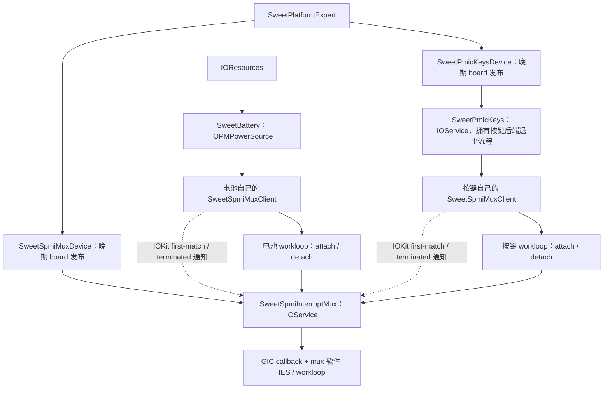

# PMIC mux consumer：匹配通知与终止清理

2026-11-05，新增补丁 `0145-mh2lm-mux-consumer-matching.patch`，基于已核对的
0117 最终源码。实现与本地验证完成；0118 原生云端内核及 buildtree 已核对，
包含 0145 和后续退出告警，三档 boot 已生成，实机结果待验证。
0117 baseline 证明的是旧 0144 的正常启动，不能作为本次改造的实机验收。

## 当前服务与接口



consumer 使用 IORegistry 通知发现服务，并持有有引用计数的 mux 指针。
`SweetSpmiMuxClient` 是每个 consumer 自己的 C++ 对象：包含自己的 notifier、
provider 引用、锁和 consumer-loop 软件事件源。它没有全局 provider 指针、
全局 C 查询入口，也不代替 mux 的 IOService 生命周期。

公开类型定义在 `bsd/dev/sweet_spmi_mux.h`，提供：

```cpp
virtual IOReturn attachConsumer(IOService *consumer, unsigned group,
    unsigned events, SweetMuxNotify notify, void *context);
virtual void detachConsumer(IOService *consumer, unsigned group, void *context);
```

这是本项目定义的 C++ 驱动接口，采用 IOKit 对象身份与 `IOReturn`；不是声称
IOService 基类自带同名注册 API。mux 在自己的 workloop 串行接入/撤回。
绑定同时记录 consumer 与 context，另一个 consumer 不能用相同 context 撤回
别人的路由。caller 持有 mux 引用并保证 consumer/context 活到 detach 返回；
detach 返回后该 context 不会再收到 mux 回调。mux 不强引用 consumer，避免循环。

移除 `muxService`、`retainMux`、`readyLock`、`publishReadiness`、全局
`watch_ready/unwatch_ready/attach/detach` C API。保留的 C 入口只有 board
发布与 GIC 分发；`irqService` 是受 spin lock 保护的硬件分发槽，consumer
不使用它查找 provider。一次启动的硬件 claim 标志防止停止后重新接管同一硬件。

仍是七条固定路由、按键/电池两个 group；本次没有增加动态硬件路由描述注册。
SID/peripheral/bit/edges 固定，APID 仍在接入时解析唯一 IRQ owner。
按键 C 后端也仍只支持本机一个物理按键块，不声称已成为通用可多实例控制器。

## 匹配与启动

- 先建立 consumer workloop、连接锁和软件事件源；安装
  `gIOTerminatedNotification`，再安装 `gIOFirstMatchNotification`。
  IOKit 会回放已存在的匹配服务，无须 `waitForService()` 或重试定时器。
- 注册期间事件源保持禁用，字段与两个 notifier 建立完成后启用并排队。
  匹配回调只在锁内验证状态、retain 服务、记录引用和排队。terminated 回调
  只标记被选择的 provider 已离线并排队；均不等待 consumer/mux workloop。
- consumer workloop 调用 `mux->attachConsumer(...)`。返回成功且 provider
  仍有效后，才通知 owner 已接入；原 `SWEET_MUX_READY` 位只用作这条本地
  “路由已接入”通知，不再是全局基础设施就绪回调。
- `SweetBattery` 保留早期发布初始真实采样，IRQ mode2+ 通过匹配通知接入。
  接入后保留一次 arm-sync 采样和原有有界确认，mode0/1 对照轮询不变。
- `SweetPmicKeys` 通过 personality 匹配晚期 keys nub，准备观察寄存器，
  注册自己的连接；路由接入后才启动原 C 采样/HID 线程。board 不再直接启动
  C worker。按键关闭时不创建 keys nub，mux/电池匹配不受影响。

mux 可能先存在，也可能晚于 consumer。若 mux 根本没有成功发布，registry
不会凭空产生失败通知：consumer 保持可观察的 waiting/unhealthy，无定时读取；
board/mux 启动错误日志用于区分“服务不存在”和“已接入后终止”。不再保留旧的
全局 FAILED rendezvous。已选择的 provider 终止或运行期失败则明确停用，
本次启动不自动换 provider 或恢复轮询。

按键真实 arm 在 consumer workloop 异步完成，不要求它先于 UFS 日志；仍要求
board 发布 mux/keys nub 在根查找前，mux 硬件只在原晚期可睡眠阶段初始化。

## terminated、退出及锁顺序

1. IOKit 将 mux 标为 inactive 时立即投递 terminated 通知；连接持有的引用
   让对象不会在 consumer 清理前释放。此时通知回调只排队，不做跨 workloop 调用。
2. consumer workloop 收到 terminated/FAILED 或发现 inactive，停止再次接入，
   调用 `detachConsumer` 同步所有 mux 回调，然后释放 provider 引用并报告 owner
   失败。另一条已排队的 IRQ 不能重新建立绑定或继续采样。
3. mux 自身 `willTerminate/stop` 进入 mux gate，先阻止 attach、屏蔽并断开
   GIC callback，再停硬件/通知失败/撤回路由/清 consumer/context，禁用并移除
   软件事件源。workloop 和映射留到最后一个引用释放后的 `free()`。
4. consumer 自己退出时先停止 owner 活动；连接标记 stopping，同步移除两个
   notifier，再在 consumer loop 撤回尚未撤回的绑定并 drain。
   正常 owner 清理不在持锁或 workloop gate 的范围内等待 notifier removal；
   notifier 回调本身始终不取 workloop gate。移除完成后才移除事件源及释放对象。
   `IONotifier::remove()` 本身同步回调并释放 notifier，不额外 release。
5. 电池 `willTerminate/stop/free` 停止采样/确认计时器、detach、移除通知和
   软件事件源，最后释放连接和 loop。失败时保留上次真实数据并标记 unhealthy，
   不切回周期采样。
6. 按键收到失败或退出时，先断开 mux 连接，再通知 C worker 退出。worker
   释放仍按下的 HID 键后发布完成并唤醒等待者；等待完成后才解除 observer/core/
   cfg 映射。线程创建失败和部分 prepare 失败也释放已取得的映射。

mux 回调只做原子合并并唤醒连接事件源，绝不等待 consumer gate。因此允许
consumer gate → mux gate；没有反向等待。IRQ 自身仍只短暂持 GIC spin lock。
可释放映射使用 `ml_io_map_unmappable(..., VM_WIMG_IO)`；解除包含页偏移的完整
16K 范围，特别是 cfg 的 `0x2000` 偏移。临时 PDC/GIC 诊断映射读完即释放。

### 对退出顺序的补充核对

本项目 XNU 的 `IOService::terminatePhase1()` 先标记 inactive，再投递
`gIOTerminatedNotification`；不能用该通知推断 mux 的 `stop()` 已经完成。
`_IOServiceNotifier::remove()` 是停用订阅、等待正在执行的回调并释放 notifier，
不会触发 service terminated。因此通知回调本身只标记/排队，不调用 mux 方法、
不读 mux 成员，也不提前释放尚有绑定的 provider 引用。

后续 consumer workloop 在持有引用期间执行 `detachConsumer()`，再释放 mux。
这是本接口明确允许的 teardown 操作：inactive/已 stop 的 mux 仍保留 gate 和
映射直到 `free()`；detach 由同一个 gate 与正在执行的 callback/stop 串行。
这项约定不表示可以任意调用已经 inactive 的 IOKit 服务方法。

按键 owner 正常退出的准确顺序是：

1. 连接在锁内标记 stopping，阻止后续匹配和 owner 事件投递。
2. 同步移除两个 notifier。
3. 在 consumer gate 上 detach，等待 mux 回调结束，释放持有的 mux 引用，
   禁用并移除连接软件事件源；已在执行的 owner 动作也已完成。
4. 设置后端退出原子标志并唤醒 worker；worker 补发仍按下键的 HID key-up，
   然后发布完成。owner 等待此完成，再解除后端 MMIO。
5. `IOService::stop()`。

这里先断开 IRQ 路由，再停止采样线程。补 key-up 在 worker 发布完成之前，
其按键状态是 worker 的局部数据。mux 与按键后端各自拥有独立映射，且解绑时
callback context/事件源仍有效；不存在先 unmap、后允许 mux 调用 consumer 的窗口。

当前 consumer 通过 registry 持有 mux，并非 mux 的 IOService 子节点，IOKit
不会自动保证它们在 mux stop 前全部 detach。mux 的 gated shutdown 会对仍有
绑定的每个 group 输出 WARN，然后撤回回调并清空身份/context；不能在入口直接
assert 表为空。此告警用于观察未主动解绑的绑定，也可能来自合法的异步退出时序，
本身不证明引用泄漏。对象/notifier/MMIO 计数测试另行检查释放平衡。

## 验证与下一轮

- 精确 0117 + 0145 严格重放；最终源码与编译输入逐字节比较。
- 七个编译单元生成 ARM64 Mach-O：mux、连接、keys service、battery、personality、
  keys C 后端、board。C++ 使用实际 0116 IOKit 参数、本机路径/目标适配及 Apple
  type builtin 临时替代；BSD 不混入 IOKit。符号确认旧 consumer C 桥接消失。
- `test-mh2lm-battery-irq.py` 对新树调度实际 mux/连接/keys service 与部分电池
  方法的 registry 测试；对旧树保留原回归。覆盖先/后匹配、取消、attach 前后
  terminated、notifier/IES/启动失败、身份校验、并行 consumer，以及原有 APID/
  rollback/600 IRQ/storm/timeout；另跑 40 次通知/IRQ/退出竞争。
- 退出顺序复核增加三项：terminated 先于 provider stop 且 consumer 先处理、
  provider stop 先于 consumer 处理，以及按键 owner 先退出。检查通知回调只排队、
  两个绑定撤回及 WARN、正常先 detach 无 WARN，并保持引用/映射平衡。
- `test-mh2lm-key-lifecycle.py` 运行实际 C worker/start/stop（替换 MMIO/线程原语），
  验证 IRQ 唤醒、按下键释放、读取中退出等待、线程/三处映射分配失败、诊断映射
  回收；另跑 20 次读取/退出竞争。ASAN/UBSAN 与显式对象/映射/notifier 计数通过。
  环境无法运行 LSan；不将这些模型当作原生调度、匹配锁序或硬件退出证据。
- 实际 CircleCI 最终源码 gate 接受新树、拒绝 0117 旧树。编译命令不变，仅更新
  校验路径和标记。packer 拒绝没有 registry 消费路径的旧内核，不生成假新镜像。

0118 原生源码与符号已核对，`out-bs/boot-16k-0118-board-startup-*.img` 三档：
baseline、no-keys、usbin。先看 baseline 的 mux started、group0 matched/attached、三键/HID、
触摸/ACM 与息屏唤醒，再验证 group1 独立接入与真实 USBIN。镜像清单和 SHA256 见
`NOTES.md`。正常手机回归不主动 terminate 核心服务；真实 stop/free 的硬件验收仍未进行。
