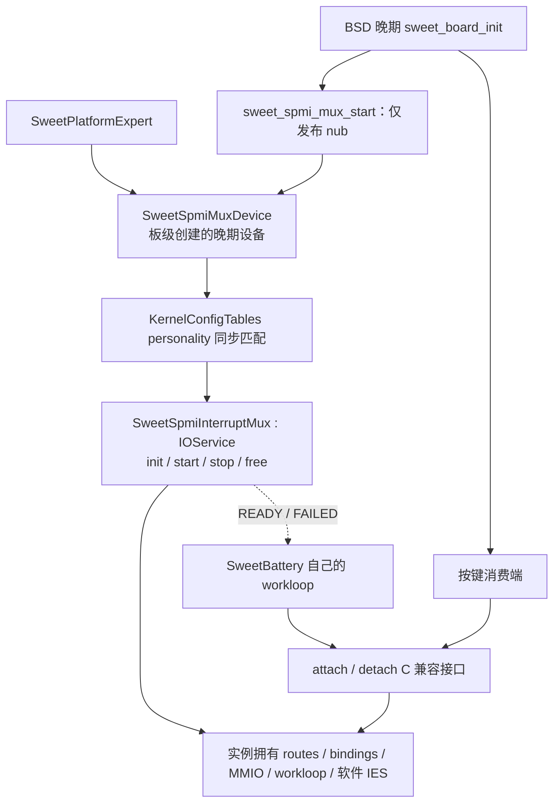

# SweetSpmiInterruptMux 的 IOService 化

**0145 更新：** consumer 已实现匹配/terminated 通知和公开 C++ attach/detach，
移除本页描述的全局 C 桥接与 readiness rendezvous；本地验证通过，待新原生
产物及实机回归。当前 consumer 架构与完整清理顺序见
[`MUX-CONSUMERS.md`](MUX-CONSUMERS.md)。下文保留为 0144 基线记录。

2026-11-05，0144 叠加 0142/0143，0117 原生内核及 baseline 实机启动通过。
电池独立接入/并行 USBIN 与真实 stop/free 尚未验收。
用户要求进一步把 mux 变成 IOService，并评估 filter / interrupt controller。
电池验收继续暂停，0115 的硬件证据与未知项不变。

0116 云端编译在 `SweetSpmiInterruptMux.cpp:239` 失败：`VM_WIMG_IO` 展开所需的
`VM_MEM_COHERENT`、`VM_MEM_NOT_CACHEABLE`、`VM_MEM_GUARDED` 未定义。
0144 已应用，问题是直接包含了 `<arm/memory_types.h>`，遗漏通用定义。
修正为包含 `<vm/memory_types.h>`；该头文件同时引入机器相关定义。
继续使用 `ml_io_map_unmappable(..., VM_WIMG_IO)` 与完整页范围释放。

本地提取 0116 的实际 IOKit 编译参数，修正前复现三个错误，修正后生成
ARM64 Mach-O；仅作本机路径/目标适配和 Apple 类型 builtin 的临时替代。
此前混合 BSD 与 IOKit 参数的交叉编译掩盖了依赖问题，不能作为此项验证。
补丁顺序应用、board 与 mux/battery 回归通过；完整原生编译/链接与实机验收
仍待下一轮。此次只改头文件，不调整 IRQ、匹配、生命周期或 consumer 接口。

0117 更新：内核 SHA256 与产物清单一致，18 个相关最终源码文件与修复版
逐字节一致；链接后的内核含 nub/mux 类、生命周期、board 入口和映射函数。
已生成 `out-bs/boot-16k-0117-board-startup-{baseline,no-keys,usbin}.img`，
核对 FAT 内容与最终 boot 的 kernel/ramdisk 字节。先验收 baseline 日志，再测
独立电池与并行档。原生编译/链接这一关已过，真实匹配、按键回归和电池 IRQ
尚未验收；未提供本轮构建日志，不能据产物声明无构建警告。

## 三种类型分别负责什么

| 类型 | 实际职责 | 本轮决定 |
| --- | --- | --- |
| `IOService` | 设备匹配、IORegistry、start/stop/free、实例资源和服务生命周期 | 实现：mux 继承 IOService，状态归实例。 |
| `IOFilterInterruptEventSource` | primary interrupt context 快速过滤；true 才调度 workloop；常用于可安全快速判断来源的硬件 | 本轮保留普通软件 `IOInterruptEventSource`。INTID513 已独占交给 mux；路由确认仍需下半部。 |
| `IOInterruptController` | 向 provider 的 client 提供 register/enable/disable/投递接口，将中断接入 IOKit 通用管理 | 尚未实现；未来由上游 GIC provider 承担，不能只把 mux 改个基类来代替。 |

这些类型不是互相替换的三种实现。拥有 `IOService` 生命周期不意味着已经具备
`IOInterruptController` 的中断 provider 能力。

核对本版 XNU 的 `IOInterruptEventSource.cpp`、`IOFilterInterruptEventSource.cpp`
和 `IOService.cpp` 后确认：

- 有 provider 时，事件源会通过 provider 的 `registerInterrupt` 等接口接到
  controller；当前平台没有这条 IOKit GIC provider 链，nub 也没有中断 specifier。
- provider=NULL 时可以手动调用事件源的 `interruptOccurred()`；若换成 filter
  子类，normalInterruptOccurred 仍可执行 filter。**不是技术上不能使用 filter**。
  但 GIC callback、屏蔽、重开和退出同步仍要自己管理，不会自动获得 controller
  管理能力，也不应把 `this` 当成不存在的中断 provider 传入。
- PMIC-arb 的 `IRQ_STATUS` 可直接读 MMIO 判断 pending；并非全部来源识别都要
  SPMI。耗时/有界等待主要在 SPMI ack、外设触发配置和状态读取，应留在 workloop。
- 当前每个已投递的共享 PMIC IRQ 都需要 drain/ack。未知 pending 必须显式停用并
  留日志；不能让 filter 简单返回 false 而留下 level IRQ 不处理。本轮无明确的
  可跳过 workloop 的正常事件类别，因此保留短 callback 加普通软件事件源。

未来若引入真正 GIC controller，先提供 provider 的注册、type、mask/unmask、
handler 与退出同步，再让 mux 的事件源绑定那个 provider。若确有安全的快速
筛选需求再选择 filter；普通 provider-bound IOInterruptEventSource 本身也可以
处理 level IRQ 的屏蔽/下半部交接。PMIC 路由表和按键/电池回调接口继续保留。
本次没有把 DWC3、触摸或定时器迁移到新 GIC controller。

## 匹配与启动

`SweetSpmiMuxDevice` 是板级在已就绪的 platform expert 下创建的服务 nub，
不是新编造的固件 DT 节点，不是 GIC controller。`KernelConfigTables.cpp` 只在
MH2LM 配置增加 provider=SweetSpmiMuxDevice、driver=SweetSpmiInterruptMux 的
personality。nub 的 `registerService(kIOServiceSynchronous)` 让 IOKit 正常匹配，
不是手工调用驱动 `start()`。

保留 BSD 晚期阶段：IOBSD/autoconf 与 inittodr 后、root lookup 前。nub 同步匹配
返回 READY/FAILED 后，board 才继续 keys/touch/USB 初始化。早期 battery 不阻塞
此过程，继续用 0142 就绪订阅；它可以在匹配前或后启动。关闭 keys 不影响发布。
匹配失败或没有驱动时发布 FAILED，board 仍继续独立设备，无轮询兜底。

`init()` 建立实例初值；`start()` 建立自己的 IOWorkLoop、owner=this 的软件
事件源、公共映射和有界 GIC probe，注册服务后发布 READY。仍没有 consumer
时不 arm 外设。三键和电池继续通过旧 C API 接入，运行时处理路径不变。

IORegistry 层级为 `SweetPlatformExpert -> SweetSpmiMuxDevice ->
SweetSpmiInterruptMux`。服务发布 `SweetMuxLifecycle`、`SweetMuxIntID=513`、
`SweetMuxHardwareProvider=false`；后者明确上游仍是板级 callback。
按键仍是 BSD consumer，电池仍按原 IOResources personality 匹配，**两者不是
本次新建的 mux 子 IOService**。未来完整子驱动 provider 化需另行实施。

## 生命周期与内存约束

1. 可变 routes、bindings、channel、计数、状态机、workloop 和事件源归实例。
   全局只保留启动前 rendezvous、受锁保护的服务/IRQ 指针，以及不可变模板。
   READY 订阅锁与 IRQ 指针锁保留整个内建模块的启动寿命。
2. C API 在 readiness lock 下取得服务临时引用，释放锁后才等待 mux gate。
   workloop 到 `free()` 才释放，保证已取得引用的调用不会遇到 stop 提前释放 loop。
3. `stop()` 进入自己的 workloop gate。先阻止新 attach，再短暂取得 IRQ spin
   lock，屏蔽 SPI 并断开指针，等待正在执行的上半部离开。上半部不取 workloop
   gate、不做 SPMI、分配或日志，因此不会与 gate 反向等待。
4. 在同一 gate 下停止硬件、通知 consumer 失败、清理自己的 route 位和所有
   callback/context，禁用并移除事件源；随后才取消 C API 查找发布。并发 detach
   可在同一 gate 同步，不会因过早隐藏服务而错过仍在使用的 context。
5. `free()` 释放事件源、workloop 和所有实例映射。部分 start 失败也走清理；
   没有接触硬件配置前的失败不会擅自写 PDC。共享 fatal 仍影响所有 consumer。
   当前服务的停止/失败是本次启动的终态，不支持停止后自动重建或重新试写
   已超时的 APID；必须重启，不隐藏恢复到轮询。

**映射使用可释放的路径。** 本版 `ml_io_map()` 的 late 分配使用 io_submap +
KMA_PERMANENT，不能配对 `ml_io_unmap()`；0144 使用
`ml_io_map_unmappable(..., VM_WIMG_IO)`，保留相同 MMIO 属性和物理跨度。
释放必须 `trunc_page(VA)` 与 `round_page(size + page_offset)`，尤其 CFG
物理地址 `0x0c40a000` 在 16K 页中偏移 `0x2000`。不能只释放原始 0x1000
寄存器范围。每 route 缓存已映射 channel，重复 attach 不重复分配；每次仍先查
唯一 EE0 IRQ owner，拒绝缓存 APID 与新解析结果不一致，避免复用错误映射。

## 验证与后续实机

0117 baseline 持久日志确认 BOARD 与 mux IOService 在根挂载之前就绪，
随后 group0 events=0x7 接入。Power/Down/Up 的真实 IRQ 命中分别为 6/4/8，
HID 按下/松开成对；触摸/USB 同时工作，息屏后电源键能唤醒显示。
未见 mux/按键/触摸/USB 的 ERROR 或停止，保留四条已有 USB endpoint WARN。
这证明正常匹配/start 与按键路径；baseline 关闭电池 IRQ，尚不证明 READY
通知到电池或 group1 独立工作。接下来使用同内核 no-keys → usbin，stop/free
仍以本地模拟为证据，未在手机主动 terminate。原始日志与计数见 `NOTES.md`。

本地输入/基线/重放/编译证据放在工作区 `scratch/mux-service-0115/`。
ARM64 编译检查 mux、KernelConfigTables 和 board；Linux Apple type builtin
替身只存在编译脚本中，不能替代原生完整链接。

已有 board 和 battery/mux 测试继续使用；服务测试编译真实实例代码，仅替换
IOKit 匹配/调度、MMIO/时间和部分 battery 采样/property。新增覆盖：未匹配、
init/loop/event/map 失败、已有 pending 时 stop、battery stop 并发、IRQ/API
与服务 stop/free 并发，最后检查所有映射释放、无回调到已删除实例、无 IRQ
指针断开后重新开启 GIC。包含 16K 对齐/CFG 偏移释放与 channel 缓存检查。
ASAN/UBSAN 的模型不证明真实 IOKit 匹配/调度和手机 IRQ/清理时序。

用户 push 后仍一次云编译，用 `--board-startup` 打包三档：baseline -> no-keys
-> usbin，按 [`DRIVER-STARTUP.md`](DRIVER-STARTUP.md) 顺序检查。
新增必需启动记录为 `SWEET MUX: IOService started; owns workloop, routes and MMIO`，
再看 consumer attach/armed；未匹配先停在启动问题，不解释成 PMIC 极性故障。
主机日志与持久日志一起保留。暂不要求重复旧硬件预检或运行 CHGR/MSOC。

CircleCI 仅新增最终源码/匹配标记门禁，构建命令未改。打包拒绝缺少 IOService
标记的旧 board-startup 内核。正常手机回归不主动 terminate 服务；stop/free 的
真实硬件行为尚未验收，不以模拟结果冒充实测。
