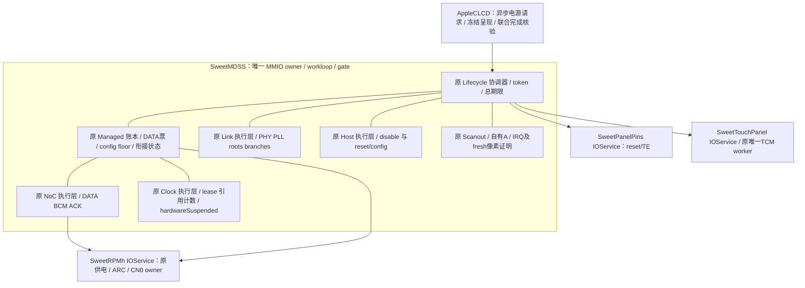

# PD3：数据票停驻与 host/PHY 下电的组合事务（0198）

**0199供电归属增量（2026-11-12，本地通过，未实机）：** 已确认DSI host L3/PHY L5
与MH2LM UFS及USB PHY共用；这些驱动尚未在SweetRPMh登记依赖，不能按显示最后一票关电。
provider新增typed `lastDisableRequiresHandoff`及mask0xc，在任何写入/token/账本修改前拒绝
这两路最后aggregate disable，保留原票和完成状态；非最后撤票及panel两路原接口保留。
21套检查与RPMh/MDSS/FB六个arm64单文件对象通过。没有新增档位或实际撤电，0198 mode5仍为
当前组合休眠路径。详见[供电图、源码依据、保护与剩余项](PANEL-SUPPLY-OWNERSHIP-D1.md)。
下一步保留L3/L5，补LG顺序的reset-low及panel VDDI/VPNL受控撤票/恢复；E7触摸与E8物理
共享/偏压尚未验收。无新FD/boot、push/CI/设备操作，CircleCI未改，暂不单开云编译。
以下0198及更早描述按当时范围保留；完整驱动仍未完成。

2026-11-12，接0197。新增显式 `sweetpanellifecycle=5`，把0196的数据资源停驻和0197的
host/PHY/PLL关闭、重建接到原统一协调器。默认0，原1–4语义保留，不自动降档。
本轮仅本地验证，未实机；不等于面板rail-off、整机休眠或完整显示冷启动。

交付 `xnu/patches/0198-mh2lm-panel-combined-suspend.patch`。启动/match无硬件事务，初次
takeover仍走原温态接管。没有新增IOService、线程、映射、全局实例桥或第二套硬件配置算法。

## 架构

数据票与链路共用同一代生命周期事务，执行仍分别由原NoC、Clock、Link、Host模块负责。
`ManagedParkLink` / `ManagedRestoreLink`是两个内部衔接状态；旧一次性takeover状态机不处理它们。
没有清空`fManagedStarted`重跑接管，也不把软件`stop()`当作硬件下电。

## 顺序及每一步的证明

息屏：

1. 原TCM暂停fence、TE/autorefresh停止、显示IRQ及DMA真实静止，完成所选profile完整OFF和等待。
2. config-only NoC floor明确Held；保留CN0 300MB/s，所有DATA字段为零。
3. 原managed DSI0 clock票明确Released才清旧token；boot票继续持有，所以此步不物理关钟。
4. 进入`ManagedParkLink`，仅boot link票存在。复用0197关闭host、BYTE/PCLK、PHY/PLL/bias；
   要求分支/root off、新LOCK清零、全部Dormant读回成功。
5. 在LinkDormant/HostDormant及暂停mask=0x70下，释放managed DATA NoC；明确Released才清token。
6. 完成必须同时有`resourcesParked`与`linkPoweredDown`，managed clock/DATA token都为零；
   config floor、boot/RSC clock、LDO/ARC和core配置通路继续保留。

唤醒：

1. 只接受本驱动成功停驻、同一组provider、再次验证一致的Dormant状态和触摸暂停fence。
2. PHY仍关闭时，沿保留的配置通路取得新DATA NoC票并等Held；不提前复位PHY或面板。
3. 进入`ManagedRestoreLink`，复用原Link重建后半段：PHY reset、REFGEN、完整配置、PLL rate/SSC、
   新LOCK、RCG更新、实际分支/root运行及受控parent snapshot提交。
4. 只有上述物理证明成功、暂停mask清零后，才走原Clock typed接口取得新managed DSI0票。
5. DATA与两张clock票全部Held后，复用原Host reset/显式配置读回。Host完成前不报告完整资源就绪。
6. 原面板activate/reset、完整ON、最新typed亮度、fresh像素完成及实际TCM恢复，之后才交付完成。

四版LG表、OFF/ON时序、PHY/PLL和Host算法均复用原执行层，没有新复制一套常量表。
OFF不进行PHY/面板reset；ON不恢复未知ABL寄存器快照。

## 配置通路的有限授权

普通Clock接口在暂停mask非零时仍拒绝增撤票；没有开放“PHY关闭时取得DSI0 clock”。
普通NoC接口此时同样拒绝增撤票，status查询仍可用。

协调器通过私有`lifecycleDataBandwidth()`构造typed request。仅这一笔请求携带栈上内部标记，
没有gate范围的临时全局开关。NoC再次检查：mode5、准确的ResourcePark/Restore阶段、
ManagedParkNoC/RestoreNoC、指定managed DATA token或输出地址、没有managed clock/中间token、
真实Link/HostDormant、config floor和完整资源fence。不能借此释放config floor、boot或RSC clock。

原RSC票跨周期保留，DATA事务不重取/撤销RSC clock。原NoC solver/sequencer仍温态继承；
这不是冷NoC实现。其它active DATA票继续参与聚合，释放本票不保证硬件DATA BCM归零。
额外软件link票和DSI1硬件alias仍在DDI副作用前拒绝，事务期间继续复核。

协调器及NoC/Clock/DSI子timer每次推进都重查同代participants/TCM fence、ARC/rails/core、
保留clock/parent、config floor、IRQ、TE/auto、DSI/CTL/line、自有A/SMMU与期限。
休眠链路不再伪装为物理Ready；只允许保留AHB上的受控MDP/SMMU快照读取。
总16s期限保留，资源段4s、链路段1s及原NoC/Clock/Link/Host内部期限保留。

失败/取消/stop/provider撤回仍关闭本代，保留剩余或在途token、部分硬件状态和DMA lifetime pin。
没有自动回退、复位收尾、清除poison或偷偷恢复旧状态。已提交的RPMh请求可能后来ACK，
不宣称取消能撤回已经发出的硬件事务。

## FB完成条件与档位

mode5同时要求`SweetPanelDataParking`和`SweetPanelLinkPowerCycle`能力。
OFF核验睡眠/触摸/显示drain以及DATA parked、link down、保留config token和零DATA/clock token。
ON核验两部分恢复、有效新DATA/clock token，以及原profile/reset/亮度/pixel/touch证明。
只满足mode3或mode4、普通Complete、缺少任一联合证据均失败，不回退旧电源路径。

| 档位 | managed DATA/clock票 | host/PHY/PLL | 面板 |
|---|---|---|---|
| 0 | 原默认行为 | 原默认行为 | 原默认行为 |
| 1 | 保留 | 保留 | 温态28/29 |
| 2 | 保留 | 保留 | 完整OFF/reset/ON |
| 3 | 释放、重取；config floor保留 | 保留 | 完整OFF/reset/ON |
| 4 | 保留 | 实际关闭、重建 | 完整OFF/reset/ON |
| 5 | 按组合次序释放、重取；config floor保留 | 实际关闭、重建 | 完整OFF/reset/ON |

mode5要求mode4的live profile/pins2/touch2/own2/power1/IRQ2/dsi1/managed1/core2/host1/link2
及原resource/clock/NoC依赖。不猜PV，不接管未知冷PHY，不清Fault/Stopped后重试。

## 本地验证与交付边界

底稿`/home/shenli/work1/scratch/framebuffer-0198/`，base逐字节连续于0197verify。
严格应用无offset/fuzz，114个原CI source marker保留。
21套检查：20套实际源码ASan/UBSan及1套Python ADT检查；无最终sanitizer报告。
新联测执行实际协调器/资源/NoC/Clock/Link/Host/扫描及TCM worker，仅替换OS调度、MMIO响应和线级peer。

覆盖四profile各四轮、两个衔接点的先后顺序、DATA ACK前不reset、PHY完成前不取clock、
clock完成前不reset host、新DATA/clock token、config/boot/RSC/ARC token保持、暂停时公共请求拒绝；
每资源/Link阶段取消/stop/provider撤回、ACK丢失、独立硬件响应失败、子timer先运行下的硬件漂移/
期限、额外link consumer拒绝与DATA票保留、token耗尽、停驻后漂移/取消和FB联合证据缺失。
LSan因环境ptrace限制关闭；另核对对象/映射/通知/分配和模拟reboot后的DMA pin归零。

真实XNU/KDK arm64的MDSS/FB base/final单文件对象编译、关键符号检查通过，不代表整核链接或硬件结果。
MDSS warnings 1524→1527，净增3为数组提示（五处增加、两处旧表达式替换）；固定mask索引1<3、
clock lease循环n<4、clock reference循环4≤n≤6<10，已逐项审查；FB 1397不变。没有抑制新警告。

未改CircleCI、USB/按键/电池/mux或触摸IRQ策略；无push/CI/设备操作，无新FD/boot。
暂不为孤立接口单开云编译。后续打包仍须合入0195实际Mu→DarwinBoot身份补丁与ADT slot，
仅新XNU配旧UEFI不会得到live profile。本机身份、E7复位触摸、E8共享电/偏压仍未实测。

下一步继续PD3正常rail-off与故障后受控资源释放，先厘清共享电源/偏压E8的所有权；
然后PD4冷NoC/MDP与状态失效后的独立重建、PD1剩余ABL buffer/console/panic退出、PD5完整IOPM。
不盲撤ABL/其它consumer票，不扫描未知PMIC偏压，不启动Android。完整驱动仍未验收。
A单缓冲/30Hz CPU复制保留，未宣称旧滑动退化或BUG-003修复；零拷贝在完整驱动之后推进。
