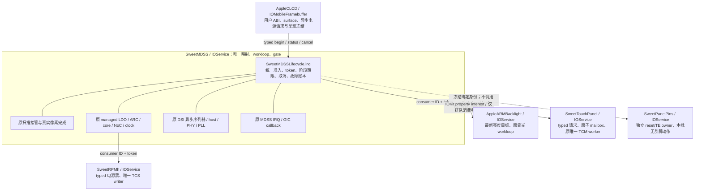

# 统一面板生命周期协调器（0194）

**0201当前增量（2026-11-12，本地通过，未实机）：** 统一协调器新增显式
`sweetpanellifecycle=6`：完整OFF→reset实际低保持→原mode5 DATA/link停驻→VPNL/VDDI
逆序撤本panel票；ON先active-low→VDDI ACK+20ms→VPNL ACK+5ms，再恢复DATA/link/clock/
host/reset/完整ON/亮度/fresh像素/触摸。共享L3/L5、ARC、config floor和boot/RSC/core通路保留。
每ACK更新部分完成账本，失败先同步取消RPMh子事务再撤Pins/Touch token；FB核对联合证据。
原0–5保留，模式6默认关闭。撤本票不是物理rail-off证明，E7/E8仍待实机。
23套检查、8个真实XNU/KDK arm64单文件对象通过；**完整Mu mh2 RELEASE FD现已构建并核验**，
包含原0195身份adapter，旧blob未改。新`--panel-lifecycle`支持同核identity/retained/combined/
supply四档，先核对live身份，再逐级验收；缺新固件manifest或内核marker就拒绝打包。
现在需要用户push并云编译，下载后再打实际boot；CircleCI未改，未push/触发CI/操作设备。
详见[供电生命周期、架构、四档与证据](PANEL-SUPPLY-LIFECYCLE-D1.md)。
PD4冷NoC/MDP、ABL首帧/console/panic退出、故障后受控释放及完整IOPM仍缺；完整驱动未完成。
**以下0200及更早段落是各阶段历史记录，当前状态以本段及NOTES顶部为准。**

**0200供电依赖校验增量（2026-11-12，本地通过，未实机）：** Pins 新增实时 reset-low
查询，RPMh 新增仅 VDDI/VPNL 的 typed panel vote/取消接口，逐写核对同代 Pins/Touch token，
保留依赖引用，异常停止并保留部分事务；不撤共享 L3/L5。22套检查及八个真实 arm64
单文件对象通过。**尚未接入协调器供电释放/恢复，未新增档位，mode0–5正常路径不变。**
下一步接 LG 顺序、部分撤票账本及联合完成证据；E7/E8仍未实机。详见
[接口、锁顺序、失败边界及验证](PANEL-SUPPLY-FENCE-D1.md)。无新 FD/boot、push/CI/设备操作，
CircleCI 未改，暂不为接口单开云编译。以下旧阶段按各自范围保留，当前以此段及NOTES为准。

**0198后续增量（本地通过，未实机）：** mode5现已将数据票停驻与host/PHY/PLL关闭、
重建组合：OFF保config→放clock→关link→放DATA；ON取DATA→重建link→取clock→重建host→
原reset/ON/亮度/pixel/touch。普通暂停接口仍拒绝改票，仅协调器指定DATA请求获得有限授权；
不是rail-off或冷NoC/MDP。详见[组合事务和架构](PANEL-COMBINED-SUSPEND-D1.md)。
以下按各原阶段范围保留，当前以0198及NOTES顶部为准。

**0197后续增量（本地通过，未实机）：** 新增mode4，保留全部票，实际关闭并重建host/PHY/PLL；
clock状态另报物理暂停，FB核对关闭/重建证据。原0/1/2/3范围保留；未实现rail-off。
详见[硬件关闭及恢复、架构和边界](PANEL-LINK-POWER-D1.md)。以下按原阶段范围保留。

**0196后续增量（本地通过，未实机）：** 已接入mode3 managed数据票释放与重新取得，
保留独立config floor及所有供电/boot/link/core资源；原mode1/2范围保留。
详见[当前资源事务及边界](PANEL-RESOURCE-PARKING-D1.md)。以下按本文件原阶段范围保留。

**0195补充（本地通过，未实机）：** mode2现已接入完整厂商表、保留供电的sleep/reset恢复及亮度重放；
引脚增加consumer/token取消。实际Mu/DarwinBoot身份传递、准入和未完成项见
[PD3当前记录](PANEL-PROFILE-D1.md)。以下0194及更早描述按当时范围保留。

2026-11-11。本批接通可运行的**温态接管及 Display Off/On 事务**，不再只绑定 provider。
默认关闭；仅本地验证，未实机。完整面板驱动仍未完成，不能将本批称为冷初始化或断电恢复。
补丁为 `xnu/patches/0194-mh2lm-panel-lifecycle-coordinator.patch`，接在0193后。

## 1. 架构与所有权

生命周期层是 MDSS 内部模块，不另建一个反向等待 MDSS 的 IOService，也不增加线程、
MMIO映射、全局实例桥或触摸硬件 owner。匹配通知继续只撤回/retain并排队。
跨 provider 方法只提交请求或查询状态；没有持有对端需要的 gate 等待其硬件完成。
每次延时和阶段推进由原子 mailbox 或 timer 完成，CPU/IRQ 的原所有权不变。

## 2. 实际支持的事务

| 动作 | 本批执行内容 | 完成条件 |
|---|---|---|
| Warm takeover | 现有只读准入 → 触摸暂停 → 原扫描停流 → IRQ真实退出 → LDO/ARC/core/NoC/clock/可选PHY-host重建 → A提交 → 触摸恢复 | 资源票完成、自有A的 fresh PP_DONE、flush=0、RD_PTR推进，且原TCM worker完成应用/格式读回与IRQ恢复 |
| Display Off | 触摸暂停 → 保存并停TE/auto → IRQ/DMA静止 → 异步DCS28 | fresh命令DMA_DONE且DMA/MDP idle；触摸继续停驻、TE/auto停、IRQ停、资源票保留 |
| Display On | 核验同一个触摸暂停token及资源票 → 异步DCS29 → 恢复TE/auto及IRQ → 新像素完成 → 触摸恢复 | 新PP_DONE、flush=0、RD_PTR推进，并且触摸验证恢复成功 |
| Prepare / Reset / Unprepare | 返回 Unsupported | 不提交触摸请求、不动TE、不投票、不写引脚/厂商表 |

Display Off依然是F2的28语义，不是Sleep In、rail-off或domain collapse；Display On不发送
候选vendor初始化表。原 `setPanelPower(bool)` 在默认档保持原行为；显式协调档改用新typed
异步接口，直接调用旧接口返回Unsupported，不偷偷把同步调用变成断电。

Warm takeover仍从ABL温态布局准入，使用原自有A交接与资源链；没有撤销ABL像素、console、
panic及冷NoC/MDP依赖。面板PP1/DV1/DV2/PV身份未确认，E1/E7/E8未关闭，reset后可恢复、
触摸共享供电可撤销和完整资源反向释放均无证明。本批没有调用pins的activate/reset/park。

## 3. 完成、期限和准入

`SweetDisplayBackend`新增 `panelLifecycleCapabilities / beginPanelLifecycle /
panelLifecycleStatus / cancelPanelLifecycle`，使用provider拥有的单调64位token。
Takeover仍通过带pool/channel的 `beginScanout()` 入口，因此不会绕过原几何、DMA可达性及
硬件生命周期pin准入。begin成功只表示已受理；status在stop后仍可读取，不访问硬件。
未知op不会消耗token，溢出拒绝请求，不wrap。协调器不复用替换provider的旧token。

阶段包括 `TouchPause / Drain / TakeoverPending / Command / Frame / TouchResume /
Complete / Fault / Stopped`。触摸请求每段最多6.5秒，显示/IRQ drain50ms，资源和接管段5秒，
单命令段500ms，新像素100ms，总事务16秒；已有子状态机的更短期限继续生效。
这些是本地软件预算，不是新的实机时序测量。Framebuffer另有17秒consumer watchdog。

`IrqIdle`仅是软件状态。资源写入前另核对GIC RWP、INTID115 enable和active均清，以及
peripheral enable清和DSI DMA/MDP idle；等待由timer推进，不在gate里长忙等。
像素完成复用真实PP_DONE/flush/RD_PTR关联；不把地址读回、旧DONE或一次RD_PTR当作完成。
触摸QUIESCED来自0193实际worker，不是提交暂停就当成功。

事务中拒绝外部DCS、亮度及独立DSI序列与旧同步电源操作。所有参与者由MDSS持有引用；
每次推进（含scanout/DSI/clock/NoC子timer）核对client当前provider、inactive状态及已取得的
触摸暂停token；撤回通知即使尚未执行changed事件，也不能继续后续写入。
引脚provider若已参与绑定，其替换同样使本代失效，但不由协调器猜测引脚状态。

status中的rails和阶段布尔值是本事务已取得的证据/账本；故障后的旧 `displayDrained /
pixelsComplete / resourcesHeld`不构成可再次reset/撤电或释放DMA内存的授权。
`uncertain`、terminal result和provider/token身份必须一起看。像素完成也不是通用buffer复用fence。

## 4. Framebuffer与背光消费者

协调档的请求在AppleCLCD gate内受理后立即返回，timer查询provider结果。期间冻结CPU呈现，
保留最新swap；硬件frame mailbox不能让pending电源事务误报完成。完整成功还核对operation、
token和相应资源/触摸/显示完成标记。快速OFF→ON或ON→OFF只更新最新期望，当前token完成后
才提交下一请求。失败记录真实错误并冻结，无静默F2/ABL恢复。

当前显式协调档要求自有扫描接管完成后才受理真正OFF/ON；尚未完成交接时不声称已经息屏。
同状态请求不新发命令。默认档保持旧F2行为。

亮度仍通过原typed接口及已有DCS短命令路径执行。协调期间Busy时，原背光服务保存最新目标，
不按timer空闲轮询。`SweetDisplayClient`在自己的workloop上订阅IOKit general interest；
MDSS完成事务时发 `kIOMessageServicePropertyChange`，interest handler只排队软件IES。
背光在自己的loop重试，OFF完成后的Busy仍保留目标，ON完成后再写入。通知本身不是就绪证明。
stop在owner gate外同步移除匹配通知、事件源及interest，再释放保留的provider引用。

## 5. 取消和失败

取消、总/阶段超时、ACK/读回失败、provider失效和stop均关闭本代推进，不自动reset、park、
resume、重试旧表、恢复旧TE或撤电。子DSI取消增加明确noRestore入口，保留部分命令/DMA状态；
原独立序列默认语义不变。旧scanout取消在协调档不回放继承TE/auto。

`SweetTouchPanel::cancelRequest(consumer,token)`验证exclusive consumer和token后关闭本次
mailbox session并poison；不调用整个provider的stop。异步worker在自己的边界收尾，曾提交的
session退休至reboot，不宣称cancel返回就证明硬件静止。旧ID/token取消不影响当前请求。

所有已确认/在途电源票及硬件可达buffer pin保留。若失败发生在真正停流前，甚至不能声称
显示已停；因此任何后续reset/撤电/回收都被拒绝。stop与晚timer不重新开始已终止事务。
日志沿用ERROR失败、WARN异常清理、INFO阶段/结果，不逐毫秒打印。

## 6. 开关、验证与后续

默认 `sweetpanellifecycle=0`。显式1要求 `sweetfbown=2 / sweetfbpower=1 /
sweetmdssirq=2 / sweetdsi=1 / sweettouchpanel=2 / sweetdisplaymanaged=1`，以及managed
原有resource/clock/NoC依赖与ADT `--panel-touch` nub。host/core/link保持各自显式选档。
需要的provider/worker未绑定就绪时不受理，不推断不存在的硬件能力。
当前暂不要求push/刷机，不修改CI、USB、按键、充电或触摸IRQ策略。

本地验证运行实际MDSS、资源/PHY/host/DSI/IRQ和触摸C worker及实际framebuffer/背光代码，
只替换OS、MMIO和独立TCMv1线级响应。ASan/UBSan覆盖正常接管/OFFON、独立GIC active/RWP、
假DONE/无frame、触摸格式错误、阶段/总期限、错误token/consumer、provider撤回早于changed、
每阶段取消/stop/晚timer、保票/pin、快速相反电源请求、consumer超时/错误完成及亮度事件重试。
LSan因环境ptrace限制关闭，另外断言对象、映射、通知、分配及测试重启释放后的pin归零。
既有14套回归和两套新增生命周期检查、真实XNU/KDK arm64单文件编译及补丁严格重放结果
记于 `scratch/framebuffer-0194/`。这些不代替真实内核链接、启动或硬件恢复验收。

下一步仍优先完整面板驱动：确认实际panel profile与共享供电证据，接已确认的pins/reset/
完整vendor ON/OFF和资源反向释放，然后独立重建与ABL退出，最后推进零拷贝。
