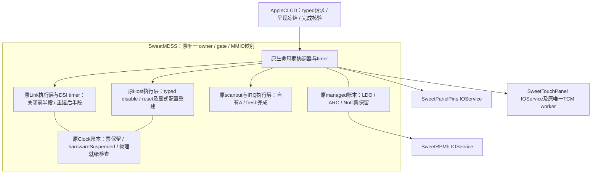

# PD3：host、PHY/PLL 的硬件关闭和重建（0197）

**0198后续增量（本地通过，未实机）：** mode5现已将数据票停驻与host/PHY/PLL关闭、
重建组合：OFF保config→放clock→关link→放DATA；ON取DATA→重建link→取clock→重建host→
原reset/ON/亮度/pixel/touch。普通暂停接口仍拒绝改票，仅协调器指定DATA请求获得有限授权；
不是rail-off或冷NoC/MDP。详见[组合事务和架构](PANEL-COMBINED-SUSPEND-D1.md)。
以下按各原阶段范围保留，当前以0198及NOTES顶部为准。

2026-11-12，接0196。新增显式 `sweetpanellifecycle=4`，在完整profile OFF之后关闭host、
BYTE/PCLK分支、PHY PLL和PHY blocks；ON从这次成功关闭的状态重建原链路，再reset面板、
发送完整ON、恢复亮度、新帧和触摸。默认0，原1/2/3语义保留。

**本轮保留全部资源票和电压供给。硬件blocks关闭不等于撤电、PMIC rail-off或全显示冷启动。**
本机live profile、复位后触摸和共享偏压仍无新实机证据；完整驱动未验收。
交付 `xnu/patches/0197-mh2lm-panel-link-power-cycle.patch`，不改启动侧/CI，不生成boot。

## 架构和复用关系

没有新增IOService、线程、映射、实例桥或空闲poll。生命周期还是原MDSS gate上的事务；
DSI timer调用原Link/Host执行层，consumer不穿透读写硬件。
`stopLink()` / `stopHost()`仍只负责取消，不承担硬件关闭。
初始takeover仍复用原温态路径；start/match不关闭、reset或自动启动生命周期事务。

| 显式档位 | 面板动作 | managed票 | host/PHY/PLL |
|---|---|---|---|
| 1 | 温态28/29 | 保留 | 保留 |
| 2 | 完整OFF/reset/ON | 保留 | 保留 |
| 3 | 完整OFF/reset/ON | 数据票释放、重取；独立config floor保留 | 保留 |
| 4 | 完整OFF/reset/ON | 全部保留 | 实际关闭后重建 |

4要求live允许的profile、pins2、touch2、own2/power1/IRQ2/dsi1/managed1，以及core2/host1/link2和
原resource/clock/NoC依赖。缺失则拒绝，不猜PV、不降档。4不是3的叠加开关；当前先分开保留
可诊断的硬件事务，后续再组合资源释放。两档共用原执行层，没有复制第二套PLL/host配置算法。

## 硬件关闭及证据

原touch QUIESCED → TE/autorefresh停流、GIC/peripheral和DMA静止 → 原完整profile OFF及等待 →
host mask/disable → lanes idle → pixel/intf/byte gate off → roots off → global clock/PLL off →
新观察到LOCK清零 → bias off至少250ns → LPRX/lanes/PHY blocks off → 完成。

host typed disable遵循LG顺序：先清command engine，再以`DSI_CTRL_DYNAMIC_FORCE_ON=0x200b3f`
强制必要时钟，清controller enable，确认读回，再恢复原0x23f时钟控制。各阶段检查posted write读回。
没有用普通软件标志代替engine禁用。读回失败通过原`finishHost()`发布HostFault，再关闭整代。

三分支必须同时看到SW enable=0和CBCR_OFF=1，两root必须ROOT_OFF=1且没有UPDATE/dirty；
之后才允许停PLL。PLL控制写零后必须另看到LOCK=0；不能直接拿控制位零当模拟电路停止证明。
PHY按LG v4关闭identity lane0的LPRX（+0x214）、lane enable、LANE_CTRL0及CTRL_0。
OFF不做PHY或面板reset，不撤bias regulator/LDO/ARC票，不操作未知labibb资源。
成功关闭的终态为`LinkDormant` / `HostDormant`；再次读回分支/root/PLL/bias/PHY/host与reset
未assert，才对外发布`linkPoweredDown`，保持触摸停驻。

真实寄存器事实来源于LG树 `android_kernel_lge_sm8150@d4f335e13d73c4aa2af85581a6ec11b670ee5b94`：

- `drivers/gpu/drm/msm/dsi-staging/dsi_display.c`：`dsi_display_unprepare()`的host/link/PHY/core顺序。
- `dsi_ctrl_hw_cmn.c`：`cmd_engine_en()` / `ctrl_en()`及dynamic force mask。
- `dsi_phy_hw_v4_0.c`：lane idle、`config_lpcdrx()`及`disable()`的确切偏移和顺序。
- `drivers/clk/qcom/mdss/mdss-dsi-pll-7nm.c`：global clock/PLL停止、bias关闭与250ns间隔。

本轮沿原PLL重建执行层前半段追加正常关闭终态，后半段复用于恢复。未照搬Linux API或吞错行为。
未实现LG完整unprepare中的core clock/domain和regulator撤销、panel reset低/偏压断电等剩余步骤。

## 保票期间的物理暂停与恢复

gate第一次有效关闭前置`fLinkSuspendedMask=0x70`，表示BYTE0/BYTE0_INTF/PCLK0硬件不可用。
`localClockStatus()`仍报告逻辑Held票，同时通过`hardwareSuspended`明确物理暂停；
`localClocksReady()`在暂停期间一定为false。暂停时clock/NoC的新增及释放请求均拒绝，
DSI/scanout/brightness沿原生命周期阻塞，不把仍在持有的票当作物理就绪。
`SweetDisplaySuspendedClockMask`暴露账本；失败保留mask，不把部分恢复冒充成功。

物理暂停只允许boot和managed这两张link票：其它active link lease、引用计数不符，或者硬件
DSI1 alias/root仍使用PHY0时拒绝。AHB/MDP/RSC等非link分支、root和core继续真实运行。
不撤额外consumer的票，不动PHY1；不是无视共享资源引用计数强制停钟。

ON仅接受本驱动同provider、成功Dormant且再次读回一致的状态。Fault/Stopped/poison不清除，
不接管任意未知冷PHY。保留原LDO/ARC/NoC/clock票，复用原PHY reset/REFGEN/完整PHY配置/
PLL rate+SSC/新LOCK/RCG update/实际branch+root running/受控parent snapshot提交，随后复用
原host reset和显式RGB888配置读回。实际reset会破坏旧配置，恢复不重放ABL快照。

只有物理分支/root/PLL/PHY和parent证明均通过才清暂停mask；host重建也通过后才允许面板
activate/reset、完整ON、最新亮度、新像素完成和实际TCM协议恢复。完成前FB保持呈现冻结。
恢复准入用自有A布局，不回到原ABL地址，不清一次性managed标志重跑takeover。
额外补查root和BYTE_INTF divider在受控更新之前的漂移，避免用旧快照覆盖无权修改的字段；
Dormant准入也验证这些保留字段。

新生命周期阶段为LinkPowerDown / LinkRebuild，新能力`SweetPanelLinkPowerCycle`及status
`linkPoweredDown` / `linkRebuilt`。FB档4必须见到匹配能力；OFF要求已关闭、触摸/显示静止、
供电及data/clock票保留，ON要求链路重建和原profile/reset/亮度/像素/触摸证据全部齐全。
不能用普通Complete、mode2或mode3状态替代。属性包括`SweetPanelLinkCycleEnabled`、
`SweetPanelLifecycleLinkPoweredDown`、`SweetPanelLifecycleLinkRebuilt`。

## 故障、验证与后续

原16秒总期限保留；link硬件段1秒，执行层原250ms、lane100us、gate/root/LOCK有界等待及
host20ms期限保留。协调器及DSI/clock/NoC子timer推进前检查同代participants/touch fence，
LDO/ARC/NoC/clock逻辑票、非link物理分支/core、DSI1 alias、IRQ drain、TE/auto、DSI busy、
CTL/line、自有A/SMMU及期限。对link非Ready期间的MDP/SMMU snapshot，只在显式协调事务/成功Dormant下放行，
仍要求core/AHB真实可访问；不以PHY关闭为由越过config clock和domain检查。

取消/stop/provider撤回/读回或等待失败关闭整代，保留资源票、DMA lifetime pin及部分硬件状态。
无自动resume、复位收尾、回放TE或降档；旧timer不能接续新provider。已关闭硬件不会被stop
为“清理”而重新打开，也不会把取消视作物理恢复证明。正常运行为INFO，失败为原ERROR路径。

20套本地检查通过：原19加实际link-power-cycle，19套实际源码ASan/UBSan及Python ADT检查，
无最终sanitizer报告。LSan因ptrace环境限制关闭，另断言对象/映射/通知/分配及模拟重启DMA pin归零。
四版各4轮OFF/硬件关闭/重建/面板reset/ON，独立wire和硬件状态响应，确认OFF不新增reset、
ON必经破坏旧配置的PHY/host reset、资源token不变、物理暂停不能被普通接口绕过、fresh像素/TCM，
额外software link lease/DSI1 alias拒绝；每个shutdown及restore link阶段cancel/stop/withdrawal，
REFGEN/LOCK/gate/root/posted write失败、host force/disable/reset失败、停驻取消/丢provider、
root漂移及子timer先于父timer的依赖变化。FB额外覆盖档4能力和完成证据缺失。

真实XNU/KDK arm64 MDSS/FB基线和最终对象编译通过；不是整核链接或硬件验证。
MDSS warnings1510→1524，净增14条数组访问提示已逐项核对；FB1397→1397，没有抑制告警。
补丁严格接0196verify，无offset/fuzz、12源码字节核对、114原CI marker保留。底稿在
`scratch/framebuffer-0197/`，含base/edited/verify、重放/测试/编译脚本、JSON结果及原始编译日志。

本轮未push/触发CI/操作设备，没有新FD或boot。后续镜像仍需合入0195的DarwinBoot身份适配及
identity/pins/touch/NoC ADT；本机live profile仍待确认，不为孤立接口单开云编译或重复旧长测。
下一步组合资源票释放与硬件下电，继续PD3共享供电/偏压E8和PD4冷NoC/MDP独立重建；
正常rail-off、故障后受控资源释放、ABL framebuffer/console/panic退出和完整IOPM仍未完成。
A单缓冲/30Hz CPU复制保留，不宣称旧滑动退化或BUG-003修复。
