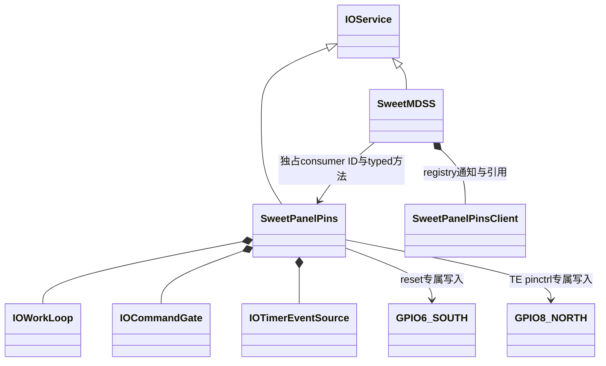

# 0192：面板 reset / TE 引脚服务

**0193后续：** 已补[触摸暂停/恢复执行层及MDSS绑定](PANEL-TOUCH-D1.md)，本地通过、未实机。
下面的引脚服务范围保留；完整生命周期协调器、panel身份和共享供电实机证据仍待补。

2026-11-11，本地实现与验证通过，**尚未实机**。补丁
`0192-mh2lm-panel-pin-provider.patch` 接在0191之后，SHA256：
`ead1f8ef6cf6d19e409f847895bf2e8f4395eff06f78fde73706b1ee0f277a57`。
它完成PD3需要的引脚执行层及MDSS匹配绑定，尚未把reset接入真实启动/唤醒，不能算完整面板驱动完成。

## 服务架构与所有权

`SweetPanelPins`是真正的IOService，由独立`IOPlatformDevice` nub匹配；有自己的
workloop/gate/timer，不是全局C实例桥。MDSS通过匹配通知持引用，在自己的workloop调用
`attachConsumer()`。通知上下文只retain/release和排队，不调用provider方法、不访问MMIO。

provider只接受一个consumer，有单调递增且不回绕的client ID、请求token。
公开接口为`attachConsumer/detachConsumer/copyStatus/activate/reset/park`，没有raw GPIO地址接口。
引脚服务不控制RPMh/DSI/PHY/DMA/触摸，不假装能够自行证明这些依赖已就绪。

| 引脚 | 物理页及大小 | 用途 | active低10位 | parked低10位 |
| --- | --- | --- | --- | --- |
| GPIO6 / SOUTH | `0x03d06000 / 0x1000` | reset GPIO output | `0x2c0`：无pull、8mA、OE | `0x201`：pullDown、2mA、OE保持 |
| GPIO8 / NORTH | `0x03908000 / 0x1000` | function1 mdp_vsync input | `5`：pullDown、2mA | `5` |

两个GPIO不在同一个tile。只访问CTL+0、IO+4、IRQCFG+8，IRQCFG只读；不写IRQ、GPIO7或
触摸引脚。CTL高位保留并逐步校验。现有触摸legacy会映射TLMM整tile，因而其映射范围与这里
的两页存在包含关系；这不是全局无重叠映射。当前硬件引脚的写入所有权不重叠。
共享电源/reset对触摸的影响仍须生命周期协调，不能从GPIO号不重合推断无影响。

## 准入、时序与失败

`--panel-pins`为ADT工具的可选扩展，隐含display-resources，可与display-noc组合。
它不改变原有MDSS/RPMh映射索引或默认ADT字节；增加独立nub和LE u32
`sweet,panel-pins-abi=1`，provider校验两个物理页及长度。没有自动panel profile或IRQ声明。

| 参数 | 行为 |
| --- | --- |
| `sweetpanelpins=0`（默认） | 不启动新服务，MDSS不订阅 |
| `sweetpanelpins=1` | 只允许绑定/查询；activate/reset/park返回NotPermitted |
| `sweetpanelpins=2` | 允许显式typed请求；start、匹配、attach、query仍不读写引脚 |

MDSS启用pins绑定还要求display-resource mode非0。本批MDSS只attach/detach，**没有实际
activate/reset/park调用**；仅加参数不会复位面板。未来完整生命周期协调器必须在调用前确认
面板身份、供电、链路及DMA/IRQ/触摸quiesce。

首次activate只接受继承的GPIO6 output-high且实际input-high、TE已是mdp_vsync input、
两路GPIO IRQ禁用、无eGPIO接管。CTL/IRQCFG保存完整快照，后续timer每次重新校验；
输出latch(bit1)与输入电平(bit0)分别确认，不能用写读回代替实际电平。

reset在provider workloop通过timer执行：高电平确认后至少10ms，低电平确认后至少2ms，
再次高电平确认后至少10ms，再稳定至少5ms。每个edge输入最多等待1ms；提前到达的timer
不缩短hold，hold中电平丢失直接失败。单次请求总预算100ms，无长忙等。
park先低电平确认并保持至少5ms，再切弱驱动/pullDown，OE保持；重新activate保持低电平，
不会无意产生reset解除边沿。随后需要显式reset。

LG reset时长与末尾5ms来自`lge_dsi_panel.c`。park是受限引脚操作，并不声称已经复现LG的
完整reset_off/rails关闭顺序：LG完整路径还有pinctrl、偏压和触摸通知，未来协调器必须补齐。

写失败、输入超时、配置/IRQ漂移均poison该实例，保留已发生的效果和不确定状态，不回滚、
自动重试或自动park。active/不确定状态不能detach。stop/willTerminate经gate停止准入、
同步timer，不偷偷改变引脚；晚timer无MMIO。任何写入后实例销毁会留下本boot所有权
retired latch，拒绝新实例丢弃旧账本重建；latch不存全局实例指针。

MDSS清理在其gate外先同步移除client通知与event，再detach/release。当前provider丢失只
解绑；因为本批没有真实pin操作，尚无运行中的面板事务可取消。未来接完整生命周期时必须
把provider丢失纳入fault/cancel，不能沿用“只解绑”作为active显示的完整恢复策略。
日志沿现有ERROR/WARN/INFO：实际失败ERROR，停止中止INFO，stop仍有consumer则WARN。

## 验证与证据边界

13套本地检查通过：新增panel-pins，加原dsi-link、dsi-host、display-core、managed-display、
display-noc、display-clocks、display-service、framebuffer-service、dsi-sequence、rpmh-resources、
fb-perf、mdss-adt。12套执行实际源码并启用ASan/UBSan，另1套Python ADT；无sanitizer报告。
LSan因运行环境ptrace限制关闭，另断言对象、映射、通知和分配归零。

专项使用独立physical input模拟，不让latch写入自动更新input；覆盖10/2/10/5ms最短时序、
提前timer、park/reactivate、配置/IRQ/eGPIO/复用冲突、写丢、输入不跟随、hold丢电平、超时、
每个reset/park phase停止、晚timer、真实gate并发stop等待、ID/token耗尽及retired owner。
实际MDSS registry绑定/终止测试验证通知只排队、workloop才attach，绑定过程无引脚MMIO。
ADT检查两页精确翻译、无GPIO7、NoC组合、重复nub拒绝及旧ADT字节不变。

真实XNU/KDK arm64单文件对象：MDSS基线/最终、SweetPanelPins均编译成功。
MDSS warning数1475→1475，无新增诊断签名；新服务1171条主要为现有XNU/KDK头文件/宏诊断，
源码数组与MMIO边界提示已审，没有压制warning。不是完整云端构建/链接或实机验证。
0191基线连续性、5份源码严格重放/字节一致及114个原CI marker通过。
CircleCI blob仍为`da0b6c0947a66f03491b3a9023590b49665292df`。

底稿：`scratch/framebuffer-0192/{base,edited,verify,prepare-patch.py,compile.py,verification.json,
base-continuity.json,native-results.json,warning-counts.json,array-bound-review.json,reference-audit.json,
run-tests.py,tests.json,test-*.txt,*compile.txt}`（相对工作区根，不是仓库根）。
参考LG HEAD=`d4f335e13d73c4aa2af85581a6ec11b670ee5b94`；寄存器/引脚事实来自
`pinctrl-sm8150.c/pinctrl-msm.c/sm8150-pinctrl.dtsi/sm8150_common-panel.dtsi/lge_dsi_panel.c`，
逐文件SHA见reference-audit。没有新增panel revision/硬件读数证据。

## 下一步

继续PD3：补触摸quiesce/resume接口和生命周期协调，确认实际PP1/DV1/DV2/PV身份后接完整
vendor ON/OFF、reset及资源反向释放。E1身份与E7共享电源协调仍未关闭；不试发未知vendor表，
不要求启动Android。随后还需NoC/MDP冷初始化、独立重建和ABL缓冲/控制台/panic依赖退出。
现有A单缓冲/B未提交/30Hz CPU复制限制不变。暂不为pins绑定单开云编译或只读刷机轮次。
