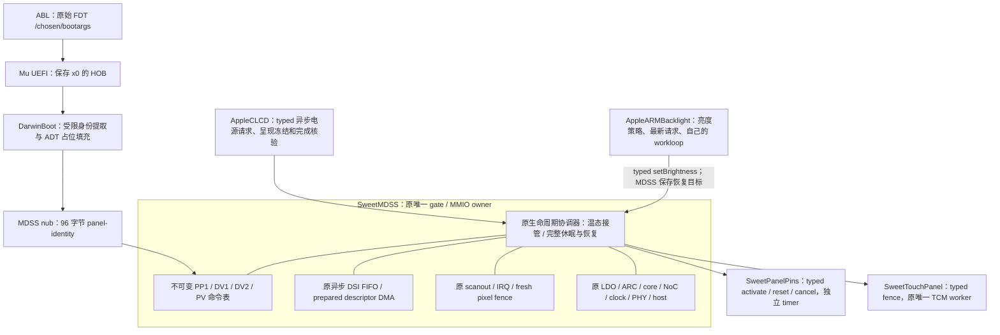

# PD3：按 ABL 选择的完整命令与保留供电的 reset 恢复（0195）

**2026-11-12实机更新：** `sweetlog-0121a14-identity-slot-control.bin`第85行已取得
`SWEET PANEL: ABL selection source=2 profile=4`，对应
`dsi_r66456_tianmamd_pv_1080_2340_cmd_display`。本机ABL选择与Mu→DarwinBoot→ADT→XNU
校验链已实机成功；不是物理DDIC读回。测试保留power1/IRQ2/vsync1/own2，尚未执行完整
PV厂商表/reset或供电撤票，E7/E8仍缺。原metadata-off档仍有NULL写，当前查显示模式差异。
详情见[0121a14实测与对照](PANEL-D1-0121A14.md)。以下为0195及后续实现的历史记录。

**0197后续增量（本地通过，未实机）：** 新增mode4，保留全部票，实际关闭并重建host/PHY/PLL；
clock状态另报物理暂停，FB核对关闭/重建证据。原0/1/2/3范围保留；未实现rail-off。
详见[硬件关闭及恢复、架构和边界](PANEL-LINK-POWER-D1.md)。以下按原阶段范围保留。

**0196后续增量（本地通过，未实机）：** 已接入mode3 managed数据票释放与重新取得，
保留独立config floor及所有供电/boot/link/core资源；原mode1/2范围保留。
详见[当前资源事务及边界](PANEL-RESOURCE-PARKING-D1.md)。以下按本文件原阶段范围保留。

2026-11-11。接在0194后，默认关闭，仅本地验证。实现的是完整厂商命令、Sleep In/Out、
面板 GPIO reset 和亮度恢复；**没有撤销任何供电票，不是整屏断电重建或完整驱动验收**。
本机实际选择仍未读取到，不能宣布PV，也不能把本地模型当成硬件恢复证据。

## 实际架构与入口

当前实际启动链是Mu UEFI → DarwinBoot → XNU，不是本仓库旧`shim/loader.c`。
旧shim没有交付变化。启动侧改动独立交付为
`boot-support/0001-mh2lm-darwinboot-panel-selection.patch`；XNU改动为
`xnu/patches/0195-mh2lm-panel-profile-lifecycle.patch`。只更新XNU而继续用旧UEFI blob，
不会凭空得到面板身份；需要把新的DarwinBoot模块整合进后续UEFI FD和boot镜像。
本轮只编译链接模块，没有生成/替换FD或现有`out-bs/kernel-32m.blob`。

## 身份传递和选择规则

`tools/mk-mh2lm-mdss-adt.py --panel-identity`仅在`/arm-io/mdss`增加96字节全零占位，
隐含display resources，可和pins/touch/NoC组合。不接受手填revision选项，旧默认ADT字节不变。
DarwinBoot在读取并验证ADT后、kernel/window复制与ExitBootServices前处理占位。
没有占位时不查HOB、不读FDT；畸形或预填占位拒绝启动，不能把静态ADT伪装成live来源。

实际读取Mu SEC的x0 HOB（GUID `DAEE82E6-8090-4E72-BFB9-78C13CD4E359`）。先检查HOB数据大小，
再用UEFI memory map核对完整FDT位于允许的RAM描述符内；不扫描地址、不读MMIO。
解析器验证v17头、结构/字符串范围、深度、完整节点结束和属性边界，FDT上限2MiB，bootargs上限8192。
只接受唯一的`/chosen/bootargs`与唯一`msm_drm.dsi_display0`，四个完整label精确匹配：

| ID | LG display label | ON字节 / 包数 | OFF字节 / 包数 |
|---|---|---|---|
| 1 PP1 | `dsi_r66456_tianmamd_pp1_1080_2340_cmd_display` | 834 / 20 | 35 / 4 |
| 2 DV1 | `dsi_r66456_tianmamd_dv1_1080_2340_cmd_display` | 538 / 16 | 35 / 4 |
| 3 DV2 | `dsi_r66456_tianmamd_dv2_1080_2340_cmd_display` | 538 / 16 | 35 / 4 |
| 4 PV | `dsi_r66456_tianmamd_pv_1080_2340_cmd_display` | 694 / 17 | 35 / 4 |

限定默认拓扑/时序后缀`:`、`:config0`或`:config0:timing0`；未知override不能授权固定模式。
记录只含magic/version/source/profile/允许的label和零保留字节，不复制完整bootargs、序列号或其它字段。
未知、缺失、重复、畸形分别记录来源状态；XNU再次检查整个记录、保留字节和ID/label一致性。
属性`SweetPanelSelectionSource`（0未填/无有效记录，1缺失，2选中，3未知，4歧义，5畸形）、
`SweetPanelSelectedProfile`以及日志只报告来源/ID。**这是ABL选择证据，不是物理DDIC读回或认证**。
替换模组/错误固件仍可能导致ABL本身选错；不把它宣称为抗恶意输入的硬件身份机制。

参考LG `android_kernel_lge_sm8150@d4f335e13d73c4aa2af85581a6ec11b670ee5b94`：
`sm8150_common-panel.dtsi`对应display与panel连接，`dsi_display.c:2380`按冒号前label选择。
通用panel-name四版相同，不能用于revision识别，包含静态所有候选的ABL字符串也不是实际选择。

## 完整表、延时和恢复事务

八份表来自同一LG源码`settings_panel/dsi-panel-r66456-{pp1,dv1,dv2,pv}-tianmamd-fhd-cmd.dtsi`，
逐字节保留，独立fixture记录来源、SHA256及完整字节。保留源文件的版权和GPLv2标注。
长命令使用原prepared descriptor DMA，不拆149字节等厂商payload去迁就FIFO。

注意源码实际顺序：ON结尾为**29 → 11 → 等待150ms**；OFF为B0 03 → 51 00 00 →
等待90ms → 28 → 10 → **等待150ms**。LG包头的wait属于该包发送完成之后。
不能把OFF解释成28后先等150ms再发10，也不擅自交换ON的29/11。
LG重写了通用`dsi_panel_*`函数，实际reset还在10/2/10ms之后额外等待5ms。
完整撤电涉及use-labibb、reset-after-ddvd、full_power_seq和触摸LPWG，本批没有照函数反序盲撤电。

`SweetPanelDisplayOff/On`仍为typed接口，不增加用户态寄存器入口。仅mode2扩大其语义：

| 事务 | 实际步骤 | 成功条件 |
|---|---|---|
| Takeover | 沿0194温态资源/链路/自有A交接 | 不自动reset或发送厂商ON表 |
| OFF | touch实际QUIESCED → TE/auto停止 → GIC/peripheral/DSI退出 → 完整OFF表及延时 | 完整4包成功、DSI idle、sleeping=true；触摸停驻、全部资源票保留 |
| ON | 同代touch fence/全部资源票/显示静止 → 首次typed activate → typed GPIO6 reset → 完整ON表/延时 → DCS51恢复亮度 → 原扫描/IRQ恢复 → fresh像素完成 → 实际TCM识别/格式读回与arm | resetComplete、brightnessRestored、pixelsComplete及touch Ready全部成立；sleeping=false |

`SweetMDSS::setBrightness()`成为typed override，通过同一gate保存背光服务已知的最新目标。
mode2在没有已知亮度目标时，OFF/ON在任何副作用前NotReady，避免OFF写零后无法恢复。
Busy期间的新目标继续保留；如果更新晚于恢复命令，原背光interest机制在事务完成后重试最新请求。
不通过FB读取寄存器，也不根据不透明的任意DCS字节猜亮度策略。

新增阶段PinActivate/PinReset/Brightness；`lifecycleBusy()`改为显式阶段判断，避免枚举扩展漏保护。
GPIO每请求100ms预算、完整命令段5s、亮度500ms，其余0194期限和16s总预算不变；无忙等或空闲poll。
`SweetPanelPins::cancelRequest(consumer,token)`同步其gate并停timer、poison该lease，保留部分引脚状态，
不reset/park来“清理”。旧consumer/token无效，晚timer无写入。provider在途执行到取消生效前可能
已有部分动作，取消不是恢复或通用硬件静止证明。事务故障保票/保DMA pin，整代关闭，不自动重试。

FB mode2要求backend额外的`SweetPanelRetainedSleepReset`能力；完成还检查profile、sleeping、
resetComplete和brightnessRestored，不能把温态Complete当成完整恢复。默认mode0及mode1保持原语义。
Standalone Prepare/Reset/Unprepare仍Unsupported；实际reset只由已暂停的完整ON事务受理。
未实现正常rail-off或失败释放；pin-active lease不能在stop时假装安全detach，保留/退休到reboot。

## 开关与验证范围

默认`sweetpanellifecycle=0`；1仍是0194温态28/29；2为本批完整休眠/reset实验档。
2额外要求有效live记录、`sweetpanelpins=2`及其nub、原touch2/own2/power1/IRQ2/dsi1/managed1及
原resource/clock/NoC依赖。start/matched不发面板命令。没有身份时拒绝2，不默默选择PV或退回1。
下一次同核镜像应先用1取得来源/ID并核对，再选择2测试；不为单个只读接口再开云编译。

18套本地检查通过：原16套，加实际FDT/ADT/DarwinBoot adapter与完整profile生命周期。
17套实际源码ASan/UBSan，ADT工具为Python；LSan因环境ptrace限制关闭，另断言对象/映射/
通知/分配和模拟重启后的DMA pin归零。新增覆盖四版各3轮OFF/reset/ON、完整线包/内存DMA/
延时与独立输入、每个reset phase取消、provider撤回、stop、读回/输入/DMA/亮度/触摸失败、
错误身份/未知模式、FB错能力/缺完成证据。FDT/ADT覆盖每个截断和bit mutation；实际打包ADT也通过。

真实XNU/KDK arm64 MDSS/FB/Pins单文件对象成功；不是整核链接。
Mu mh2平台实际消费的DarwinBoot模块编译链接成功（不是完整FD，也不是实机启动）。
底稿`scratch/framebuffer-0195/`含严格重放、源码连续性、18套结果、native对象/告警审阅和UEFI模块结果。
未push、未触发CI、未操作设备；CircleCI blob保持`da0b6c0947a66f03491b3a9023590b49665292df`。

## 仍待完成

0195阶段E1/E7/E8均未验收；最新0121a14已取得ABL的E1选择证据，E7实际reset后触摸恢复、
E8共享供电/偏压撤销仍未硬件验收。
本批仅保留所有供电的DDIC恢复，不能关闭上述门槛；reset成功也不证明真实断电恢复。
PD3完整反向释放仍缺，PD4冷NoC/MDP/host/PHY状态失效后的独立重建、ABL framebuffer/console/panic退出、
PD5完整IOPM与停机收口仍在后续。A单缓冲/30Hz CPU复制不变；旧滑动退化与BUG003未宣称修复。
