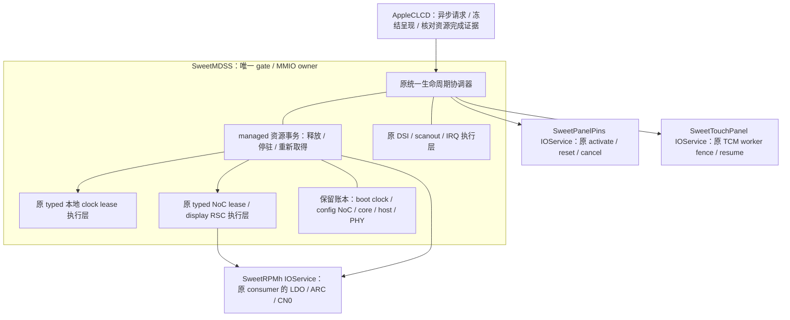

# PD3：数据资源票的反向释放与重新取得（0196）

**0197后续增量（本地通过，未实机）：** 新增mode4，保留全部票，实际关闭并重建host/PHY/PLL；
clock状态另报物理暂停，FB核对关闭/重建证据。原0/1/2/3范围保留；未实现rail-off。
详见[硬件关闭及恢复、架构和边界](PANEL-LINK-POWER-D1.md)。以下按原阶段范围保留。

2026-11-12，接0195。新增显式 `sweetpanellifecycle=3`，默认0，原1/2语义保留。
沿用原SweetMDSS内部协调器、gate、timer和typed资源执行层，接通完整休眠后的
managed DSI0 clock lease及DATA NoC lease释放，唤醒重新取得后才reset/ON。
**这是数据票释放，不是整屏rail-off、host/PHY shutdown或冷态重建；完整驱动尚未验收。**

补丁：`xnu/patches/0196-mh2lm-panel-resource-parking.patch`。
启动侧沿用0195的独立DarwinBoot补丁；本轮没有再改启动侧，也没有重建FD或boot。
实际live profile/E7复位恢复/E8共享供电仍缺实机证据，不猜PV、不试探未知偏压寄存器。

## 资源所有权与架构

同一MDSS owner内部调用原typed `releaseLocalClocks()` / `releaseBandwidth()` /
`retainBandwidth()` / `retainLocalClocks()`，不新增consumer MMIO、全局实例桥、线程或空闲轮询。
资源事务由协调器timer推进；clock/NoC自己的timer仍负责实际异步写入和ACK。
初始温态takeover仍走原实现，start/match不会发休眠/reset/撤票请求。

| 资源 | mode3息屏完成时 | 唤醒前要求 |
|---|---|---|
| managed DSI0 clock lease | 本张票确认Released后清token | 取得新token并确认Held |
| managed DATA NoC lease | 五个DATA BCM按聚合后的目标ACK，确认Released后清token | 新token、DATA目标ACK/Held |
| 新增config-only NoC lease | CN0 300000000 B/s floor保持Held | 同一token继续Held |
| boot DSI0 clock lease | 保留，不撤销 | 同一token及物理branch/root验证 |
| RSC clock lease | config floor使其保持Held | 保留 |
| LDO四路 / ARC Turbo / GDSC / core PLL及root | 保留 | 原typed状态与物理配置继续有效 |
| host / PHY / link | 保留配置及供电，不调用软件stop冒充shutdown | 验证保留配置；本轮不重建它们 |
| 触摸 | QUIESCED，原worker停驻 | 新帧后原协议识别/格式读回/arm |
| scanout DMA pool | lifetime pin保留 | 原自有A及fresh完成证据 |

clock执行层本来就按引用计数和owned mask区分本驱动开启的branch与继承branch。
boot lease仍引用DSI0 branches，所以**释放managed clock票一般不产生物理关钟**；不能报告成门控节电。
DATA票的降低也尊重其它active NoC lease的聚合需求；存在其它使用者时目标可以非零。
本轮明确不撤其它票，不把“本票已Released”等同于“物理资源已关闭”。

独立config票是必需的：core初始化和NoC曾使用同一个RPMh consumer的CN0槽位；若直接撤最后一张
NoC票，原接口会把这个consumer的CN0降零、释放RSC clock，而core/host/PHY仍在保留状态。
现在先取得独立config-only票，之后仅释放managed DATA票，CN0不会沿这条路径降零。
config票跨OFF/ON复用，不每轮新增票。原NoC接口增加“所有DATA值为零”的有效config-only形状；
平均值大于峰值、部分DATA路径缺失、registerPeak低于原下限仍拒绝。
300MB/s是既有LG bootstrap配置通路floor，不是本轮新增的最低功耗或DVFS目标。

## 实际事务与完成条件

OFF：原触摸QUIESCED → 原TE/auto停流及IRQ/DMA静止 → 原完整profile OFF表和等待 →
新增config-only票Held → managed clock Released → managed DATA NoC Released → 完成。
不更改LG包顺序和等待，不park/reset GPIO，不撤供电。故障发生在完整OFF之后，也必须显式Fault，
不能把设备已经黑屏当成资源释放成功。

ON：同代触摸fence、物理静止和保留资源准入 → managed DATA NoC新票Held → managed clock新票Held →
原activate/reset → 原完整ON表 → typed最新亮度 → 原IRQ/TE恢复 → fresh像素完成 → 原TCM实际恢复 → 完成。
恢复准入检查自有A布局，不拿初始ABL地址充当恢复配置；不清`fManagedStarted`重跑一次性takeover。
这里只重建被释放的票，没有把保留的MDP/host/PHY伪称为从冷态重建。

新增managed阶段：ParkConfig / ParkClock / ParkNoC / Parked / RestoreNoC / RestoreClock；
生命周期增加ResourcePark / ResourceRestore。释放中保留旧token，只有明确Released才清账，
恢复使用新token；失败保留剩余和在途账本，不自动回滚、重试或切回mode2。

`SweetPanelDataParking`能力位和status新增resourcesParked/resourcesRestored/retainedPower/configHeld，
以及configToken/dataToken/clockToken。FB mode3必须看到该能力；OFF完成要求数据票已释放而
供电/config票有保留证明，ON完成要求新票与原reset/亮度/像素/触摸证据同时满足。
普通Complete或mode2完成不能蒙混通过。原请求合并、呈现冻结和17秒consumer watchdog继续使用。

原16秒总期限保留；新增资源段4秒，原NoC 1.5秒、clock 200ms期限保留。
协调器推进、clock子timer、NoC子timer都在资源阶段重复核对同代participants、touch fence、
boot clock物理branch/root、core/PHY配置、GIC RWP/enable/active、peripheral mask、TE/auto、
DSI busy、CTL start/flush、自有A配置和idle line，以及资源/总期限。
子timer先运行也不能凭旧fence继续写；关闭本代后旧timer不接续新provider。
资源故障由原ERROR日志报告，正常完成为INFO；stop/取消不额外撤票、不释放hardware DMA pin。
已提交给RPMh的异步CN0事务可能随后ACK，保留其在途账本；本路径不会提交CN0降零或LDO/ARC撤票。

## 参考、验证及证据边界

LG树 `android_kernel_lge_sm8150@d4f335e13d73c4aa2af85581a6ec11b670ee5b94`：
`drivers/gpu/drm/msm/dsi-staging/dsi_display.c` 的 `dsi_display_unprepare()` 实际还包含
host disable、link clocks off、ctrl deinit、PHY disable、core clocks off及panel post-unprepare。
`drivers/gpu/drm/msm/lge/lge_dsi_panel.c` 覆盖通用panel上下电/reset逻辑，另有labibb/触摸通知。
**本轮没有照搬或声称完成这条完整下电序列**；只在不关boot/link/core/rails的条件下释放managed数据票。
后续必须补真正的host/PHY静止/关闭、冷NoC/MDP重建和共享供电证据，才能继续向下撤电。

19套本地检查通过：原18套加实际源码resource-parking；18套实际源码ASan/UBSan及Python ADT检查，
无最终sanitizer报告。LSan因环境ptrace限制关闭，另断言对象/映射/通知/分配及模拟重启DMA pin归零。
新增测试运行实际协调器/资源/NoC/clock/DSI/pins和C TCM worker，OS/MMIO及输入/协议对端才是fixture。
覆盖四版各4轮完整释放/恢复、独立wire命令与等待、DATA BCM目标ACK、新token及floor复用、
其它active数据/clock持票不被撤销、每资源阶段cancel/stop/provider撤回、子timer早于协调器时的
物理漂移/期限拒绝、DATA ACK丢失、token耗尽、FB mode3能力/完成证据拒绝。

真实XNU/KDK arm64 MDSS与FB基线/最终单文件对象编译通过，关键符号已核对。
MDSS warnings1503→1510：净增7条均为固定数组访问提示（原校验1处改为2处，资源模块新增6处），逐项边界已审；FB1397→1397。
没有抑制告警；不是整核链接或硬件测试。0196严格接0195verify，无offset/fuzz，8份源码字节核对，
114个原CI source marker保留。CircleCI内容未改，无push、云构建、设备操作或新boot镜像。

底稿：`scratch/framebuffer-0196/{base,edited,verify,prepare-patch.py,compile.py,native-checks.py,run-tests.py,
verification.json,base-continuity.json,native-results.json,warning-review.json,tests.json,*compile.txt,*symbols.txt}`。
后续合并镜像仍需纳入0195新DarwinBoot并带identity/pins/touch/NoC ADT；先确认live profile，
再按同核mode2/mode3分档验证，不为孤立只读接口追加云编译，也不重复旧USB/BUG-002/半小时测试。

下一步仍是PD3正常host/PHY/供电释放，以及PD4冷NoC/MDP独立重建；ABL buffer/console/panic退出、
完整IOPM、故障后受控释放尚未完成。A单缓冲/30Hz CPU复制保留，不宣称滑动退化或BUG-003修复。
