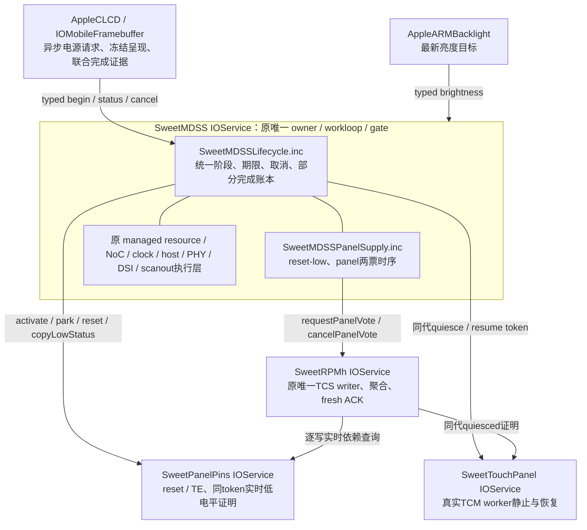

# PD3：统一协调器的面板供电票撤销与恢复（0201）

**0121a14当前进展（2026-11-12）：** ABI修正版identity已实机进入系统，持久日志477字节
参数匹配，source2/profile4、MDSS/RPMh/SpringBoard正常，无panic/驱动ERROR。
原loader1024/XNU608交接错误已修正，原NULL写本轮未复现；旧USB、HFS clonefile及关机
分配错误仍在，不扩大为所有HFS错误已解决或完整面板验收。
**下一步只测`0121a14-abi608-panel-retained`**：lifecycle2、605字节参数、保留供电票，
两次手动OFF/ON验证完整厂商表、面板reset、亮度/fresh像素/实际触摸恢复。
combined/supply继续暂停，E7/E8仍待本机证据，无需云编译。详见
[ABI修正与当前测试步骤](BOOTARGS-ABI-0121A14.md)及[历次启动对照](PANEL-D1-0121A14.md)。

2026-11-12。接父提交 `8722913` 的0200实时依赖接口，新增显式
`sweetpanellifecycle=6`。本地验证通过，完整Mu FD已构建，**尚未整核链接或实机验收**。
原模式0–5保留；模式6默认关闭。交付
`xnu/patches/0201-mh2lm-panel-supply-lifecycle.patch`，SHA256：
`1a79089011539675d801d09059091d9e2294ddd7268b0274dd1435618af1596e`。

## 架构和所有权

供电阶段是原MDSS协调器的内部模块，没有增加provider、线程、MMIO映射或全局实例桥。
consumer调用typed接口；硬件执行仍在对应provider的gate/timer。锁序为MDSS→RPMh→Pins/Touch，
leaf不反向进入MDSS。没有跨gate持锁等待硬件完成。

## 模式6的真实执行次序

必须满足模式5全部依赖，且有实际ABL选择的四版R66456之一、pins2与touch2。
模式6新增能力 `SweetPanelSupplyCycle`；未知/缺失身份或能力拒绝，不能猜PV或降档。

| 操作 | 顺序 | 保留内容 |
|---|---|---|
| OFF | 触摸静止、DMA/IRQ drain → 完整OFF表及等待 → 必要时warm activate引脚 → pre 5ms → park并确认reset低保持≥5ms → 原模式5的config floor、clock释放、host/PHY/PLL关闭及DATA释放 → VPNL ACK → VDDI ACK → post 5ms | 共享L3/L5、ARC、config floor、boot/RSC与core配置通路 |
| ON | 核对同provider与停驻账本、实时reset低 → parked转active-low（不脉冲reset）→ pre 5ms → VDDI ACK后20ms → VPNL ACK后5ms → DATA/link/clock/host重建 → panel reset/完整ON → 最新亮度、fresh像素、实际TCM恢复 | 同上，未重跑一次性takeover |

所有等待由原timer推进；等待以观察到的真实ACK为起点，不能用时间到替代ACK。
LG来源和共享供电依据延续[归属核对](PANEL-SUPPLY-OWNERSHIP-D1.md)。

仅撤销**本panel consumer**的VDDI/L14与VPNL/L17两票。
RPMh聚合结果允许OFF仍enabled（其它consumer保电），因此成功撤本票不证明物理rail-off。
L3/L5共享UFS/USB，0199最后aggregate disable保护保留；不撤其它consumer或假造ABL票。
触摸静止是软件/IRQ/HID协调，不证明deep sleep或与panel电源物理隔离。

## 完成、部分执行和取消

`fManagedRails` bit0=VDDI、bit1=VPNL、bit2=Host、bit3=PHY。
OFF每ACK一次更新15→13→12；ON按12→13→15更新。
`panelReleasedMask`记录本票已撤集合，`panelAggregateEnabledMask`记录ACK时聚合enabled，
`panelVoteTokens[2]`记录两路已完成票；在途操作保留`supplyRail/supplyToken`。
`resetHeldLow`、`panelVotesParked`、`panelVotesRestored`与原资源/link证据分别记录。
`retainedPower`在本票撤销后为false，全部恢复后为true；它不是物理电压读数。

部分rail集合仅在明确的供电阶段或成功OFF停驻允许；普通资源/link和takeover仍要求15。
reset-low期间，MDSS资源/link子timer以及RPMh逐TCS写都重查实际Pins/Touch，不用父层旧缓存。
FB模式6独立核验能力、rails、两票token、低保持、资源与链路等联合证据，普通Complete不足以通过。

父事务失败先关闭generation，**先同步cancelPanelVote，再取消Pins/Touch token**。
未ACK操作保留旧票与在途token并标uncertain，不补电、不回滚、不自动重试。
子gate已提交成功ACK、父尚未读取时，cancel后查询真实status，补记ACK到部分完成账本。
已trigger的硬件动作无法撤回；故障后保留DMA pin至reboot，不提前释放可能仍被扫描的页。

## 启动链和本轮四档

实际链路为ABL→Mu原始x0 HOB→DarwinBoot→ADT→SweetMDSS。
身份是bootloader选择证据，不是物理DDIC读回或认证身份。
`tools/build-mh2lm-panel-uefi.py`在隔离目录应用既有0195 loader补丁，完整构建Mu mh2 RELEASE FD。
已核验新DarwinBoot PE→FFS→FVMAIN→压缩guided FV→最终FD；保留原BootShim和两个append DTB，
没有修改旧`out-bs/kernel-32m.blob`或参考源码。详细manifest记录源码HEAD、命令和SHA。

本地产物：`/home/shenli/work1/out-bs/panel-uefi-0201-final/panel-uefi.json`。
新blob SHA256：`8e1e65d891a831b6f9b9005701f339d80330378c21520ec6f6ef4159d8e9561e`。
FD SHA256：`fadb5b59f3ec22f67ebac3e33babc642d372e42cdb004c5730fdaf376d43e48f`。
完整FD构建成功不代表手机可启动；本轮尚无可刷的新内核镜像。

同一新云端内核用`--panel-lifecycle`生成四档，共用kernel/新固件。identity使用独立metadata ADT，
含RPMh/resource ABI及零身份slot，不声明NoC/Pins/Touch；后三档用相同完整ADT，仅lifecycle参数不同：

| 镜像后缀 | 模式 | 验收重点 |
|---|---|---|
| panel-identity | lifecycle0，metadata-only | 首次新固件启动，live source/profile唯一且有效；不启用panel reset/PHY/供电配置 |
| panel-retained | lifecycle2，全部票保留 | E7实际触摸/reset恢复；完整ON/OFF、亮度、按键、触摸及正常唤醒 |
| panel-combined | lifecycle5 | DATA/clock停驻与host/PHY/PLL关闭重建，供电票继续持有 |
| panel-supply | lifecycle6 | reset-low及两路本票撤销/恢复；新token与联合证据、画面和输入恢复 |

按表顺序检查每档日志和现象，失败就停止后档，不把四档连续盲测。
保留USB ACM、按键IRQ和battery runtime3；此轮不改USB/充电实现或重测旧bug。
不要求自动息屏、半小时等待或重跑F3矩阵。具体命令见[构建指南](BUILD-GUIDE.md)。

## 本地验证和剩余项

23套检查全通过：22实际源码ASan/UBSan及1套Python ADT。
新增联测覆盖四profile多轮、独立MMIO时间戳、实际Pins/RPMh/TCM、部分ACK、各阶段取消/stop/
withdraw、ACK先于父取消、子先于父丢依赖、超时/posted-write/缺ACK、另一consumer保电及停驻漂移。
LSan因ptrace环境关闭，另查对象/映射/通知/分配/模拟reboot DMA pin归零。
严格patch重放无offset/fuzz、逐字节一致、114原CI源码marker保留。
RPMh/Pins/MDSS/FB前后8个真实XNU/KDK arm64对象通过；新增5个有界数组告警已审，无抑制。
单文件对象不是整核链接；模拟器断言不代替实机。

完整驱动仍缺PD4冷NoC/MDP及独立重建、ABL首帧/default surface/console/panic依赖退出、
故障后的受控释放与完整IOPM。E7/E8实机验收尚未关闭，不能宣称物理共享偏压已厘清。
A单缓冲/30Hz CPU复制保留，未宣称修复滑动退化或BUG-003。
本轮到云编译前停下：用户push、下载产物后，agent核对并打上述四档，由用户fastboot测试。
