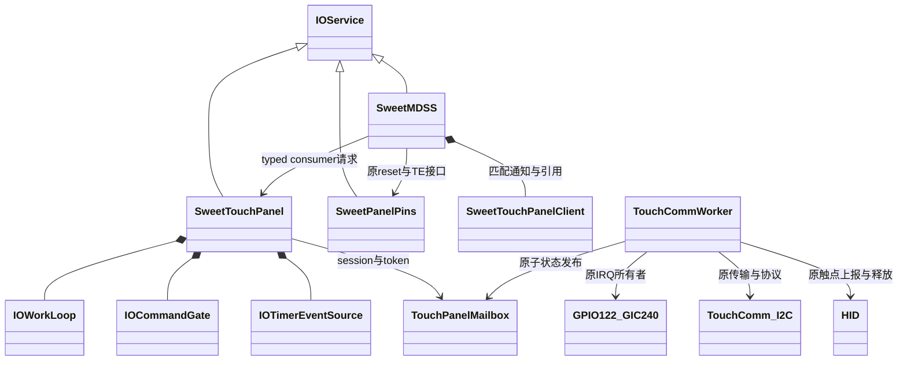

# 0193：面板生命周期所需的触摸暂停与恢复接口

**0121a19已核对打包：** 0206首次接管等待触摸worker修复已包含；78源码、114 source/160 binary
markers及镜像回读通过。只启动新的ABI608 retained档，等约90秒导启动日志，先不做OFFON/长测。
参数605字节及ADT同上一轮，旧镜像保留；见[本轮步骤](PANEL-D1-0121A19.md)。
触摸与面板的接口/独立reset/IRQ及软件依赖见[关系说明](PANEL-TOUCH-STARTUP-WAIT.md#为什么面板接管会依赖触摸用户追问核对)。
以下0206待push/0121a18待测步骤为已完成历史，实机修复结果仍待验证。

**0195补充（本地通过，未实机）：** mode2现已接入完整厂商表、保留供电的sleep/reset恢复及亮度重放；
引脚增加consumer/token取消。实际Mu/DarwinBoot身份传递、准入和未完成项见
[PD3当前记录](PANEL-PROFILE-D1.md)。以下0194及更早描述按当时范围保留。

**0194补充：** MDSS已实际调用typed quiesce/resume，统一温态协调器及消费者token取消见
[PANEL-LIFECYCLE-D1.md](PANEL-LIFECYCLE-D1.md)。`cancelRequest(consumer,token)`只关闭独占
mailbox session并poison，不stop整个provider；仍不把取消返回当作硬件已静止。
以下0193描述为当时范围，完整面板reset/上下电仍未完成。

2026-11-11，本地实现与验证通过，**尚未实机**。补丁
`0193-mh2lm-panel-touch-coordination.patch` 接在0192之后，SHA256：
`cce91ee520c9e868ad0082af0315aa0a9c5a836d6e3c0c161a053e4777fc2693`。
完成PD3的触摸协调执行层及MDSS匹配绑定；尚未接入实际面板reset/ON/OFF协调器。
MDSS启动只绑定，不自动暂停触摸，不代表完整面板驱动已经完成。

## 真实架构和接口边界

`SweetTouchPanel`是真正匹配的IOService。MDSS通过registry通知取得实例，在自己的workloop
调用`attachConsumer()`；通知中只有retain/release和排队，不做初始化或硬件操作。
provider提供独占consumer、`quiesce/resume/copyStatus/copyWorkerAvailable/detachConsumer`，
方法经command gate串行化。状态查询不访问硬件，旧client/token不泄露给下一consumer。

**本批没有把整个触摸驱动转换成IOService。** 原C TouchComm驱动和唯一工作线程保留，
它们继续独占GPIO/I²C/GIC/HID。provider内部通过`bsd/dev/sweet_touch_panel.h`的4个受限
C mailbox方法open/close/request/snapshot与该线程通信；MDSS不包含这个C头、不调这些全局函数。
C层有原子session/取消标志和打包的token+state，**没有全局IOService实例指针或回调**。
这个桥是到既有C worker的后端边界，不是消费者绕过IORegistry直接调用寄存器。

没有新增线程或GPIO/GIC映射。现有触摸仍是GPIO54 reset、59/152 power、55/56 I²C、
122 ATTN/INTID240；reset6/TE8仍属于SweetPanelPins。INTID240是现有TLMM summary线，
本批沿用其现有所有权，未实现可供其他GPIO消费者共享的通用TLMM interrupt controller。

## 暂停的完成条件

submit只发布请求并唤醒worker。provider的timer和状态查询都不能代替worker完成硬件动作。
worker在当前消息/上报事务结束后的循环边界处理请求：

1. 将触摸IRQ软件状态置为parked，禁用GPIO122的peripheral enable并读回。
2. 屏蔽现有GIC summary线，最多20次1ms睡眠等待RWP清、enable清和active/EOI退出。
3. 释放所有已按下的HID触点，清空触点状态。
4. 仅在上述动作成功后发布带token的`QUIESCED`。

现有`sleh_irq()`在touch callback返回后才写EOIR；暂停还要求GIC active真实清除，不能仅等软件状态。
暂停期间worker等待mailbox事件，不读GPIO/I²C、不上报HID。晚到的parked IRQ回调直接返回，
不访问寄存器。提交/取消与assert-wait之间会复查状态，避免丢失唤醒。

`QUIESCED`证明软件事务、IRQ与HID已收尾，**不证明控制器进入deep sleep、供电关闭或共享
电源可撤销**。未发sleep命令，未改touch reset/power GPIO，不能用它宣布整机低功耗已实现。
mask读回失败/active不退不会发布成功fence；日志区分未确认mask与实际停止上报。

## 恢复、期限与停止

调用resume前，未来面板协调器必须先确认panel/rails已恢复；本服务不能证明这些条件。
worker保持IRQ关闭，复用现有`tcm_start()`实际执行识别、application info、报告禁用、RAM
报告格式写入/读回、报告启用；确认application mode、几何范围与暂停前一致后，清理旧GIC
pending并重新arm原level-low IRQ。初始化期间消耗的消息不下发为触点。

它不脉冲touch reset、不改触摸电源、不刷固件、不做总线引脚交换或额外recovery reset。
已有TouchComm命令内部的有界协议重传保留；失败后不自动重新执行整个resume或退回轮询。

worker执行请求预算4秒；新控制请求期间，原transport在事务开始/每字节边界和命令等待处
检查取消/期限，终止时仍完成bus STOP。旧IRQ arm中的GIC RWP短等待保持原实现。
provider只有在请求pending时用1ms timer查mailbox，6秒整体watchdog取消未完成请求；
没有后台空闲轮询，也不在provider gate内等worker或做I²C。

服务stop/willTerminate同步关闭自己的准入和timer，然后取消C session；任何曾提交过请求的
session在close后本boot退休，拒绝无账本替换。取消本身不访问硬件，**不阻塞等待worker退出**：
正在执行的worker可在后续边界完成bus STOP/重新mask并退出。它没有provider指针，故服务
对象释放后不会发生回调或对象解引用；provider自己的晚timer也无硬件访问。
停止/超时后status清除ready/quiesced，不把“取消已提交”当作硬件静止证明。

若stop恰好遇到IRQ arm，可能已有部分enable写入；worker会复查取消、尝试重新mask，
不会向已停止的服务交付可用的Ready完成。mask失败也明确记录，不声称硬件已完全关闭。
未来完整协调器遇到服务丢失/取消/不确定状态必须停止后续panel/reset/撤电，保留资源并报错，
不能拿旧quiesced状态继续。当前MDSS只绑定，provider丢失仍只解绑；该active生命周期路径尚待实现。

错误ERROR、正常取消INFO、服务stop仍有consumer为WARN，沿现有日志等级管理。

## 选择与现有证据

| 项目 | 行为 |
| --- | --- |
| `--panel-touch` | ADT增加独立`sweet,touch-panel` nub及LE u32 ABI1，没有reg/interrupt属性；隐含display-resources，可与panel-pins/NoC组合 |
| `sweettouchpanel=0`（默认） | 不启动新provider，MDSS不订阅；原触摸IRQ-only路径继续运行 |
| `sweettouchpanel=1` | 绑定/查询，不允许quiesce/resume |
| `sweettouchpanel=2` | 允许显式异步请求；start/matched/attach不触发请求 |

MDSS绑定还要求display-resource mode。服务可以早于原worker启动；绑定不等于worker就绪，
未初始化/已失败worker不发放控制token。没有新增诊断镜像，也没有启用实际启动中的暂停。

已有日志`logs/live-e-0114a15-irq-only-debug1.txt:1724`（相对工作区根）报告
`TouchComm v1 ... part "s3618-14.0.1" ... max-write 1024 ... crc 0`。
这确认触摸控制器的软件识别结果，**不是面板PP1/DV1/DV2/PV身份**。
LG HEAD `d4f335e13d73c4aa2af85581a6ec11b670ee5b94` 的`touch_core.c`有BLANK/RESET通知；
`s3618/touch_s3618.c`的NOTIFY_TOUCH_RESET分支为空，LCD_MODE另走suspend/resume/LPWG。
本批不把其他S3706型号的reset通知动作套到本机，也不由空分支推断全部电源互不影响。
E7的软件暂停/重建接口已具备，实际共享供电/面板reset后触摸恢复的实机证据仍缺。

## 本地验证

14套检查通过：新增panel-touch，加0192的13套显示/资源/命令/引脚/ADT回归。
13套实际源码执行使用ASan/UBSan，另1套Python ADT。无sanitizer报告；LSan因ptrace限制关闭，
另断言对象/映射/通知/分配归零。最终consumer状态隔离和日志收尾后重跑新增路径，CLI组合另复查。

新增专项把**实际C worker、IRQ callback、HID释放和TouchComm协议**与实际C++ provider/
MDSS链接执行，只替换OS调度、MMIO和I²C线级传输。模拟v1固件独立回应identify/app/config，
覆盖正常恢复及bootloader、app坏状态、配置读回错误、geometry变化、I²C失败、pending不清、
总期限；不是复制状态机。v2协议代码仍保留并编译，本专项没有声称模拟v2线协议。

同时覆盖仅排队不算完成、active延迟/不清、RWP不清、enable/disable读回失败、HID触点全释放、
暂停期间零I/O、late IRQ、assert-wait竞态、并发请求、排队/paused/协议中/arm中的取消、服务释放
后worker处理取消、watchdog、所有权退休、ID/token耗尽、consumer间旧状态隔离及真实registry绑定。
ADT验证新nub无第二writer、旧字节保持、pins/NoC组合、重复拒绝和实际CLI输出。

真实XNU/KDK arm64单文件：触摸C基线/最终、MDSS基线/最终和新provider均成功；
触摸warning1→1，MDSS1475→1475，无新增签名，新provider1151条为既有头文件/宏诊断。
另外核对C对象确有mailbox/IRQ/init符号，未将feature guard空对象当编译成功。
0193 base等0192 verify，7份源码严格应用无offset/fuzz、字节一致、114原CI marker保留；
CircleCI blob仍`da0b6c0947a66f03491b3a9023590b49665292df`。
没有完整云端链接/新boot/新实机读数或硬件验收。

底稿：工作区根下`scratch/framebuffer-0193/{base,edited,verify,prepare-patch.py,compile.py,
verification.json,base-continuity.json,native-results.json,native-worker-symbols.txt,warning-counts.json,
warning-review.json,reference-audit.json,run-tests.py,tests.json,test-*.txt,*compile.txt}`。

下一步仍是PD3：将触摸fence、显示DMA/IRQ静止、资源票、pins和已确认panel profile接到统一
生命周期事务，再实现完整ON/OFF及反向释放。E1身份未关闭；不猜vendor表，不要求启动Android。
NoC/MDP冷初始化、独立重建、ABL退出与随后零拷贝的顺序不变，暂不为元数据绑定单开刷机轮。
